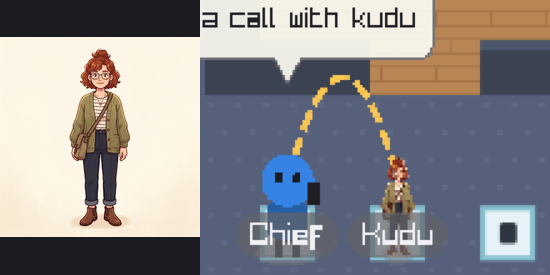

#+title: Higgsfield
#+description: Image and video generation for any agent, through Higgsfield's hosted MCP server
#+authors: Zach Podbielniak
#+categories: software documentation
#+created: [2026-11-21 Sat]
#+updated: [2026-11-21 Sat]
#+version: 0.1.0

* Higgsfield
:PROPERTIES:
:CUSTOM_ID: higgsfield
:END:

Higgsfield is a hosted service that runs some fifty image and video models behind one account.  clawtilla ships it as a first-party connector: any agent granted it gets Higgsfield's tools, and clawtilla holds the sign-in.  The office's asset steward is one user of it (see [[file:office.org][office.org]]); a marketing agent making a thumbnail, or a chief illustrating a report, are others.  Nothing about it is specific to the office.

It is the one closed service clawtilla offers out of the box, and it costs money on every call.  Read [[#terms][What you are agreeing to]] before you connect it.

** Connecting it
:PROPERTIES:
:CUSTOM_ID: connecting
:END:

#+begin_src bash
clawtilla connector catalog                       # higgsfield is listed under "Media generation"
clawtilla connector add hf --provider higgsfield --scope selected --agents designer
clawtilla connector connect hf                     # prints a URL; sign in with your Higgsfield account
clawtilla connector list
#+end_src

Or in any client: Settings, Connectors, Add, Higgsfield, then Sign in.

The catalogue entry names only the server, =https://mcp.higgsfield.ai/mcp=, and no OAuth endpoints, so the sign-in is asked of the server itself (RFC 9728 protected-resource metadata, RFC 8414 authorization-server metadata and, with no ~client_id~ configured, RFC 7591 dynamic registration) -- the same path any remote MCP server takes (see [[file:connectors.org][connectors.org]]).  Nothing has to be registered in a Higgsfield console, and there is no key in ~clawtilla.yaml~: the token lives under =secrets.dir= as every connector credential does, renewed before it expires.

A free Higgsfield account works as well as a paid one: it signs in, lists the tools, reads its balance, estimates for nothing and spends its credits like any other.  (An earlier version of this page said a free account's calls were refused; a live run on 2026-11-22 showed otherwise.)  What the account sees is the server's whole catalogue -- 217 tools on that day, from ~generate_image~ to website deployment and GPU rental -- so narrow it with ~tools:~ to the handful an agent needs, e.g. ~--tools generate_image,estimate_image_cost,job_status,balance~.

** Who gets it
:PROPERTIES:
:CUSTOM_ID: scope
:END:

Like any connector: ~--scope all~, ~--scope selected --agents a,b~, or an inline integration on one agent.  It reaches an agent through the relay, so the agent's =.mcp.json= names ~clawtilla connector relay hf~ and carries no secret, ~tools:~ on the integration narrows what it may call, and the agent's action rules apply to every call.

Because every generation spends credits, an approval rule is the sensible default for anybody but the agent whose job this is:

#+begin_src yaml
agents:
  - id: chief
    policy:
      rules: ["mcp__clawtilla-hf__*=ask"]     # a person approves each Higgsfield call
#+end_src

The rule names the connector's =.mcp.json= entry (~clawtilla-<name>~), so a second Higgsfield account under another name needs a rule of its own.

** How a generation works
:PROPERTIES:
:CUSTOM_ID: jobs
:END:

Higgsfield's generations are jobs, not answers.  A call returns a request id at once and the image or video arrives seconds to minutes later; the server's own tools submit, report a job's status and return the result's URL.  The relay passes all of that through unchanged.  An agent should:

1. submit, and keep the request id;
2. ask the job's status until it says completed or failed -- a turn that waits should do other work between checks rather than spin;
3. fetch the result into its exchange directory (~computer.exchange~) or workspace, because a result URL on Higgsfield's CDN is not forever.

The office can make characters through this connector too (=office.asset_api: higgsfield-mcp=, the daemon calling the MCP tools itself with the connector's sign-in, paid from the app credits); its other road (=office.asset_api: higgsfield=) is the REST API instead, with a key pair from the console, and it bills a separate API balance: the app's credits do not pay for it, and a submit with none is refused =HTTP 403 not_enough_credits= ([[file:office-custodial-team.org::#direct][made by the daemon itself]]).

What the server's tools want, as of 2026-11-22 -- the names are not the ones a model guesses, and a wrong one is refused with an input validation error rather than ignored:

- ~estimate_image_cost~ takes the same ~params~ as ~generate_image~ (~model~, ~prompt~, ~aspect_ratio~, ...), costs nothing, and answers with the exact credits and a ~quote_ref~; sending ~{"params": {"ref": "quote:..."}}~ to ~generate_image~ submits exactly the quoted request.  A quote names a model family: ~nano_banana_2~ was rendered by ~nano_banana_flash~.
- ~job_status~ takes ~jobId~ (camel case), and ~sync: true~ to wait for it; a finished job carries ~results.rawUrl~, a PNG on Higgsfield's CDN.
- ~jobs_wait~ takes ~jobs~ and waits at most 15 seconds a call.
- ~balance~ answers credits and plan, free.

#+caption: kudu's character from Higgsfield (1.5 credits), and drawn in the office with its backdrop keyed and its margin trimmed

A result that is a large blob of JSON is held by the relay's result budget like any other (see [[file:connectors.org::*Results bigger than the budget][Results bigger than the budget]]).

** Automation without a model
:PROPERTIES:
:CUSTOM_ID: api
:END:

Higgsfield also has a REST API, with a key and secret from [[https://console.higgsfield.ai][console.higgsfield.ai]] instead of a sign-in.  ai-glib carries a client for it (~AiHiggsfieldClient~, since ai-glib 0.14.0, which clawtilla has through libreclaw 0.30.6): submit to a model path, poll the request, estimate the cost first, upload an input image.  That is what the office's direct character road is built on -- =office.asset_api: higgsfield=, ~clawtilla office api-key higgsfield~, then ~clawtilla office character AGENT --direct~: a job clawtilla runs on its own, with the estimate put to you as a decision before anything is spent ([[file:office-custodial-team.org::#direct][made by the daemon itself]]) -- and it is separate from this connector: the connector is for *agents*, the API client for the daemon.

** What you are agreeing to
:PROPERTIES:
:CUSTOM_ID: terms
:END:

Stated plainly so the choice is made with open eyes; check Higgsfield's current terms before relying on any of it.

- *It is closed.*  The service, its models and its MCP server are proprietary.  clawtilla's FOSS default for assets is self-hosted generation (ComfyUI, see the custodial team in [[file:office.org][office.org]]); Higgsfield is the optional alternative.
- *It costs credits on every call*, whatever the plan, and the MCP server needs a paid plan.
- *Images and video only.*  There is no 3D model output: a character's model, for the office's 3D view, comes from elsewhere (see the custodial team's characters); without one the picture is drawn on a billboard facing the camera.
- *Free-tier outputs carry a watermark.*
- *Your inputs and outputs may be used for training* on anything below Higgsfield's enterprise plan.
- *Commercial use of outputs is allowed* on paid plans.
- A generated asset in a world pack records its generator, model and terms in the pack's ~office.yaml~ (see [[file:office-world-packs.org::#licensing][licensing and provenance]]), so where a picture came from stays answerable.

** Troubleshooting
:PROPERTIES:
:CUSTOM_ID: troubleshooting
:END:

- /"Authorization with the MCP server failed"/ on every call: the sign-in expired or was revoked on Higgsfield's side.  ~clawtilla connector connect hf~ again.
- /Signed in, every call refused/: the account has no paid plan, or no credits left.
- /A job never finishes/: ask its status again rather than resubmitting -- a resubmitted job is charged twice.
- /The agent does not have the tools/: ~clawtilla connector list~ says which agents it reaches; an agent started before it was granted needs a restart, since a CLI reads its tool list at session start.
