#+title: The libregnum client
#+description: clawtilla-lrg -- every capability of clawtilla-gtk, drawn with libregnum's widgets on an OpenGL canvas, with its own themes, materials and motion
#+authors: Zach Podbielniak
#+categories: software documentation
#+created: [2026-11-07 Sat]
#+updated: [2026-11-07 Sat]
#+version: 0.7.0

* The libregnum client

~clawtilla-lrg~ is the third graphical client.  It talks to the same daemon over the same socket as ~clawtilla-gtk~ and ~clawtilla-web~, and does everything they do: chat, the inspector, computers and their screens, routines, triggers, tasks, decisions, the flow between agents, live activity, skills, memory, and every page of Settings.  ~make parity~ holds all three clients to the same frame kinds, slash commands, enumerations and declared affordances (see [[#lrg-parity][Parity]]).

What it adds is the way it looks.  It is drawn with [[file:../../libregnum][libregnum]]'s retained widget toolkit: one instanced signed-distance-field shader, analytic shadows and glows, frosted and refractive glass over an animated background, and springs on everything that moves.  The same palettes that colour the GTK and web clients colour this one, and five settings that only this client reads choose its motion, material, background, accent and scale.

It is optional.  Nothing else in clawtilla links libregnum, the daemon and ~libclawt~ stay headless, and a plain ~make~ builds exactly what it built before this client existed.

** At a glance
:PROPERTIES:
:CUSTOM_ID: lrg-glance
:END:

| What | Where |
|------+-------|
| Build it | ~make LRG_BACKEND=1~ (libregnum at ~LRG_DIR~, default ~../libregnum~) |
| Run it | ~build/release/clawtilla-lrg~, same options as ~clawtilla-gtk~ |
| Its settings | ~$XDG_CONFIG_HOME/clawtilla/appearance.yaml~, shared with GTK; the ~lrg_*~ keys are its own |
| Its code | ~clients/lrg/~, one file per GTK file (see [[#lrg-files][the file map]]) |
| Its tests | ~tests/test-lrg-models*.c~ (always), ~tests/test-lrgui-*.c~ (with ~LRG_BACKEND=1~), ~tests/test-lrg-rooms.sh~ (integration) |

** What it looks like
:PROPERTIES:
:CUSTOM_ID: lrg-gallery
:END:

Made with ~CLAWT_LRG_SCREENSHOT~ under Xvfb against a scratch fleet (see [[#lrg-screenshots][screenshots from the command line]]), in Catppuccin Mocha unless the caption says otherwise.

#+caption: A room: the operator's messages in accent bubbles, the day divider, the glass composer
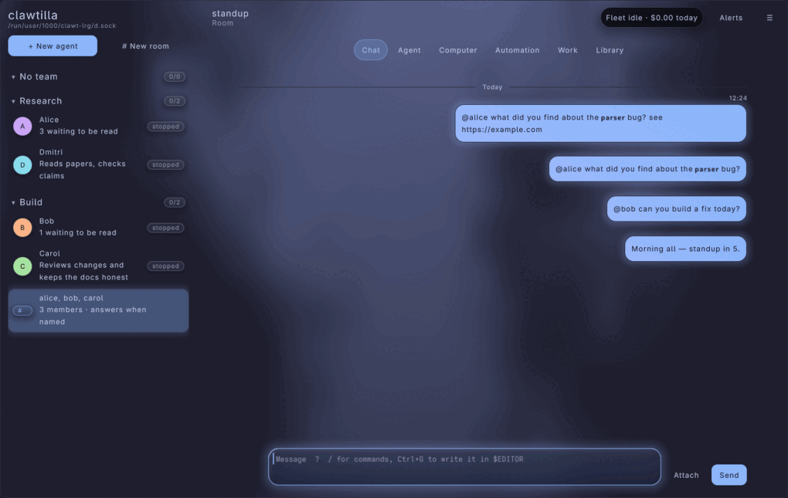

#+caption: The same room in Light, with the mesh-gradient background
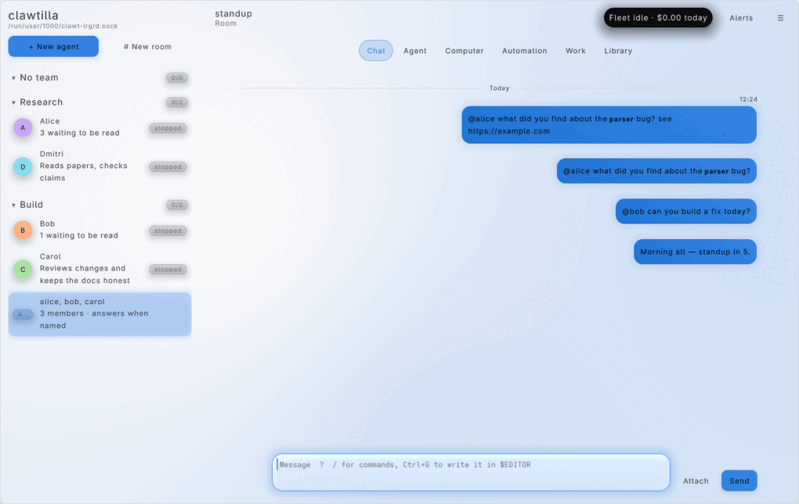

#+caption: The same room in Dark with ~lrg_material: glass~, ~lrg_background: plasma~ and ~lrg_accent: '#ff7a3d'~
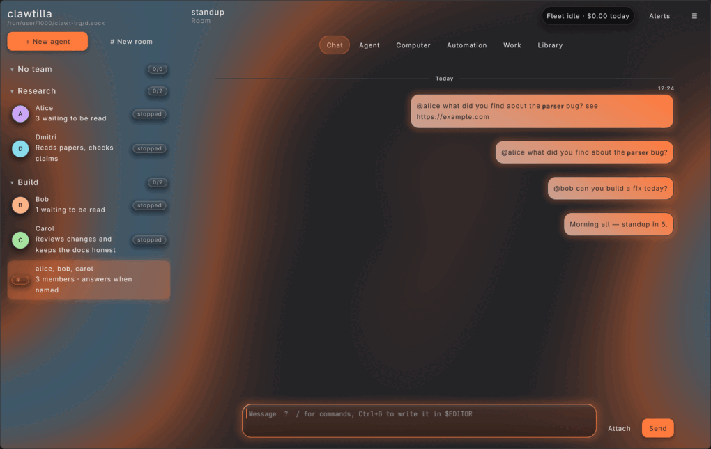

| Page | Screenshot |
|------+------------|
| An agent's chat | 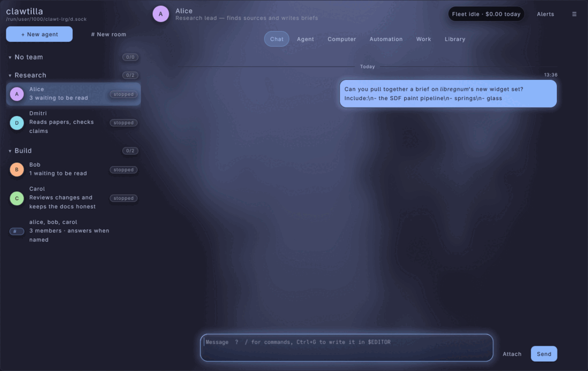 |
| Overview | 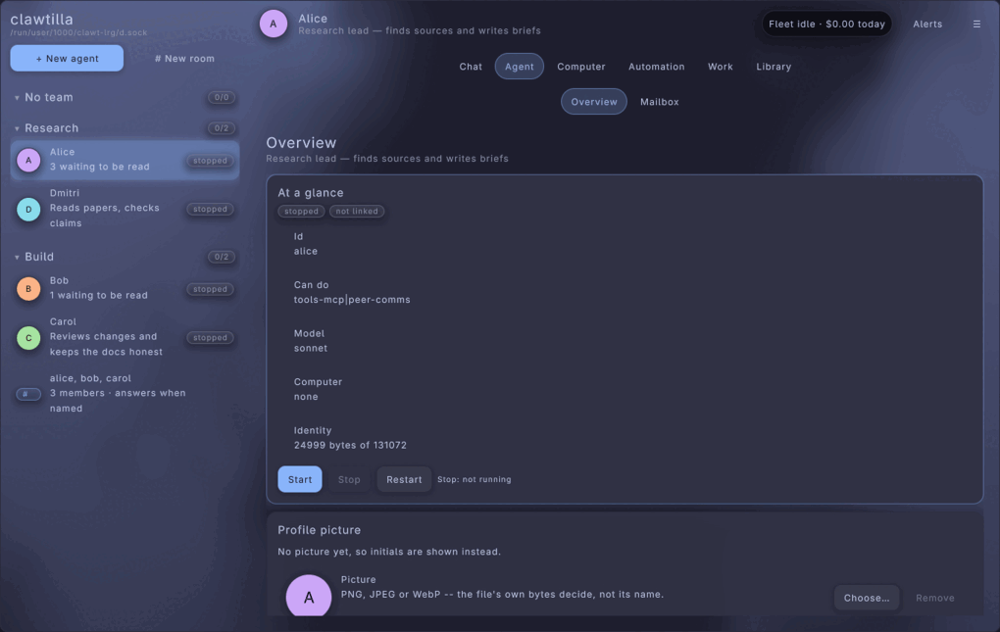 |
| Mailbox | 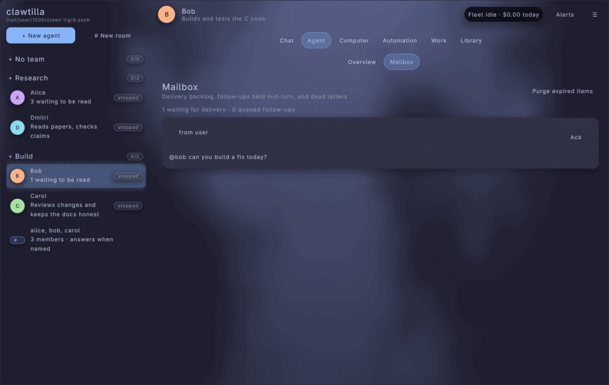 |
| Computer | 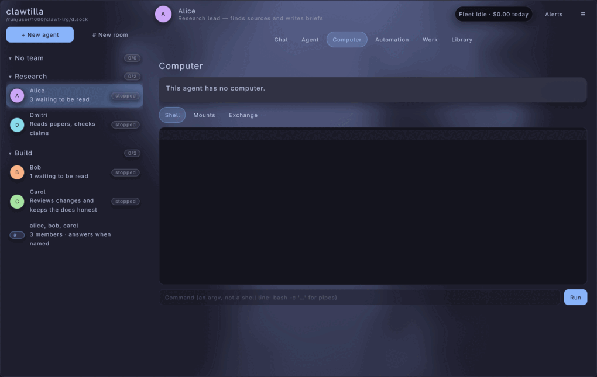 |
| Routines (a broken one says why) | 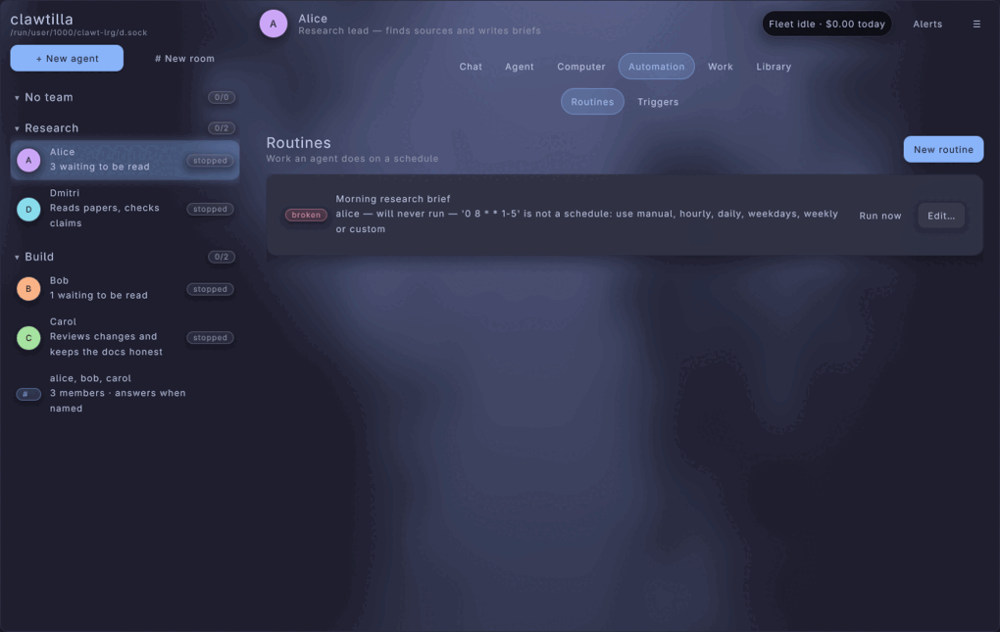 |
| Triggers | 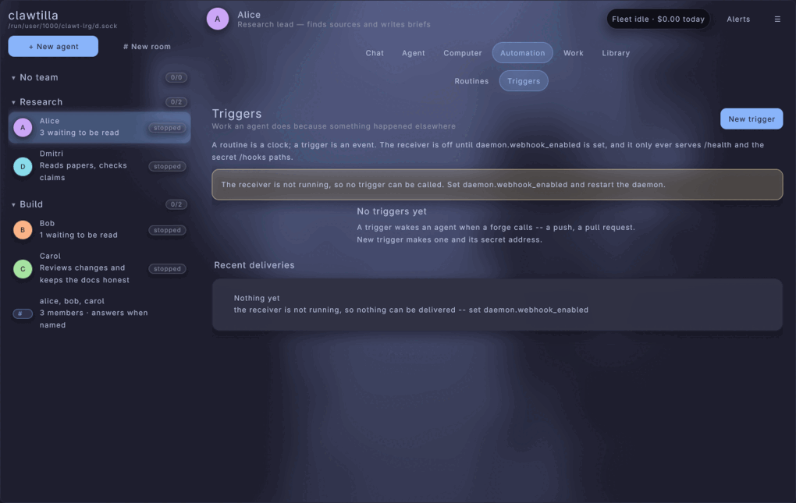 |
| Tasks | 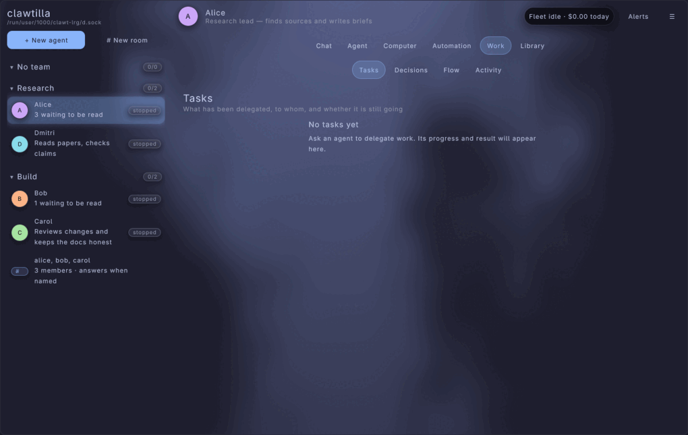 |
| Decisions | 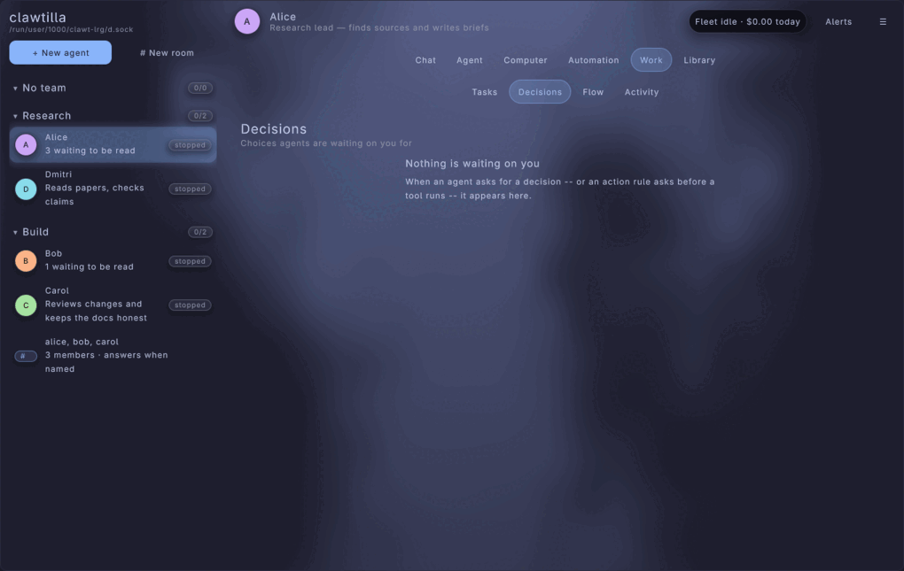 |
| Flow (every agent on the ring) | 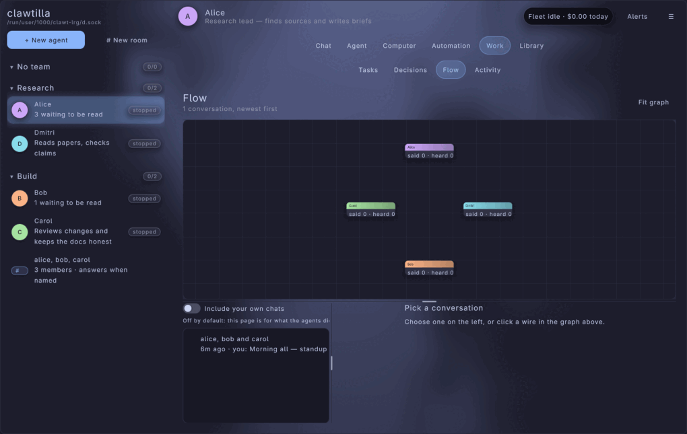 |
| Activity | 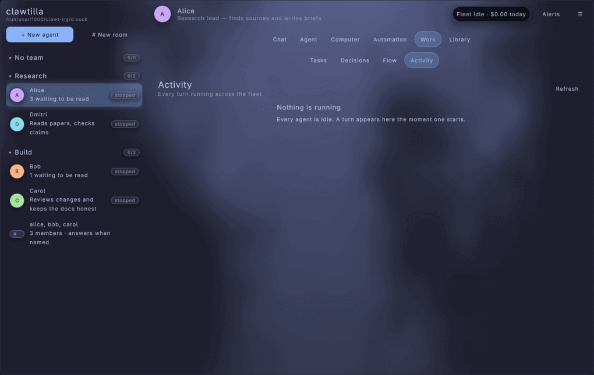 |
| Skills | 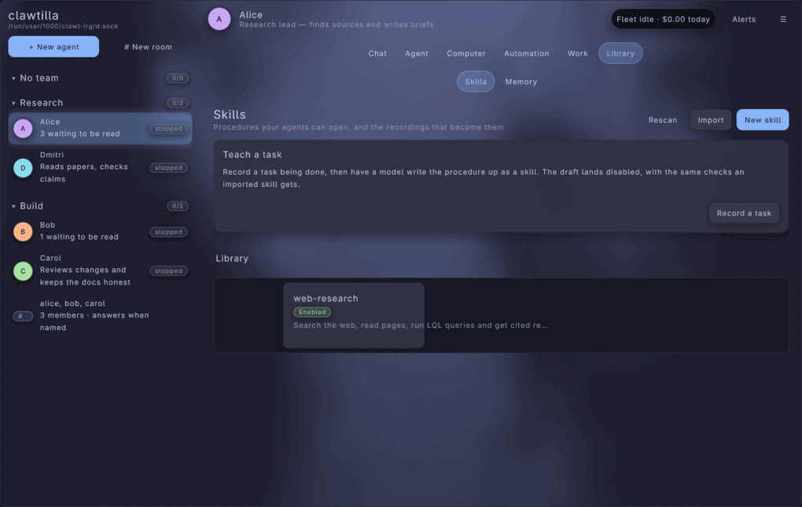 |
| Memory | 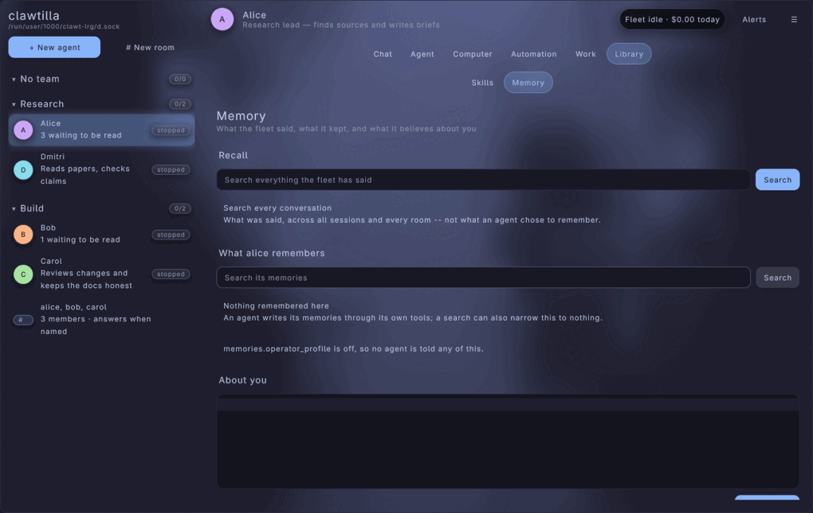 |

* Building
:PROPERTIES:
:CUSTOM_ID: lrg-building
:END:

#+begin_src bash
make LRG_BACKEND=1
#+end_src

#+begin_src bash
make LRG_BACKEND=1 LRG_DIR=$HOME/src/libregnum
#+end_src

** Why libregnum is not a submodule
:PROPERTIES:
:CUSTOM_ID: lrg-not-a-submodule
:END:

Recursively, libregnum is enormous: graylib and raylib, crispy, and optional ai-glib, cad-glib (manifold and solvespace, in C++) and the Steamworks SDK.  Vendoring it would put all of that under ~deps/~ for a client most builds never make.  So the client builds against a checkout you already have, named by ~LRG_DIR~, defaulting to the sibling ~../libregnum~ the other projects in this family use.

** The library is kept current for you
:PROPERTIES:
:CUSTOM_ID: lrg-lib
:END:

Before the client links, ~make lrg-lib~ (run automatically) looks at ~$(LRG_DIR)/build/release/lib/liblibregnum.a~ and rebuilds it in place when any of these is true:

- the archive does not exist;
- any ~.c~ or ~.h~ under ~$(LRG_DIR)/src~ or its graylib is newer than the archive;
- the archive lacks one of ~LRG_REQUIRED_SYMBOLS~ (in ~config.mk~) -- ~lrg_canvas_new~, ~lrg_island_new~, ~lrg_text_editor_new~, ~lrg_markdown_label_new~, ~lrg_table_new~, ~lrg_node_graph_new~, ~lrg_toast_queue_new~, ~lrg_header_bar_new~, ~lrg_switcher_new~, ~lrg_timeline_view_new~, ~lrg_property_grid_new~, ~lrg_label_set_ellipsize~.  An archive from before the widget set links nothing useful, and the symptom would otherwise be a wall of undefined references.

The rebuild runs libregnum's own ~deps~ and ~lib~ targets with ~DEBUG=0~ and *none* of clawtilla's command-line variables: a ~DEBUG~, ~ASAN~ or ~BUILDDIR~ given to clawtilla reaches every nested make through ~MAKEFLAGS~, which is how libreclaw's release tree was once built with ASan.  It uses libregnum's default options, so an archive another project links (cmacs, gsurf) is rebuilt as itself, not as a cut-down variant that would break them.  The logic is ~tools/clawt-lrg-lib.sh~.

The checkout itself must be libregnum 0.8.6 or later.  Those are behaviours, not symbols -- 0.8.5's clip culling and cached markdown measure, without which a long conversation costs every frame (see [[#lrg-loop][the frame loop]]), and 0.8.6's boxes that take width back from flexible children, without which the window does not fit (see [[#lrg-fit][fitting the window]]) -- so ~clients/lrg/clawt-lrg.h~ checks ~LRG_CHECK_VERSION(0, 8, 6)~ and stops the build with an ~#error~ naming ~LRG_DIR~.  Pull the checkout and build again.

The first build takes a few minutes (libregnum is large); later ones only relink.

** One yaml-glib, not two
:PROPERTIES:
:CUSTOM_ID: lrg-yaml
:END:

~liblibregnum.a~ has yaml-glib merged into it, and clawtilla links libreclaw's yaml-glib.  Two copies in one process are worse than duplicate symbols: both register ~YamlParser~, ~YamlNode~ and the rest with the GType system, and the second registration fails.  So the ~clawtilla-lrg~ link line drops libreclaw's ~libyaml-glib-1.0.a~ and takes libregnum's (~LRG_LIBRECLAW_LIBS~ in ~config.mk~).

That is only sound while libregnum's yaml-glib contains clawtilla's: ~libclawt~ was compiled against clawtilla's headers.  ~make lrg-yaml-check~ (run automatically) refuses the build unless libregnum's yaml-glib commit descends from the one libreclaw pins, naming both:

#+begin_example
lrg-yaml-check: libregnum's yaml-glib (1a2b3c4) does not descend from clawtilla's (89a835b).
  The lrg client links one yaml-glib -- libregnum's -- so it must contain clawtilla's.
#+end_example

The remedy is to update ~$(LRG_DIR)/deps/yaml-glib~, or bump libreclaw's yaml-glib, until one contains the other.  As written, libregnum pins ~2391020~, four bug fixes ahead of clawtilla's ~89a835b~.

** What it needs
:PROPERTIES:
:CUSTOM_ID: lrg-packages
:END:

Everything clawtilla already needs, plus what libregnum links.  On Fedora:

| Package | Why |
|---------+-----|
| ~mesa-libGL-devel~ | OpenGL, which raylib draws with |
| ~libX11-devel~ | the window under X11 or Xwayland |
| ~wayland-devel~, ~libxkbcommon-devel~ | native Wayland windows, when found |
| ~fribidi-devel~ | right-to-left text in libregnum's text layout |
| ~zlib-devel~, ~openssl-devel~ | libregnum's core |
| ~readline-devel~ | crispy, libregnum's C scripting, on by default |
| ~luajit-devel~, ~python3-devel~ | only if libregnum found them when it was built; the link line follows |

** The other build switches
:PROPERTIES:
:CUSTOM_ID: lrg-switches
:END:

| Target | What it does |
|--------+--------------|
| ~make LRG_BACKEND=1 lrg~ | the client alone |
| ~make LRG_BACKEND=1 lrg-lib~ | only keep the libregnum archive current |
| ~make LRG_BACKEND=1 lrg-yaml-check~ | only check the yaml-glib rule |
| ~make LRG_BACKEND=1 lrg-check F=clients/lrg/lrg-chat.c~ | syntax-check one file with the client's flags |

Without ~LRG_BACKEND=1~ each prints a line saying it was skipped and why.  With it, but no libregnum at ~LRG_DIR~, each says where it looked.

~make DEBUG=1 ASAN=1 LRG_BACKEND=1~ builds the client with AddressSanitizer, but links the *release* libregnum archive: libregnum is not rebuilt with ASan, so a fault inside libregnum's own code is reported without its frames.  clawtilla's code -- the client and ~libclawt~ -- is fully covered.

* Running
:PROPERTIES:
:CUSTOM_ID: lrg-running
:END:

#+begin_src bash
build/release/clawtilla-lrg
#+end_src

The options are ~clawtilla-gtk~'s, with one addition for tests:

| Option | Meaning |
|--------+---------|
| ~-s~, ~--socket FILE~ | the daemon's socket |
| ~-p~, ~--profile NAME~ | start on a connection saved with ~clawtilla remote add~ |
| ~-H~, ~--host HOST~ | start on a daemon at this address (tailnet) |
| ~--port PORT~ | port for ~--host~ (default 8792) |
| ~--token TOKEN~ | bearer token for ~--host~ |
| ~--self-test PAGE[:TARGET]~ | lay out one page with no window, optionally selecting an agent or room, print what it shows as JSON, exit |
| ~-V~, ~--version~ | version |
| ~--license~ | licence |
| ~-h~, ~--help~ | help, with examples |

~--host~ wins over ~--profile~, which wins over the local socket.  A daemon that is not there is not a reason to refuse to start: the window opens, the banner says what happened and offers the connections, and the client keeps trying in the background -- the decision the GTK client made, for the same reason.

#+begin_src bash
clawtilla-lrg --host 100.72.0.41 --token "$(ssh box clawtilla daemon token)"
#+end_src

** Keyboard
:PROPERTIES:
:CUSTOM_ID: lrg-keyboard
:END:

| Keys | Action |
|------+--------|
| =Ctrl+K= | Go to… (agents, rooms, pages) |
| =Ctrl+B= | show or hide the sidebar (in a narrow window: open or close it over the page) |
| =Ctrl+,= | Settings |
| =Ctrl+Q= | Quit |
| =Tab=, arrows | move focus; libregnum draws the focus ring |
| =Return= | send (in the composer); =Shift+Return= is a newline |

** Screenshots from the command line
:PROPERTIES:
:CUSTOM_ID: lrg-screenshots
:END:

~CLAWT_LRG_SCREENSHOT=out.png~ draws for ~CLAWT_LRG_SCREENSHOT_FRAMES~ frames (default 150), saves the window and exits.  ~CLAWT_LRG_SCREENSHOT_PAGE=PAGE[:TARGET]~ selects an agent or room and a page first, with the spelling ~--self-test~ takes.  The images in ~docs/images/lrg/~ are made this way, under Xvfb, then shrunk with ~magick -resize 75% -colors 256~.

GLFW prefers Wayland whenever it can reach a compositor, and unsetting ~WAYLAND_DISPLAY~ is not enough: libwayland then tries ~wayland-0~ in ~XDG_RUNTIME_DIR~ and finds the desktop's.  Point it at a socket that does not exist, so GLFW falls back to X11 and the Xvfb display:

#+begin_src bash
env -u XDG_SESSION_TYPE WAYLAND_DISPLAY=no-wayland-here DISPLAY=:97 CLAWT_LRG_SCREENSHOT=/tmp/chat.png CLAWT_LRG_SCREENSHOT_PAGE=chat:standup clawtilla-lrg
#+end_src

* The window
:PROPERTIES:
:CUSTOM_ID: lrg-window
:END:

#+begin_example
canvas
├── backdrop          the animated background, under everything
└── root
    ├── sidebar       the fleet: teams, agents, rooms (frosted)
    └── main
        ├── header    the selected agent, the island, the menu
        ├── sections  Chat · Agent · Computer · Automation · Work · Library
        ├── pages     a section's pages, when it has more than one
        ├── banner    disconnected, or the fleet paused
        └── switcher  one child per page, crossfading between them
#+end_example

Sections and pages are walked from the library (~clawt_section_count()~, ~clawt_section_page_nth()~), the same enumeration GTK and the web client walk.  A section's tab carries the sum of its pages' badges, so a decision waiting is visible from any section.

** The island
:PROPERTIES:
:CUSTOM_ID: lrg-island
:END:

At the right of the header is the island: a dark pill that says, in one line, the most urgent thing about the fleet -- ~Not connected~, then ~Fleet paused~, then decisions waiting, then turns running (and across how many agents), then unread messages, then the day's spend when the providers report it.  It glows in the warning colour when a decision is waiting or the daemon is gone.  Clicking it expands it; it springs back on a second click.

The sentence is ~clawt_lrg_island_text()~ in ~clients/lrg/lrg-island-model.c~, tested in ~tests/test-lrg-models.c~.  A disconnected window shows no counts at all, because counts from a daemon that stopped answering are the confident wrong answer.  Agents are counted by id, not by summing ~running_turns~, which repeats an agent's total on each of its rows.

** The banner
:PROPERTIES:
:CUSTOM_ID: lrg-banner
:END:

A condition the window is /in/ until something changes is a banner, not a toast: disconnected (with *Connections…*), or the fleet paused (with *Resume*).  Toasts answer what somebody just did; a failed request says why in one, except "not connected", which the banner already holds -- ~clawt_ipc_reply_toast_text()~, the rule all three clients share.

* Appearance
:PROPERTIES:
:CUSTOM_ID: lrg-appearance
:END:

~clawtilla-lrg~ reads the same ~appearance.yaml~ as ~clawtilla-gtk~ (~$XDG_CONFIG_HOME/clawtilla/appearance.yaml~), and the same palettes (built-in and ~$XDG_CONFIG_HOME/clawtilla/palettes/*.css~).  Everything the GTK Appearance page sets applies here too: the scheme, fonts, sizes, the conversation measure, the run spacing, agent descriptions.  The Appearance page in this client's Settings edits all of it and applies each change live.

** How a palette becomes a libregnum theme
:PROPERTIES:
:CUSTOM_ID: lrg-palette-mapping
:END:

The palettes are written in libadwaita's colour vocabulary, because that is what GTK reads.  libregnum reads neither CSS nor that vocabulary: it has twenty-six colour roles and a YAML theme format.  ~clawt_lrg_theme_yaml()~ (~clients/lrg/lrg-theme-model.c~) is the translation.  It reads each colour with ~clawt_palette_color()~ (in ~libclawt~), which understands ~#rgb~, ~#rgba~, ~#rrggbb~, ~#rrggbbaa~, ~rgb()~, ~rgba()~, ~@name~ references and ~alpha(@name, f)~, and writes a complete theme document: the colour roles, the accent, the motion preset, the metrics at the interface scale, and the style rules that give the client its look.

| Palette colour | libregnum role | Used for |
|----------------+----------------+----------|
| ~window_bg_color~ | ~window~ | the canvas; the animated background is tinted toward it |
| ~window_fg_color~ | ~text~ | body text; muted text, borders and tracks are mixed from it |
| ~view_bg_color~ | ~input~ | entries and the composer |
| ~sidebar_bg_color~ | ~panel~ | the sidebar and every panel |
| ~sidebar_border_color~ | ~border~ | hairlines between panes |
| ~card_bg_color~ | ~surface~ | cards, bubbles, controls |
| ~popover_bg_color~ | ~popup~ | menus, popups, dialogs, tooltips |
| ~accent_bg_color~ | ~accent~ | primary actions, selection, focus, glows (~lrg_accent~ overrides) |
| ~accent_fg_color~ | ~text-on-accent~ | text on a primary action |
| ~accent_color~ | ~link~ | links, and the background's second colour |
| ~destructive_bg_color~ | ~danger~ | destructive actions, the bad tone |
| ~success_bg_color~ | ~success~ | the good tone |
| ~warning_bg_color~ | ~warning~ | the warn tone, the island's alert glow |
| ~shade_color~ | ~shadow~ | every drop shadow; the modal veil is mixed from it |
| ~active_toggle_bg_color~ | ~control-pressed~ | a toggle that is on |

Every other colour in the vocabulary has a row in ~palette_uses[]~ saying why this client does not draw it (no secondary sidebar, no thumbnails, no overview, no unfocused-window state), and ~tests/test-lrg-models.c~ fails on a required colour without a row -- so a colour added to the vocabulary later is a decision somebody makes, not a colour silently never drawn.

The "system", "light" and "dark" schemes have no palette of their own (GTK asks libadwaita, the web client has them in its stylesheet), so this client reads libadwaita 1.9's stock values from ~clawt_lrg_stock_palette()~, through the same reader.  A palette file that leaves colours out falls back to the stock value of the same brightness, exactly as GTK does.  "System" follows GNOME's ~color-scheme~ setting when its schema is installed, and is dark otherwise.

After the document loads, ~lrg_theme_fix_contrast(theme, 4.5)~ nudges any text colour that fails WCAG AA against what it sits on.  Palettes on disk are written for GTK and checked by nobody for contrast; this is the cheapest point to make them readable.  ~tests/test-lrgui-theme.c~ loads every combination of scheme, material, background and motion and requires zero failures after the fix.

** The settings only this client reads
:PROPERTIES:
:CUSTOM_ID: lrg-own-settings
:END:

Five keys in ~appearance.yaml~.  GTK and the web client ignore them: GTK follows the desktop's animation setting and the web client the browser's ~prefers-reduced-motion~, and neither has springs or glass to tune.  Each has a zero value that means "the shipped value", like every other field in the file, so a file written before the key existed keeps the behaviour it had.

#+begin_src yaml
lrg_motion: default
lrg_material: default
lrg_background: default
lrg_accent: ''
lrg_scale: 0
#+end_src

*** ~lrg_motion~
How everything that moves, moves.  libregnum's springs drive hover, press, layout changes, entrances, page transitions and the island.

| Value | Feel |
|-------+------|
| =default= | the shipped feel, which is =smooth= |
| =none= | *reduced motion*: no animation at all.  Values jump to their target, the background holds still, the busy shimmer becomes a border, entrances are instant |
| =snappy= | quick and nearly critically damped (0.16 s) |
| =smooth= | critically damped, no overshoot (0.30 s) |
| =bouncy= | a visible overshoot |
| =wobbly= | playful, several oscillations |

=none= also reaches libregnum's global reduced-motion switch (~lrg_motion_set_reduced()~), so widgets that animate on their own are stilled too.

*** ~lrg_material~
What the chrome -- the sidebar and the header -- is made of.

| Value | Look |
|-------+------|
| =default= | the shipped surfaces, which is =frosted= |
| =flat= | opaque panel colour, no blur; the cheapest to draw |
| =frosted= | blurred and translucent: the background shows through, softly |
| =glass= | refractive glass with a rim light |

The composer is glass with any material but =flat=.  A blurred surface costs one backdrop snapshot per frame for each stack of glass; =flat= costs none.

*** ~lrg_background~
What is drawn behind everything.  Each animated background uses the window colour, the accent mixed toward the window, and the link colour mixed toward the window, so it follows the palette and stays dim enough for text.

| Value | Look |
|-------+------|
| =default= | the shipped background, which is =aurora= |
| =none= | the window colour, still |
| =aurora= | slow aurora bands tinted by the accent |
| =mesh= | a drifting mesh gradient |
| =plasma= | a plasma field |

Under =lrg_motion: none= the background holds still.

*** ~lrg_accent~
A colour, ~#rgb~ or ~#rrggbb~, that replaces the palette's accent in this client only -- primary buttons, selection, focus rings, glows, the operator's own chat bubbles.  Empty takes the palette's.  Anything that is not a colour is dropped rather than misread.

*** ~lrg_scale~
The interface scale, from 0.5 to 3.0.  0 follows the monitor: libregnum has no DPI API of its own, so the client asks raylib for the window's DPI scale and sizes every metric -- text, padding, radii, row heights, control heights -- from it.  ~font_size~ in the same file scales text on top of this.

** Reading a bad value
A nick this build does not know (~lrg_motion: jiggly~) becomes the shipped value, and a warning names it on stderr.  A hand-edited preference must not cost somebody their client, and must not silently become a neighbouring value either.

* The look, and the classes that paint it
:PROPERTIES:
:CUSTOM_ID: lrg-look
:END:

No page picks a colour.  Pages add style classes, and the theme document's style rules paint them; changing the palette or a setting re-resolves every look on the next frame.

| Class | What it is |
|-------+------------|
| ~clawt-backdrop~ | the animated background |
| ~clawt-chrome~ | the sidebar and header, in the chosen material |
| ~clawt-card~ | a lifted, rounded card with a soft shadow; glows faintly in the accent on hover |
| ~clawt-card-selected~ | a selected card: accent wash and glow |
| ~clawt-bubble~ | a chat message |
| ~clawt-bubble-mine~ | the operator's own message: an accent gradient with a glow |
| ~clawt-composer~ | the composer: glass with a rim light, glowing when focused |
| ~clawt-island~, ~clawt-island-alert~ | the island, and its attention glow |
| ~clawt-tone-good~ … ~clawt-tone-neutral~ | badges, one per tone (~clawt_lrg_tone_class()~) |
| ~clawt-unread~ | the unread count pill |
| ~clawt-busy~ | a row whose agent is mid-turn: an accent shimmer (a border under reduced motion) |
| ~clawt-banner~, ~clawt-banner-bad~ | the connection and pause banner |
| ~clawt-tab~, ~clawt-tab-active~ | section and page tabs |
| ~clawt-row~, ~clawt-row-selected~ | sidebar and list rows |
| ~clawt-terminal~ | monospace output: the shell, code, secrets shown once |

Every task state's tone is painted: ~tests/test-lrg-models.c~ walks ~ClawtTaskState~ and fails on a tone the theme has no rule for.  A badge's text is its tone mixed a quarter of the way to the text colour, because a pale accent at caption size on a dark row loses its horizontal strokes (see ~AGENTS.md~, "A coloured caption at badge size").

* Pages
:PROPERTIES:
:CUSTOM_ID: lrg-pages
:END:

Each page mirrors the GTK file of the same name, feature for feature; what follows is what each one shows and does, and the frame behind every action.

** The alerts drawer
:PROPERTIES:
:CUSTOM_ID: lrg-alerts
:END:

The *Alerts* button in the header opens a drawer on the right of the window: what happened, and what needed you.  Mirrors GTK's alerts panel (=clients/lrg/lrg-alerts.c=, with its rules in =clients/lrg/lrg-alerts-model.c=).

A condition that arrived on its own goes here rather than in a toast, because a toast vanishes after a few seconds and leaves no trace if nobody was looking.  A refused message (~message.refused~: "alice to bob was stopped: max_hops"), a failed cloud-image download and a routine turned off because its computer did not start (~routine.turned_off~, worded by ~clawt_routine_turned_off_alert()~) are errors, said in a sentence.  Everything else ~clawt_alert_tier_for_event()~ calls a notice or routine is recorded quietly as "kind · subject" ("alice is error" for an agent's state), or in the event's own =message= when it carries one (~agent.failover~: "Scout is running on fallback codex-cli gpt-5.5 because ...").  The newest 200 are kept, newest first.

| Control | What it does |
|---------+--------------|
| *Alerts N* | opens and closes the drawer; N counts unread errors and notices, never routine entries |
| *Show everything* | adds the routine stream to the list (it is hidden by default) |
| an agent's name on a row | narrows the drawer to that agent; *Only NAME ×* widens it again |
| *Earlier, from the daemon's log* | reads the 50 most recent events from the daemon's own log (~event.list~, narrowed to the agent when the drawer is) |

Opening the drawer marks everything read, and an alert that lands while it is open arrives read (~clawt_alert_arrives_read()~), so the count never points at a row somebody watched appear.

** Fleet sidebar
:PROPERTIES:
:CUSTOM_ID: lrg-sidebar
:END:
Source: =clients/lrg/lrg-sidebar.c=; decisions in =clients/lrg/lrg-chat-model.c= (=clawt_lrg_sidebar_entries()=, =clawt_lrg_agent_row_new()=, =clawt_lrg_reorder_entries()=), tested by =tests/test-lrg-models-chat.c=. Mirrors =clients/gtk/gtk-sidebar.c=.

The sidebar is drawn in the =clawt-chrome= material at the left of the window. The =‹= button at the left of the header, the menu's "Show or hide the sidebar" and =Ctrl+B= fold it away and bring it back; the choice is saved as ~sidebar_collapsed~ in ~appearance.yaml~ (=clawt_lrg_window_toggle_sidebar()=), which the GTK client reads too, so the next window of either opens the way this one was left. Below =CLAWT_LRG_NARROW_WIDTH= (1000 pixels) it is never beside the page -- 340 of them left a column too thin to read -- and the same toggle opens it as a drawer /over/ the page instead: the one sidebar is moved from the window's row onto the canvas (=clawt-drawer=), so its selection and scroll position are the ones it had. Choosing an agent or a room closes the drawer, and opening one is not saved: a small window is not a decision about the sidebar. This is what lets the window go down to 640 pixels (=CLAWT_LRG_MIN_WIDTH=). It reads =app->agents= (~agent.list~) and =app->rooms= (~room.list~), which the shell keeps current, and asks for ~team.list~ itself alongside every refresh, redrawing only when the answer changed. A failed ~team.list~ keeps the previous list rather than showing a fleet with no teams.

*** What it shows
- *Brand*: "clawtilla" and, under it, which daemon the window is connected to (=clawt_connection_describe()=).
- *New agent* and *New room* buttons, which open =clawt_lrg_new_agent_dialog()= and =clawt_lrg_new_room_dialog()= (=lrg-dialogs.c=).
- *The fleet, as the daemon groups it*: a heading whenever the team changes, the headings of empty teams filled in around them in the daemon's group order (teamless first, then the declared teams as ~team.list~ gives them), each team's declared rooms after its agents, and whatever nobody is on at the bottom. The order is never re-sorted here: ~agent.list~ and ~room.list~ already are.
- *Team headings*: a twisty, the team's name ("No team" for the teamless group), and a tally badge -- running out of total, plus how many are working when any are ("1 working · 2/3"). A heading whose team has anybody mid-turn shimmers (=clawt-busy=), because a folded team hides exactly the rows that would have shown it. Clicking a heading folds or unfolds the team; folding is a per-window view preference and is not written anywhere.
- *Agent rows*: the agent's avatar (=clawt_lrg_avatar()=, glowing in its colour while its process is up), its name, and a subtitle that is what it is doing (=clawt_agent_activity_label()=, merged with a hold and the mailbox depth exactly as GTK does) or, when it is doing nothing, its description -- unless =clawt_appearance_get_show_descriptions()= is off. The activity is never hidden. On the right: the unread count as a filled accent pill (=clawt-unread=, no 99+ cap), an amber "On fallback: ..." badge while the agent runs on one of its ~model.fallbacks~, a HOST badge for an agent with =host-control=, a CHIEF or LEAD badge from =clawt_team_badge_for()=, and the state in words when it is anything but running. A row mid-turn shimmers (=clawt-busy=); the selected row carries =clawt-row-selected=; a row with unread messages is drawn in the heading weight.
- *Room rows*: a "#" glyph, the room's name (or its members when nobody named it), its membership line ("3 members · answers when named" / "· everyone answers"), and its unread pill.
- Only new rows fly in (=clawt_lrg_appear()=); the sidebar is rebuilt on every fleet event and must hold still to be read.

*** Actions
| Gesture | Effect | Frame |
|---------+--------+-------|
| Click an agent | selects it (=clawt_lrg_select_agent()=) | (its history: ~room.history~) |
| Click a room | selects it (=clawt_lrg_select_room()=) | (~room.history~) |
| Click a team heading | folds / unfolds it | none |
| Right-click an agent: Start / Stop / Restart | the lifecycle verb; greyed out when it would fail (=clawt_lrg_agent_verb_allowed()=: a shadow agent cannot run) | ~agent.start~, ~agent.stop~, ~agent.restart~ |
| Right-click: Team ▸ | a radio list -- "No team", every declared team, and an undeclared team the agent names under its own id; choosing the ticked one does nothing | ~agent.set~ (=key: team=) |
| Right-click: Computer (<type>) ▸ Start / Stop / Restart | only for an agent whose computer has a machine (=computer_machine=, from =clawt_computer_type_has_machine()= in the daemon); Stop and Restart of a machine that does not survive a stop (=computer_stop_removes=) are confirmed first, and sent with =remove: true= as a JSON boolean | ~computer.start~, ~computer.stop~, ~computer.restart~ |
| Right-click: Delete… | asked twice; the second dialog offers "Also delete its container/virtual machine" (for those types) and "Also delete everything it owns", both off | ~agent.remove~ |
| Drag a row onto a row | reorders: the whole order is sent, the dragged row placed above or below by which half was dropped on; dropped among another team's rows, it joins that team first and the order is sent only if that was accepted | ~fleet.reorder~ (after ~agent.set~ / ~room.set~) |
| Drag a row onto a team heading | puts it on that team (the team only; a heading names no position). Already there is accepted, not refused | ~agent.set~, ~room.set~ |

=clawt_lrg_agent_action(app, agent_id, kind)= is the one entry point for the lifecycle, shared with the inspector. =kind= is one of ~agent.start~, ~agent.stop~, ~agent.restart~, ~agent.interrupt~ (toasts how many processes ended), ~agent.remove~ (the double confirmation), ~computer.start~, ~computer.stop~, ~computer.restart~ (with the losing-the-machine confirmation). Every reply refreshes the fleet whether it worked or not, so a failed start shows the agent's real state beside the toast that explains it.

*** Unread
The Chat tab's number is =clawt_lrg_unread_badge()=: the total of =app->unread=, hidden while the Chat page is showing (the sidebar beside it says which conversation, which is strictly more). It is recomputed whenever the sidebar redraws, and a zero-size ticker in the sidebar notices page changes. Counts against rooms the sidebar no longer draws are pruned (=clawt_lrg_unread_prune()=) so a removed agent's number cannot stay in the total for ever.

*** libregnum widgets used, and why
- =LrgScrollBox= (vertical only, kinetic) holding an =LrgVBox= of rows.
- Rows are an =LrgPanel= surface holding the =clawt_lrg_row()= content and, over it, an invisible =LrgCustomWidget= that turns a press-and-release inside it into a click. libregnum's boxes take no clicks of their own; the surface carries =clawt-row= so the hover look still applies (the surface is on the hover path).
- =lrg_widget_set_context_menu()= with a per-row =GSimpleActionGroup= ("agent"): the menu acts on the row right-clicked, whatever is selected, and a redraw under an open menu cannot redirect it.
- =LrgDragSource= / =LrgDropTarget= with the content type =application/x-clawtilla-fleet-row= and a string payload =a:<id>= / =r:<id>=: the token travels, never the widget, because a refresh can rebuild every row mid-drag. The canvas paints the drop highlight.

*** Differences from GTK
- No hover tooltips: the description is in the subtitle, and when descriptions are turned off it is not shown at all (GTK moves it to a tooltip). libregnum's tooltip is a game-style panel, not a widget hint.
- A right-click acts on the row clicked without selecting it; GTK selects first because its actions read the selection. The effect -- acting on what was clicked -- is the same.
- No touch long-press binding of its own: libregnum's canvas already turns a touch long press into a right click.
- New room is a dialog in =lrg-dialogs.c= rather than in this file.

** Chat
:PROPERTIES:
:CUSTOM_ID: lrg-chat
:END:
Source: =clients/lrg/lrg-chat.c=; decisions in =clients/lrg/lrg-chat-model.c=. Mirrors =clients/gtk/gtk-chat.c=, =clients/gtk/gtk-follow.c= and the chat half of =clients/gtk/clawt-window.c= (message, typing and unread handling, drafts, selection).

*** What it shows
- *The transcript*: the conversation of the selected agent (its direct room with the operator) or the selected room, loaded with ~room.history~ and the room's turn steps with ~room.steps~, merged on time so each stretch of tool calls sits between the message that prompted it and the answer it produced (=clawt_lrg_steps_before()= / =clawt_turn_step_precedes()=). Both replies are guarded twice: by the shell's selection generation and by the page's own history generation, so a reply that lands after the person moved on never repaints the page they left.
- *Runs*: consecutive messages from one sender on one day share one header (=clawt_chat_run_is_start()=). An agent's run header is its avatar (clickable to see the picture larger when it has one), its name and the clock (=clawt_chat_time_label()=); a continuation carries its time in the avatar's gutter, which is what tells a new message from a new paragraph. The operator's turns are bubbles on the right in the accent gradient (=clawt-bubble-mine=, popping in), the time once above the first; an agent's bodies sit on a soft surface card (=clawt-bubble=), flying up as they arrive.
- *Spacing*: a new run is further apart than a new message, and a new message further than a paragraph (=clawt_appearance_get_run_spacing()=, the message gap derived from it as in GTK). Day dividers ("Today", "Yesterday", "Wednesday 25 August", from =clawt_chat_day_label()=) sit between rules.
- *Chips*: a task chip ("task 1a2b3c4d") opens the Tasks page; a hop count from the second hop on warns of a loop.
- *Bodies*: markdown through =clawt_lrg_markdown()= (links open http, https and file only).
- *Attachment previews*: every file named in a message's attachment block (=clawt_lrg_attachment_refs()=). A picture is a thumbnail decoded at drawing size (460×320 at most), click for full size; anything else is a chip with name and size, click to open with the desktop's handler. An agent's file (=clawt:<id>=) is fetched once with ~attachment.get~ and cached under =$XDG_CACHE_HOME/clawtilla/attachments=. Right-click: Open, Save a copy…, Copy path, Delete permanently (~attachment.remove~, confirmed).
- *Turn steps*: ~turn.step~ events for the room on screen build a live block at the end of the transcript; runs of tool calls collapse into an =LrgExpander= titled with =clawt_turn_step_run_summary()= that opens onto the command lines in monospace; reasoning is marked "thinking:"; only failures are coloured (=clawt_turn_step_tone()=). When the turn ends the block is sealed where it is, not removed.
- *Activity line*: "thinking", or "working for <peer>" when the turn is for somebody else (=clawt_lrg_typing_activity()=), "delivered -- waiting for a reply" after a send; shimmering while shown.
- *Following the live edge*: the transcript stays at its newest message while the reader is there (=clawt_transcript_is_at_bottom()=). A reader who scrolls up is left alone; a message arriving then draws a "New messages" rule in the text and a "↓ New messages" pill over it, both cleared by any return to the bottom. A loaded history lands at the bottom instantly; later arrivals scroll smoothly.
- *Measure*: the column (and the composer under it) is the appearance's measure (=clawt_measure_resolve_px()=, characters measured on a zero in the label font, as CSS's =ch=), centred, so a wider window widens the margins rather than the lines. The composer's frame stands on the same line as the message bodies (=clawt_chat_body_inset()=).
- *Conversation picker*: above the transcript when the selected agent has talked to other agents (=clawt_chat_conversation_peer()= over ~room.list~): "Chat" for the operator's own and "with <peer>" for each other. A peer conversation is read-only; the composer is disabled and says so.
- An empty conversation says how to start it; no selection says to pick one.

*** The composer
An =LrgTextEditor= with class =clawt-composer= (glass with a rim light), growing to 200px. Placeholder: "Message — / for commands, Ctrl+G to write it in $EDITOR".

| Key | Effect |
|-----+--------|
| Enter | send |
| Shift+Enter | newline |
| Ctrl+G | write the message in =$VISUAL= / =$EDITOR=, seeded with what is typed; the result comes back without its trailing newline |
| Ctrl+Shift+G | the whole conversation in =$EDITOR= as org |
| Ctrl+V | a picture on the clipboard is queued as =pasted-<time>.png=; anything else pastes as text |
| Up / Down | move the completion highlight (wrapping; from nothing, Down takes the first, Up the last) |
| Tab | take the highlighted completion, or the first |
| Return | take the highlighted completion when one is highlighted, else send |

The completion list shows at most twelve rows -- built-in commands first, then the agent's own (~skill.commands~) -- each one line, its description ellipsized, and says how many more match ("and 48 more -- keep typing to narrow it"). Before 0.9.1 every match was a row with a wrapping markdown paragraph, rebuilt on every keystroke, and each row added re-measured the ones before it: with sixty skills a key took 2.6 s and the window looked hung the moment "/" opened the list. =/lrgui/widgets/typing-a-slash-stays-quick= types into it with sixty skills and fails past 100 ms a key; it measures 4 ms. The agent's commands are cached for the line and dropped when the selection changes, so another agent's list is never offered.
| Escape | close the completion list |

- *Sending*: ~msg.send~ with =target= (the room, or the agent for its direct conversation), =body=, =from: user=. Queued files are first put with ~attachment.put~ and named in the body with both paths, host first (=clawt_lrg_body_with_attachments()=). Not drawn on send: the daemon's =message= event draws it. The composer is emptied only if it still holds what was sent. A steer ("mid-turn -- held, and sent when this turn ends") and a stopped target ("held in its mailbox until it starts") are toasted; otherwise the activity line says it was delivered.
- *Stop turn*: shown only while the selected agent is mid-turn and declares =interrupt=; ~agent.interrupt~, which ends the turn and leaves the agent running. The toast says how many processes ended, or that it was between turns.
- *Drafts*: per conversation, kept in memory and in the client's draft store (=clawt_draft_store_*()=, keyed with =clawt_draft_key()= on the connection's name and the agent or room id), saved on leaving a conversation and restored on returning, cleared on send.
- *Attachments*: =Attach= (and =/attach=) opens an =LrgFileDialog= for several files; queued files show as chips above the entry with × to drop one; over 32 MB is refused with a pointer to shared folders.
- *@ completion* (rooms only): the room's members from ~room.list~ (=clawt_mention_prefix_at()=, =clawt_mention_candidates()=), with =@all= last when it fits the prefix and no member is called that. Choosing one replaces only the half-typed name.
- */ completion*: every built-in whose name starts with the line, then the agent's own skill commands (~skill.commands~, asked once while the line stays a command and forgotten when it stops being one or a =skill.*= event arrives).

*** Slash commands
The same set, order and words as GTK (=clawt_lrg_slash_commands()=); =/help= prints them.

| Command | Effect | Frame |
|---------+--------+-------|
| =/help= | the list, and the composer's keys | none |
| =/start=, =/stop=, =/restart= | the lifecycle verb; "<agent>: <verb> requested." | ~agent.start~, ~agent.stop~, ~agent.restart~ |
| =/interrupt= | stop the running turn, leave the agent up | ~agent.interrupt~ |
| =/attach= | pick files for the next message | none |
| =/compose= | write the message in =$EDITOR= | none |
| =/edit [file]= | open a workspace file in =$EDITOR= (the daemon's path); without a name, lists them | ~agent.files~ |
| =/files= | the workspace files | ~agent.files~ |
| =/memory <query>= | search what the agent remembered; without a query, list it | ~memory.search~, ~memory.list~ |
| =/recall <query>= | go to the Memory page and search every room | none here (see below) |
| =/agents= | id, state and description of each agent | ~agent.list~ |
| =/flow= | go to the Flow page | none |
| =/tasks= | go to the Tasks page | none |
| =/reset= | start the agent's AI session again | ~agent.reset~ |
| =/retry= | put your last message back in the composer | ~room.history~ |
| =/export [text\vert{}markdown\vert{}org]= | save the conversation | ~room.history~ (limit 5000) |
| =/copy [text\vert{}markdown\vert{}org]= | copy the conversation | ~room.history~ (limit 5000) |
| =/clear= | clear the transcript on screen only | none |
| =/new= | create an agent | none |
| =/<skill> [args]= | expanded by the daemon and sent as an ordinary message | ~skill.expand~, ~msg.send~ |

A command about one agent typed in a room says it is about one agent; an unknown command says there is no such command and is never sent.

*** Menus
- *Right-click the conversation* (anywhere in the transcript but a message): copy as text / markdown / org, open in =$EDITOR= as text / markdown / org, save as text / markdown / org. The export is read back from the daemon (~room.history~, limit 5000), not scraped from the screen, and converted with =clawt_export_convert()=.
- *Right-click a message*: Copy, Copy as text, Copy as org -- of what was said, not what the label rendered.

*** Events handled
- =message=: drawn when it is for the room on screen and not already shown (deduplicated by message id, so a replay after connecting draws nothing twice); otherwise, when it is for the selected agent's own conversation while the transcript is on a different room, the history is reloaded. Every message is offered to =clawt_lrg_unread_note()= (=clawt_unread_should_count()=: not the operator's own, not the room on screen, not a replay from before this client connected, only rooms the sidebar draws).
- ~agent.typing~: folded into =app->typing= as a set of rooms per agent (=clawt_lrg_typing_note()=); only the set's edge redraws the sidebar. For the selected agent it drives the activity line and Stop, and a frame lowering the turn in the room on screen seals its steps.
- ~turn.step~: the live block, for the room on screen only.
- ~message.refused~: shown in the transcript when it is about the room on screen, toasted otherwise.
- ~agent.state~: a stopped agent's typing set is cleared (all of it).
- =skill.*=: the cached skill commands are dropped. =room.*=: the conversation picker is refilled.

*** libregnum widgets used, and why
- =LrgScrollBox= for the transcript and =LrgOverlay= for the jump pill over it.
- A zero-size =LrgCustomWidget= whose =step= hook is the follower: it runs every frame, resolves the measure, and scrolls when the content grew under a reader who was at the bottom -- the job GTK hung off its adjustment's notifies.
- =LrgMarkdownLabel= (via =clawt_lrg_markdown()=) for bodies, =LrgPanel= for bubbles and cards, =LrgExpander= for tool runs, =LrgImage= for thumbnails and pictures, =LrgSeparator= for rules.
- =LrgTextEditor= for the composer, =LrgFileDialog= (async) for attachments and saving, =GMenu= models with =lrg_widget_set_context_menu()= for every menu.

*** Differences from GTK, and why
- *Composer keys*: =LrgTextEditor= consumes Up, Down, Tab and Escape itself and the canvas offers keys to the focused widget first, so the page wraps =LrgTextEditor='s =handle_event= class method once and acts only on the editor marked as the composer. A key-filter signal on =LrgTextEditor= upstream would remove the wrapper.
- *Agent bodies on a card*: GTK draws agent bodies bare and only the operator's turns as bubbles; here an agent's body sits on the theme's =clawt-bubble= surface while the operator's stays the accent bubble, so the asymmetry that says who is speaking is kept.
- *Avatars per sender*: a run header shows the sender's own avatar and name from ~agent.list~ (GTK uses the selected agent's for every non-operator sender, which is wrong in a group room).
- *Pictures open in a dialog*, not a second window: the canvas is the only window.
- */recall* shows the Memory page and hands it the query through =clawt_lrg_recall_search()= when that page provides it.
- *Ctrl+V on Wayland* reads the clipboard through =wl-paste=; raylib's GLFW backend cannot read a Wayland clipboard image.
- *Refusals elsewhere* are toasted; GTK records them in its alerts panel, which this client's shell does not have yet.
- */reset* reads =restarted= as the JSON boolean the daemon sends, so it says when the agent was restarted (GTK reads it as an integer and never does).

** Overview (the agent inspector)

Everything one agent is configured with and doing, in a column of lifted cards. Implemented in =clients/lrg/lrg-inspector.c=; every decision it makes (which settings exist, which control each gets, which choices a chooser offers and which it starts on, which ~agent.set~ calls a save makes and in what order, every sentence it toasts) is in =clients/lrg/lrg-agent-model.c=, tested by =tests/test-lrg-models-agent.c= with no display and no daemon.

The page is drawn from one ~agent.show~ reply (guarded, so a reply for an agent somebody clicked away from is dropped). It is rebuilt when the page is shown or the selection changes. A daemon event about the agent (anything =agent.*= but the typing level, and =hold.*=) redraws only the "At a glance" card, never the form, so somebody else's change cannot throw away an edit in progress.

*** At a glance

The agent's state as a badge in the tone =clawt_lrg_agent_state_tone()= gives it (a =switch= over =ClawtAgentState= with no =default:=), the held badge from the library's =clawt_hold_label()= (held is not a state and is never drawn as one), whether its link is up, its id, why it is in its state (=detail=), its capabilities, model and computer. The identity size is always shown while there is a count ("N bytes of LIMIT"); past the threshold a row classed =clawt-identity-size= carries a "filling up" or "too large" badge and the daemon's sentence naming the files to shorten. While the agent runs on one of its ~model.fallbacks~, an amber "On fallback: codex-cli gpt-5.5" badge (=clawt_failover_badge()=) joins the state badges and the daemon's =failover_message= -- why, and until when -- is a caption under them; ~agent.failover~ is an =agent.*= event, so it redraws this card.

Start, Stop and Restart send ~agent.start~, ~agent.stop~ and ~agent.restart~ through =clawt_lrg_agent_action()= (shared with the sidebar's menu). Each is enabled only where it can work (=clawt_lrg_agent_verbs()=); a disabled one is explained in a caption beside the buttons, because libregnum has no tooltips to hide the reason in.

*** Profile picture

The agent's avatar at 64 px (=clawt_lrg_avatar()=), with Choose... and Remove. Choose opens an =LrgFileDialog= (no filter: the daemon sniffs the bytes and refuses anything that is not PNG, JPEG or WebP), reads the file and sends its bytes base64-encoded with ~agent.avatar_set~; Remove sends ~agent.avatar_clear~. Either invalidates the shared avatar cache at once (=clawt_lrg_avatar_invalidate()=) rather than waiting for the daemon's ~agent.changed~ echo.

*** Usage

This agent's row of ~usage.summary~, twice: since local midnight and all time. Turns, input and output tokens, and the cost as =clawt_usage_format_cost()= renders it; a cost the CLI did not report (=-1=) is said as "cost unknown", never drawn as free.

*** Settings

Walked from the schema (=clawt_config_schema_get()= and =clawt_config_schema_agent_name()=), grouped by first component into the same cards the web inspector draws (Identity, Model, Runtime, Persona, Memory budget, Computer, Tools, Workspace, Passthrough, then any group the schema adds, in schema order). A key added to the schema appears here without anybody editing the client. Structure (sections, mappings, lists of mappings), =id=, =integrations.*=, ~computer.mounts~ and every =model.fallbacks*= key are left out: the last three have cards of their own. On a shared machine (~computer.use~ set) every other =computer.*= key is the machine's and is not drawn or saved, and the ~computer.use~ field says so.

Each key's control is chosen by =clawt_lrg_agent_field_kind()=, dispatching on the schema type:

| Kind | Control | Filled from |
|---+---+---|
| boolean | a switch | the value |
| enum | a combo walked from the entry's =GType= | =clawt_lrg_agent_enum_choices()= |
| secret | an entry never prefilled; empty means unchanged | -- |
| string list | an entry, comma separated | the value |
| =system_prompt=, =prompt_suffix= | a multi-line editor | the value |
| =team= | a combo | ~team.list~ |
| ~model.account~ | a combo of usable logins | ~account.list~ (with the agent: the daemon applies agent.set's own check) |
| ~computer.use~ | a combo of shareable machines | ~computer.shared~ |
| =model.provider= | a combo of agent-capable providers | ~model.list~ with =refresh= |
| =model.model= | a combo of that provider's models, plus "Something else..." | the same ~model.list~ |
| ~model.effort~ | a combo of effort levels | the five levels the CLIs take |
| =computer.type= | a combo walked from =clawt_computer_type_count()= | the library |
| =computer.container.image= | a combo plus "Other..." and a typed reference | ~image.list~ (nothing chosen selects its =default=) |
| ~computer.vm.image~ | a combo plus "Other..." and a typed path | ~image.vm_list~ (no fallback: a VM with no disk must look like it) |
| ~computer.vm.resolution~ | a combo of common sizes | a fixed list plus the current value |
| anything else | an entry | the value |

~runtime.confine~ is drawn as its enum, but labelled and explained with =clawt_agent_confine_label()= and =clawt_agent_confine_explanation()= rather than its key and the schema's first line; when the agent's =confine=, =runtime_type= and =confine_available= say it cannot be sandboxed here, a "cannot be sandboxed here" badge and =clawt_agent_confine_notice()= sit under it -- the same words as the GTK and web clients.

Every chooser is drawn first holding only the current value, then refilled when its reply lands. A value the list does not have (an undeclared team, an unusable account, a model or reference typed by hand) is kept -- as itself, or in the "Other" entry -- so saving the page without touching the control never changes it. A provider change refills the model list from that provider's models.

*Fallbacks*, a card right under the Model card, edits ~model.fallbacks~ as an ordered list.  Each entry has a heading with Earlier, Later and Remove, then a provider combo (=clawt_lrg_agent_provider_choices()=), a model combo plus "Something else..." for that provider, and an account combo (=clawt_lrg_agent_fallback_account_choices()=: the CLI's own login, the accounts for that entry's CLI, and the one it names whatever it is).  A provider change refills that entry's models and logins.  /Add a fallback/ starts on the agent's own provider.  The buttons edit the list read back from the controls (=clawt_lrg_agent_fallback_edit()=) and redraw it on the next iteration, because redrawing destroys the button whose handler is running; nothing is sent until Save changes.  The entries are redrawn, keeping their values, when ~model.list~ and ~account.list~ answer.  A list that cannot be parsed is shown as the reason and left out of the save.  See "Editing the fallbacks" in [[file:clients.org][clients.org]].

Save changes sends only what changed, one ~agent.set~ at a time in the order =clawt_lrg_agent_save_plan()= gives: the account is cleared first when it moves from one login to another (the daemon checks the provider/account pair), and a computer key the newly chosen shared machine owns is never sent.  The fallback list, spelled by =clawt_lrg_agent_fallback_spell()= (which refuses an entry with no model before anything is sent), goes last; when the provider or the account changes in the same save, the old list is cleared first, because the daemon checks the list against the backend it falls back from. It stops at the first refusal (already toasted) and re-reads the page. The closing toast names the restart a change needs, and says so specifically when any reply carried =restart_required= (an AI CLI lists its tools once, at session start).

*** Waiting for

From ~wait.list~ with the agent: a row per pending wait with the agent's label as its title and, under it, the condition, the schedule line from =clawt_wait_schedule_label()= and what the last check saw, with a *Cancel* button that sends ~wait.cancel~ (the daemon tells the agent).  Only this section re-reads on a ~wait.changed~ event for the agent shown, so a form being edited above it is never thrown away.

*** Credentials

The agent's credentials by name and reference, never by value.

*** Integrations

From ~integration.list~ with the agent: a switch for each shared instance (=covers= sets it), and a row for each of the agent's own inline blocks (with its problem when it is not valid). Turning a switch re-reads ~integration.list~ and sends ~integration.update~ with the instance's =agents= list edited (=clawt_lrg_agent_integration_update()=); an instance scoped to every agent is refused with a sentence pointing at Settings rather than silently rewritten as everyone-but-one.

*** Computer

What the agent itself is told about its computer (=computer_detail=), read-only in a =clawt-terminal= editor, and a link to the Computer page, where the machine's verbs and the rebuild live with their confirmations.

*** Shared folders

For a computer type that takes mounts (=clawt_computer_type_takes_mounts()=) and is not a shared machine: the agent's mounts from ~agent.mount.list~, each with Stop sharing (~agent.mount.remove~), and a form to add one (~agent.mount.add~) with the folder, where the agent sees it, the access mode walked from =ClawtMountMode= and the SELinux relabel walked from =clawt_relabel_count()= -- the setting the daemon's refusal names when podman cannot relabel a folder this user does not own.

*** Files

~agent.files~: each workspace file, marked "prompt" when it is read into every turn, with Open in $EDITOR (=clawt_lrg_open_in_editor()=). A path that is not on this machine (a connection to another daemon) is not opened; the toast names the CLI's =agent edit= instead.

*** Danger zone

Reset session asks first and sends ~agent.reset~; the toast reports how many stored sessions were cleared and whether the agent restarted (=restarted= read as the JSON boolean it is). Delete this agent asks twice: "Are you sure?", then a louder dialog with two switches, off by default -- delete its container or VM (shown only for those types) and delete everything it owns -- read off that dialog, not the window. It sends ~agent.remove~ with =remove_computer= and =remove_files=, and the toast reports the computer's actual fate.

** Mailbox

The selected agent's delivery backlog (~mailbox.list~, including the =follow_ups= held while it is mid-turn) and its dead letters (~mailbox.dead~), as cards: who it is from, the whole body wrapped, a badge for a failure (=last_error=), a held follow-up or a dead letter, and Ack (~mailbox.ack~) and, on a dead letter only, Requeue (~mailbox.requeue~). A held follow-up has neither: there is nothing to ack. Purge expired items in the toolbar sends ~mailbox.purge~ for this agent (the daemon offers no fleet-wide sweep) and toasts how many went.

The two listings are requested together and drawn when both have answered, so the list never jumps. An empty mailbox says why: a running agent takes each message the moment it arrives -- delivery is acknowledged at its socket -- so its mailbox fills only while it is stopped, held or unreachable.

Rows rather than an =LrgTable=: each line has its own buttons and a body that wraps, and the table's cells are one line of text, or a widget per column, from a =GListModel= of =GObject= s.

The page re-reads on =agent.*= (not typing), =mailbox.*=, =hold.*= and =message= events while it is showing.

** Computer

Implemented in =clients/lrg/lrg-computer.c=. A header card with the computer type and the daemon's state for it (~computer.status~; a stopped agent has no computer object, which is said rather than toasted), then the machine's verbs, then the four views walked from =clawt_computer_view_count()= as a row of =clawt-tab= buttons over an =LrgSwitcher= that crossfades between them.

*** The machine

Start machine, Stop machine and Restart machine (~computer.start~, ~computer.stop~, ~computer.restart~, each with =remove= sent as a JSON boolean) only where =clawt_computer_type_has_machine()= -- and the daemon's =computer_machine= -- say there is a machine to power; a host agent's machine is this one. Where a stop destroys the machine (=computer_stop_removes=), Stop and Restart ask first. Rebuild computer (~computer.rebuild~) asks first, explains that it is the only way to apply what cloud-init reads at first boot, and is enabled only while the agent is stopped.

*** Shell

A command run inside the computer with ~computer.exec~, its echo, stdout, stderr and a non-zero exit status appended to a read-only =clawt-terminal= editor. Return in the entry or Run sends it. The string form is a command, not a shell line: a line with =|=, =>=, =&&= or =$VAR= is refused in the console with the library's own sentence (=clawt_command_shell_syntax_refusal()=, the check the daemon applies to the same string), naming =bash -c=.

*** Screen

Shown only where the daemon says there could be a screen (=computer_screen=). While the view is showing, a one-second source on the app's context sends ~computer.observe~ (renewing the lease) and ~computer.screen~, and on an observable screen ~computer.frame~, all quiet; a ~computer.frame~ event fetches the new frame at once. The first tick after the page or the view is left sends ~computer.observe_stop~ and removes the source, and a different agent lets go of the old one's watch before the id changes. The frame is decoded the way avatars are -- through a temporary file named for its sniffed type -- at most 1280 px wide, and drawn in an =LrgImage= in FIT mode capped at its own size, so it is never blown up.

The status line says whether the frame is live or stale (with its age, from the daemon's =stale=), who holds the screen and what the agent asked for. Take the screen (~computer.takeover~) and Give the screen back (~computer.release~) swap as the hold changes; Open in a viewer spawns =remote-viewer= on the VM's VNC address, and says plainly when it is not installed. Typing (text, or =@key= for a key or combo) or a click at =x,y= is sent with ~computer.input~ only while this client holds the screen and the machine can take input; a click that is not two whole numbers is refused rather than sent as =0,0=.

*** Mounts

~agent.mount.list~, each as host path = guest path with its mode -- both spellings, because an agent's own tools run on the host and only =computer_exec= enters the guest.

*** Exchange

~exchange.list~: the shared drop-box every computer that shares host paths can see.

** Holding the fleet

=clients/lrg/lrg-hold.c=, reached from the header menu (Pause the fleet / Resume the fleet) and the banner's Resume button. Pausing asks first, saying that a hold is not a stop: running turns finish, nothing is killed, and everything that arrives waits in order. ~control.pause~ then toasts how many turns are still finishing; ~control.resume~ toasts that queued work goes out now. Both set =app->held= from the reply's ~hold.held~ and update the banner and the island.

=clawt_lrg_hold_refresh()= reads ~control.status~ (quietly) whenever the shell refreshes the fleet or a =control.*= or =hold.*= event arrives, and is the one place the hold state comes from. The same reply carries the daemon's version and any available update; the connection notice for them (=clawt_connection_notice_text()=) is toasted once per distinct sentence.

** Differences from clawtilla-gtk

- The settings form is walked from the schema, as the web client's is, rather than GTK's hand-written rows plus a generated "Mailbox and memories" group; every key GTK has a row for is on it, with the same choosers, and it sends only what changed. GTK's hand-written explanations ("May create agents" names which of two similar settings grants the tool) are the schema's own first line here.
- The rebuild lives on the Computer page beside the machine's other verbs; the Overview links to it. GTK has it in the inspector and the verbs in the sidebar menu.
- A profile picture is chosen from a file; GTK can also paste one from the clipboard or drop one on the face. raylib has no portable clipboard-image read, and dropped files arrive at the window loop, not at a widget.
- A terminal-only $EDITOR is not retried inside a terminal emulator as GTK's =clawt_gtk_open_path_in_editor()= does; =clawt_lrg_open_in_editor()= is the kit's.
- The connection notice from ~control.status~ is toasted once rather than held in the banner, which the shell owns.

** Routines
The Automation section's first page: every routine in ~clawtilla.yaml~, one lifted card each, newest listing only (each ~routine.list~ carries a sequence number and an older reply that lands late is dropped, so a removed routine cannot be drawn back). Opening the page, and any =routine.*= event while it is showing, re-reads the list; ~routine.ran~ arrives when a run starts, so "last run" updates on its own.

Each card shows the description (or the id), the agent and when it next runs. The "when" comes from the model (=clawt_lrg_routine_when()=): "next Mon 25 Aug at 09:00" from =next_run=, "will never run — <reason>" when the daemon reported a =problem= with the schedule, "only when you ask" for an enabled routine with no next run, "off" otherwise. A broken routine also carries a red "broken" badge and a disabled one an "off" badge, because a routine that cannot fire must never look like a deliberately manual one. A read-only or proactive routine is badged as such, and the last run is a badge toned by its state (ok good, failed bad, missed warn) with its age; =last_run= is Unix seconds and is converted before it reaches =clawt_time_ago_label()=. =last_detail=, when present, is printed under the row. A routine the daemon turned off because its computer did not start (=turned_off_after= in the listing) carries a red "turned off" badge and, under the row, "turned off after N failed starts: <error>" from ~clawt_routine_turned_off_note()~ beside a *Turn back on* button.

*** Actions
| Control | Frame | Notes |
|---|---|---|
| New routine (toolbar) | ~routine.add~ | opens the editor empty |
| Edit… (card) | ~routine.update~ | opens the editor on that routine |
| Run now (card and editor) | ~routine.run~ | runs it whether or not it is enabled; toasts "Started. It is in Tasks." |
| Turn back on (card, on a routine turned off for failed starts) | ~routine.update~ | sends =enabled: true=, which clears the count and the note; toasts "Turned back on." |
| Remove (editor) | ~routine.remove~ | asks first, then closes the editor |
| listing | ~routine.list~ | on show and on =routine.*= |

*** The editor
An =LrgDialog= around a scrolling form, grouped as GTK groups it: What it does (name, fixed once made; description; instructions in an =LrgTextEditor=, because the instructions are the whole prompt and a one-line entry teaches people to write a reminder), Who and where (agent, folder, git worktree), When (schedule, time, day, cron expression, enabled, catch up, read-only, proactive, jitter).

The schedule choices are walked from =ClawtSchedule=, never spelled out, and the day names come from GLib's calendar so they follow the locale while the ids stay the ones the cron parser reads. Only the fields the chosen schedule reads are shown. The time is an =LrgTimePicker= (24-hour) when the stored value is one it can hold; a value it cannot (say =9.30=) is edited as text instead, because a picker handed it would show 00:00 and save that. Jitter is an =LrgSpinBox= of whole seconds.

Under the schedule sits a preview of the next three runs ("Next: Mon 4 Aug 09:00, then Tue 5 Aug 09:00 and Wed 6 Aug 09:00. (0 9 * * 1-5)"), worked out with the same =clawt_cron_from_preset()= and =clawt_cron_next()= the daemon schedules with, and painted in the bad tone when the schedule would be refused or can never fire (30 February). GTK shows only a static hint here.

Every boolean is read as a JSON boolean, falling back to the schema's own default for that key, and sent as a boolean; =jitter_seconds= is read with the int reader (GTK reads it with the string reader and so always starts it at 0). Save is refused before anything is sent, with the form left open, for a missing name, missing instructions (except on a proactive routine, which the runner gives instructions of its own), no agent, a jitter that is not a whole number, or a schedule the daemon would reject.

*Turn off after failed starts* is a spin box for =max_start_failures= (0 to 1000, default 3), with ~clawt_routine_start_failures_hint()~ under it -- the sentence the GTK and web editors use.

Schema options the editor has no dedicated control for are walked from =routines.*= in the schema and drawn under "More" as a switch, number or text field typed by the schema. Today that is =isolate=, which GTK's hand-written editor never offered.

** Triggers
The Automation section's second page: a lede on what a trigger is, a banner when the daemon says =receiving= is false (the webhook receiver is not running, so nothing can arrive), the triggers, and the recent deliveries. Opening the page and any =trigger.*= event while it shows re-read both.

Each trigger's card shows its description or id, "agent — provider", any additional recipients and the runs still unfinished, and a state badge chosen in priority order by the model: no secret (bad), waiting for its first delivery (warn), off, on (good). A trigger with an endpoint gets a Copy address button that copies the whole URL (the receiver's first =listening= base plus =/hooks/<endpoint>=).

Each delivery row is "trigger — outcome" over the time, the event and the detail; =at= arrives as a string of Unix seconds. An empty list shows the daemon's =note=, which says whether nothing has arrived or the receiver is not running.

*** Actions
| Control | Frame | Notes |
|---|---|---|
| New trigger | ~trigger.add~ | then the secret dialog |
| Edit… | ~trigger.update~ | |
| Preview prompt (editor) | ~trigger.test~ | the template against a made-up delivery |
| Explain latest delivery (editor) | ~trigger.replay~ | the latest real delivery and why it would or would not run |
| First delivery (editor) | ~trigger.capture~ | the held-back first delivery, or a toast that nothing has arrived |
| Check against the last delivery (editor) | ~trigger.match_test~ | the condition lines as they stand, unsaved, against the newest stored body; every field in it with a Use button that adds it as a condition |
| Rotate secret (editor) | ~trigger.rotate~ | asks first, then the secret dialog |
| Remove (editor) | ~trigger.remove~ | asks first |
| listing | ~trigger.list~, ~trigger.deliveries~ | deliveries is always quiet |

*** The secret, once
After ~trigger.add~ and ~trigger.rotate~ the secret is shown with =clawt_lrg_show_text()=: the secret is the dialog's whole text, so Copy copies exactly the value the forge wants, and the address and the lead sentence are in the body. The sentence saying this is the only time it is shown is printed only when the reply carries =secret_shown_once=, never because the client assumes it.

*** The editor
Grouped as GTK's: What it does (name, description, instructions with the placeholder list), What wakes it (sender, walked from =clawt_trigger_provider_count()= / =_nth_nick()= / =_nth_label()=; events; repository; branch; event header), Only when the body contains (up to ten "path contains value" lines, each with Remove; Add a condition goes disabled at ten; Check against the last delivery on an existing trigger), Who runs it (agent, additional agents, room, When it fires -- the modes walked from =clawt_trigger_mode_count()=, with every mode's one-line hint from =clawt_trigger_mode_nth_hint()= under it -- Runs at once, a spin box held to 1..50, folder, worktree, isolate, enabled). The condition lines go through =clawt_lrg_match_node()=, which drops a wholly blank line; =clawt_lrg_trigger_payload()= refuses a post with no room, a cap out of range and a mode the enum lacks before anything is sent. A ~match_error~ in the listing is shown as a card above the lines rather than as an empty filter, and no ~match~ is sent unless lines were added. The mode and the cap are sent only when they differ from what the editor opened with, so saving an old trigger does not write the defaults into ~clawtilla.yaml~. Lists are sent as JSON arrays. For a new trigger the Enabled switch is shown off and disabled and =enabled= is not sent, because the daemon starts every new trigger off until its first delivery has been read. Schema options without a dedicated control are walked from =triggers.*= as for routines (none today; secrets are never offered).

** Tasks
The Work section's task list, drawn as a tree: each task under the one that delegated it (the =parent= member), as nested cards indented by depth with a ↳ marker. Nested cards rather than an =LrgTreeView= because a task row is several lines of varying height, which the tree view's fixed rows cannot hold. A task whose parent is not in the listing is a root, and a cycle is broken rather than followed.

Each card shows "origin → assignee", a state badge toned by =clawt_task_state_tone()= (an unknown state stays neutral), the prompt, the freshest note (the assignee's =progress_note=, or the caveat that nobody reported the task finished when =result_inferred= is true), and the reason it ended. A running task's card shimmers (=clawt-busy=).

| Control | Frame | Notes |
|---|---|---|
| listing | ~task.list~ | on show and on =task.*= |
| Cancel (pending or running only) | ~task.cancel~ | asks first, because cancelling cascades to everything the task handed on; toasts how many were cancelled |

~task.list~ carries no timestamp for a task, so no age is drawn; GTK draws none either.

** Decisions
The Work section's inbox of questions agents are waiting on. Its tab carries the open count in the warn tone (=clawt_lrg_set_page_badge()=), set from the reply's =open= on every refresh here and by the shell on every =decision.*= event, so both ends of a decision -- asked and settled -- move the count. The column is clamped to the reading measure from the appearance settings (=clawt_measure_resolve_px()=), as GTK clamps it to the chat's.

Each decision is a card: who asked and how long ago (=created_at= is seconds, converted), the urgency badges ("closing soon" warn, "already decided" bad) with a sentence saying what each means, the whole question as a wrapping paragraph, "Going ahead with: <default> — <reason>", each option as a wrapping sentence with its own Choose button, an answer box with Answer on the same line, and "Does not need me" beside Delete. A typed answer wins over a clicked option. Enter in the answer box answers.

A policy ask is a decision like any other on the wire; the daemon writes the action and the matched action rule into the question, which is why the question is drawn whole rather than as a one-line title.

| Control | Frame |
|---|---|
| listing | ~decision.list~ |
| Choose / Answer / Enter | ~decision.answer~ |
| Does not need me | ~decision.dismiss~ |
| Delete | ~decision.delete~ |

** Go to… (Ctrl+K)
A command palette in an =LrgDialog=: a search entry, the results, and a footer of keys. Opened by Ctrl+K or the header menu's "Go to…"; pressing Ctrl+K while it is open does nothing.

The destinations are the agents, the declared rooms (a fleet's direct rooms are reached through their agents) and the pages walked from the library's sections; with no agent selected only the pages that need none are offered, as in GTK. They are a snapshot taken from the shell's ~agent.list~ and ~room.list~ replies when it opens, or asked for (quietly) when the shell has none yet; a failed listing is said inside the palette rather than as a toast behind it. Filtering uses =clawt_navigation_matches()=, the rule the other clients use, and runs locally on every keystroke.

| Key | Does |
|---|---|
| typing | filters |
| Up / Down | moves the highlight |
| Enter | opens the highlighted result |
| Escape | closes |
| click a name | opens it |

Up and Down are bound as canvas shortcuts to actions installed on the entry only while the palette is open, because =LrgTextInput= leaves them to focus navigation, which would move the focus out of the entry. Choosing an agent selects it and shows its chat; a room selects it; a page shows it.

** Differences from GTK
- The routine editor walks the schema for options it has no control for, so =isolate= is editable here and not in GTK.
- The routine editor previews the next three runs; GTK shows a static hint.
- Run now is on each routine's card as well as in the editor.
- Removing a routine or trigger, rotating a secret and cancelling a task ask first; GTK acts on the click.
- The triggers page says when the receiver is not running, from ~trigger.list~'s =receiving=, and each trigger has a Copy address button.
- Tasks are drawn as a tree by =parent=; GTK draws them flat.
- Decisions show who asked and when.
- Choosing a sidebar destination does not unfold a collapsed team in the sidebar, which GTK's palette does: the sidebar's collapsed set belongs to lrg-sidebar.c.

The four pages here mirror =clients/gtk/gtk-flow.c=, =gtk-activity.c=, =gtk-skills.c= (the page half) and =gtk-recall.c=. Every decision they make -- which rows a reply becomes, what a card says, the graph's nodes and wires, which buttons a recording offers -- lives in =clients/lrg/lrg-fleet-model.c= behind =clawt-lrg-fleet-model.h=, and is tested without libregnum or a display by =tests/test-lrg-models-fleet.c=. Every daemon request is asynchronous through =clawt_lrg_request()= with its frame kind written as a literal at the call site.

** Flow
What the agents are saying to each other: a conversation graph on top, and below it the conversation list beside the open conversation, in two splitters the person can drag.

*** The conversation graph
An =LrgNodeGraph= with one card per participant. Agents sit round a ring in fleet order (the ~agent.list~ order), the first at twelve o'clock, each card in the agent's own colour; the operator, when "Include your own chats" is on, is a card in the middle, because every one of their conversations is with somebody on the ring. Each card's body says how many messages it sent and heard.

Each direction of traffic is its own wire, from an output port on the sender (named "to beta · 12", the count once per wire, at the end that talked) to an input port on the recipient ("from alpha"). A wire glows in its sender's colour at full strength for the first minute after its latest message and fades to a quarter over ten minutes (=CLAWT_LRG_FLOW_HEAT_SECONDS=), so an old conversation is still a visible wire. When a =message= event arrives its wire pulses: it is selected with the graph's selection flow on for about two and a half seconds -- unless the person has selected something themselves, which is theirs to keep.

The graph is built from each room's ~room.history~ (read once per room, and again only when ~room.list~ says the room has grown) plus every live =message= event, counted once per message id so the two never double count. It is rebuilt only when its signature (every node, name, colour, edge and count) changes, because a rebuild throws away whatever the person dragged; otherwise the wires are only recoloured as their heat moves.

It is a view, not an editor: =can-connect= refuses any wire the page did not make, and something deleted with the Delete key is drawn again from the model. Clicking a wire opens the conversation behind it below (a room of exactly those two if there is one, else the most recent room holding both). Double-clicking a card selects that agent, as the sidebar would. "Fit graph" frames every card (the Home key does the same inside the graph).

*** The conversation list
~room.list~, through =clawt_lrg_flow_rooms()=: every room anybody has said something in, newest first, titled by its members ("alpha, beta and you"), with "4m ago · alpha: the first line" under it and the message count beside it. Rooms the operator is in are left out unless "Include your own chats" is switched on, because this page is for what the agents did without them. An =LrgListView= (recycled rows, selection driven, so arrow keys move through it). The open conversation stays selected across the refresh that every message causes.

*** The open conversation
~room.history~ (limit 200), drawn the way the chat draws a transcript: runs by sender (=clawt_chat_run_is_start()=), day dividers (=clawt_chat_day_label()=), a 24-hour stamp per run and per continuation (=clawt_chat_time_label()=) in a 44-unit gutter, bodies as markdown through =clawt_lrg_markdown()=, the operator's own turns as =clawt-bubble-mine= bubbles. The sender's real avatar and colour come from the fleet listing. A message's task is a "task 1a2b3c4d" chip that opens the Tasks page; its hop count is a badge from the second hop on. A right click offers Copy, Copy as text and Copy as org (=clawt_export_convert()=).

The open room is appended to, never redrawn, keyed on the message id: the widgets being read are the same widgets after a refresh. It scrolls to the newest message only when it is being opened or the reader was already at the bottom (=clawt_transcript_is_at_bottom()=), after the next layout. A reply for a room somebody has since navigated away from is dropped.

*** Frame kinds
~room.list~, ~room.history~.

*** Differs from GTK
- The graph is new.
- Flow's avatars are the agents' real pictures and colours; GTK derives them from the name.
- Attachment previews (the thumbnails GTK's shared chat row builder draws for an attachment block) are not drawn here; the attachment list shows as the text it is.

** Activity
Every running turn across the fleet (~activity.list~), one lifted card per turn, kept by agent and room and updated in place: GTK rebuilds its rows on every step, which loses a steer somebody is half-way through typing.

Each card shows the agent's avatar with its live glow, "alpha in planning", the subtitle from =clawt_lrg_activity_subtitle()= ("running 3m 12s · for beta · task t-1 · 9 step(s)") and the elapsed time on its own (=clawt_activity_elapsed_label()=). Ages tick every second from the last reading, on the daemon's clock (its =now= against this machine's), and the page re-reads every ten seconds while it is showing, because a turn in one long tool call produces no step for minutes. A ~turn.step~, ~agent.typing~ or =message= event re-reads at once, with at most one request in flight.

The latest step is always visible; an =LrgExpander= ("Last 6 steps", remembered open per turn) holds every step the reply carries -- each with its tone (=clawt_turn_step_tone()=) and summary (=clawt_turn_step_summary()=) -- and an =LrgTimelineView= with one locked track where each step is a clip from when it began until the next did (the last until now), which shows where the time went in a way a list does not.

*** Actions
- Stop agent (~agent.interrupt~): labelled agent-wide, because it ends every turn the agent is running; asks first with =clawt_activity_stop_prompt()=, then says whether anything was stopped.
- Steer (~msg.send~, target the agent, as GTK and the web client send it): an entry and button on a card whose =steerable= is true. Enter sends. The reply's =steered= says whether the busy agent took it as a steer or had finished and took it as a new message. A card whose turn is in another room says why there is no field: steering reaches only the agent's conversation with you.
- Refresh, in the toolbar.

*** Frame kinds
~activity.list~, ~agent.interrupt~, ~msg.send~.

** Browser (on the Computer page)
=build_browser_view()= in =clients/lrg/lrg-computer.c=: an address entry with Open and "Stop the browser", the line from =clawt_browser_session_line()=, the picture (decoded no wider than the panel, as the Screen view's is) and a "Click at x,y" entry, because an =LrgImage= takes no pointer. It reads ~browser.frame~ every three seconds while it is showing, on a source attached to the app's context by name, with one read in flight; the tab is shown only for an agent whose row says it has a browser. See [[file:browser.org][browser.org]].

** Fleet
=clients/lrg/lrg-fleet-page.c=, the third drawing of [[file:clients.org::#fleet-tab][the Fleet tab]]. A period combo, the period's total and the day's cap (=clawt_usage_fleet_summary()=, =clawt_usage_fleet_budget_line()=), the fourteen-day strip as one monospace label, and a lifted row per agent with its subtitle (=clawt_usage_fleet_row_subtitle()=), an idle badge in =clawt_usage_idle_tone()=, and Stop when =clawt_usage_fleet_row_stoppable()= says so. "Stop the idle ones" asks first with the count from =clawt_usage_fleet_stoppable_count()=.

The read is =clawt_lrg_request()= with a generation guard, at most one in flight with one queued behind it, so a period change while a read is out draws the newer period and never the older. Events (~message~, ~agent.state~, ~agent.idle_stopped~, ~spending.limit-reached~) re-read only while the page is showing; the shell's 250 ms coalescer is for its own lists, and this page's one request is already bounded by the in-flight flag.

** Grok
=clients/lrg/lrg-grok.c=, the third drawing of [[file:clients.org::#grok-tab][the Grok tab]]. A paragraph saying whether a job could be sent now, a row per bot (description and who may reach it, a "no key" badge, MCP or HTTP only, *Routine prompt* and *Mint MCP key* -- the key shown once in =clawt_lrg_show_text()=), a composer whose bot and agent combos are rebuilt on refresh keeping the chosen ids, and the jobs: a row each with the state badge in =clawt_grok_job_state_tone()=, at most thirty drawn and the rest counted. A report opens in the copyable text dialog, never as markdown, because the bot wrote it outside the fleet.

The reads are =clawt_lrg_request()= with a generation guard, one in flight and one queued behind it. The tab's badge is set from ~grok.jobs~' ~attention~ by the shell, which marks ~REFRESH_GROK~ on any ~grok.~ event and reads it on its 250 ms coalescer, never per event.
** Skills
The recordings first (a recording in progress is happening to somebody's screen now), then the library.

*** Teach a task
A card listing ~teach.list~'s recordings: goal (or id), "source, agent, N step(s)", a "recording" badge and the busy shimmer on one still running, and every caveat under it as "Before you share this". A running recording offers Stop (~teach.stop~); a finished one offers Steps (~teach.show~, shown read-only and copyable as "What was recorded"), Draft a skill (~teach.synthesize~, whose drafted name, description, preview and note are shown to be read before committing), Commit (~teach.commit~, "Written, and disabled") and Remove (~teach.remove~, confirmed). "Record a task" opens a form: the agent (a choice from the fleet, the selected agent first), what to watch (walked from =clawt_teach_source_*()=) and what is being taught; it sends ~teach.start~.

*** The library
~skill.list~'s problems as banners, then the skills as an =LrgTileView= grid -- name, a toned state badge ("Disabled · 1 warning"), the description's first line -- with the selected one opened underneath in full. Tiles are a fixed size, so the variable-length part lives in the open card: the "Not enabled" caution and every warning above the buttons (a warning below Enable gets enabled around), then "Not copied", "Provenance" (source and origin), the sha256 and the directory, then Enable / Disable (~skill.enable~, a JSON boolean) and Remove (~skill.remove~, confirmed). The open skill stays open across the refresh its own button causes. An empty library says which of the two reasons it is: skills switched off, or none in the directory.

The toolbar: Rescan (~skill.reload~), Import (~skill.import~: a directory on the daemon's machine and where it came from; it arrives disabled), New skill (~skill.create~: name and "use this when ..." description). Any =skill.*= or =teach.*= event re-reads the page while it is showing.

*** Frame kinds
~skill.list~, ~skill.enable~, ~skill.remove~, ~skill.import~, ~skill.reload~, ~skill.create~, ~teach.list~, ~teach.start~, ~teach.stop~, ~teach.show~, ~teach.synthesize~, ~teach.commit~, ~teach.remove~.

*** Differs from GTK
- A grid with one skill open rather than every skill open at once.
- The synthesised draft is shown, not only toasted.
- Removing a recording asks first.
- ~skill.commands~ and ~skill.expand~ (=/name= in the composer) belong to the chat page.

** Memory
Three questions, kept apart because their answers live in different databases.

*** Recall
A search over everything the fleet has said, across every room and session (~memory.recall~). Each hit is the words as said (plain text, never markdown), "Alpha in planning", and the day and clock -- a recall hit is a record matched against other records, so not "2h ago". No hits says whether nothing matched or nothing has been said yet (the index size tells them apart), and a daemon whose sqlite lacks FTS5 is said in a banner, because a substring scan's thin result looks like a ranked one's. Enter or Search runs it.

*** An agent's memories
The selected agent's store (~memory.list~, or ~memory.search~ when something is typed), each memory with its scope badge (the daemon's own spelling), category, a pinned badge and its age. There is no scope filter: it would walk =clawt_memory_scope_*()=, and a choice enumeration one client offers every client must (=make parity=, layer 3); GTK and the web client offer none here. A store that is off (=memories.enabled=) says so in place rather than toasting on every visit. Guarded, so a reply for an agent somebody has since moved away from is not drawn. GTK reaches this only through =/memory= in the composer; the web client draws it on the agent page.

*** About you
The operator profile (~operator.get~) in a monospace editor, with Save profile (~operator.set~), the file's path, a banner when =memories.operator_profile= is off (text nobody is told is worse than an empty page), and "What the fleet recorded": every inference with the agent and the day behind it. A re-read never replaces text somebody has typed and not saved. A save says whether every agent's =USER.org= was rewritten or which were refused.

*** Frame kinds
~memory.recall~, ~memory.list~, ~memory.search~, ~operator.get~, ~operator.set~.

** Settings
One large dialog: the pages listed down the left (flat =clawt-tab= buttons, the shown one =clawt-tab-active=), the page on the right in an =LrgSwitcher= that crossfades between them, and a Close button. The pages are GTK's, in GTK's order -- Cloud images, Teams, Spending, Integrations, Connectors, Shared folders, Appearance, Devices -- and then Connections, which GTK keeps in a header menu and a separate dialog. =clawt_lrg_settings_pages()= returns them NULL-terminated; =clawt_lrg_open_settings(app, id)= opens the dialog on the page with that id (=NULL= is the first), or switches page when it is already open, so the connection banner's "Connections…" never stacks a second copy.

Opened with Ctrl+, (~win.settings~), from the ☰ menu, or on the Connections page from the banner and from "Connections…" in the menu.

The dialog is built once and kept; each page is built the first time it is shown, and its =refresh= runs every time it is shown -- which is when GTK reads its settings pages too, so nothing is asked of the daemon for a page nobody opens. Every list is requested asynchronously with a per-page generation, so an older reply landing after a newer one is dropped rather than drawn over it.

Each page is a =clawt_lrg_page_new()= page (heading, subtitle, a toolbar for its add buttons, a scrolling body) holding =clawt-card= cards of =clawt-row= rows. Sub-dialogs (a team, an integration, a connector's actions) are =clawt_lrg_dialog()= popups over Settings; each is kept open while its request is in flight and closed by the reply, so a refused form keeps what was typed.

Every sentence a row says and every payload a form sends is decided in =clients/lrg/lrg-settings-model.c= (no libregnum), tested by =tests/test-lrg-models-settings.c=.

*** Cloud images
What VM agents boot from. "On this machine" lists ~image.vm_list~: a downloaded image shows its size and source URL with a Delete button (~image.vm_remove~, asked first -- GTK deletes at once, but an overlay built on that image cannot boot without it); one still downloading shows an =LrgProgressBar= and "16 kB of 557 MB", with Stop (~image.vm_cancel~). "Fetch another" offers the ~image.vm_catalog~ sources in a combo with Download, and a URL entry with its own Download (both ~image.vm_download~; the catalogue sends its id, so the daemon resolves the newest compose).

Progress arrives as ~image.progress~ / ~image.finished~ events.  Settings pages are not =ClawtLrgPage= entries and the shell does not hand them events, so this page listens on =app->client='s =event= signal itself, re-hooking whenever it is shown on a client it has not heard from (a connection switch replaces the client).  A progress event moves its row's bar and subtitle in place and rebuilds nothing; one for a download this page has no row for (started from the CLI) reads the list once. A failed download is a toast with the daemon's reason -- GTK files it in the alerts panel, which belongs to the shell.

*** Teams
~team.list~ as rows: the name, "what it handles — N of M running, lead: X" (a blank description is said as "nothing will be sent here", since the chief of staff routes by it), a live badge while any member runs, and Edit…, which opens the team: Name and What it handles, Save changes (two ~team.set~ frames, reported once both land), and Remove this team (asked first, ~team.remove~, then a toast counting the agents still naming it). "Add a team" asks for an id (~team.create~). Fleet warnings (two leads, an undeclared team) are drawn under the list. Any change re-reads the fleet too, so the sidebar's team headings follow.

*** Spending
A period combo (All time, Today, Last 7 days, Last 30 days -- the model turns each into =since= in unix seconds), a Group by combo walked from =clawt_usage_group_count()= / =_nth()= / =_label()= (its ids are the library's nicks, so the request needs no mapping), and ~usage.ledger~ for the pair: one row per group titled with its key, =clawt_usage_ledger_row_subtitle()= under it ("12 turns · 3 unpriced · 4,210 tokens out") and =clawt_usage_ledger_cost_label()= on the right ("unpriced" for a group nobody priced), and the Total row highlighted. A paragraph under the list carries =clawt_usage_ledger_unpriced_line()= and is hidden when every turn has a price. *Export CSV* in the toolbar opens =LrgFileDialog='s save dialog with =clawt_usage_ledger_csv_name()= suggested, and writes =clawt_usage_ledger_csv()= of the reply the rows were drawn from -- the document travels with the dialog, so a turn landing meanwhile cannot make the file disagree with the page. GTK's spending page has no budget controls; neither does this one.

*** Integrations
~integration.list~ rows: an on/off badge, the name, "Matrix — every agent (3)" (with "(off)" when disabled), and Edit…. "Add an integration" reads ~integration.types~ into a combo of type names (=clawt_integration_type_label()=, never the config value) with what the chosen one does and needs under it (=clawt_integration_needs_summary()=), then ~integration.add~ and straight into the editor -- one with only a name and a type reaches nobody.

The editor re-reads ~integration.list~ first (signing in changes the instance behind the dialog's back) and is generated from =clawt_integration_fields()=: a switch for a boolean, a combo for a choice, a switch per choice for flags, an entry for text, numbers and lists, and an empty entry for a secret, which takes a reference (env:NAME, file:PATH) and never shows a value. A field that does not apply to the current choice is hidden, by the same applies-predicate the save uses, so the saved payload (~integration.update~) contains exactly what was shown. Also: Enabled, What it is for, Who gets it (walked from =ClawtScope=), one switch per agent (kept whatever the scope), Check (~integration.list~ then ~integration.health~ as the first agent in scope) or, for a notifier, Send a test (~integration.notify_test~), and Remove (asked, ~integration.remove~).

For Matrix: Sign in… beside the homeserver opens a user and password form for ~integration.matrix_login~; the password is cleared from the entry whatever happens and never stored, and the toast names the daemon-side file the token was written to (=token_file=) -- never the token. Choose… beside the rooms opens ~integration.matrix_rooms~ as a switch per room and writes the chosen ids back.

*** Connectors
~connector.list~ rows: the name, "provider -- account", a state badge from =clawt_connector_state()= (ready, expired-and-cannot-renew, not authorised -- an expired credential that renews itself is ready), and Actions…, a small dialog of buttons: Authorize again, Paste a token (a masked entry, cleared whatever happens, ~connector.key~), Renew now (~connector.refresh~), Revoke (asked, ~connector.revoke~, and the toast says whether the provider was told), Remove (asked; revokes first, then ~integration.remove~). Buttons rather than a selectable list, for GTK's reason: a list selecting its first row on focus once ran its first entry unasked. Above the buttons, *Present as a directory* -- a combo walked from =clawt_tool_directory_mode_count()= -- saves through ~integration.update~ when it changes. Under each row a muted line gives =clawt_mcp_directory_status_label()='s sentence: how many tools the server has and whether agents get it as a directory, the same words GTK and the web client draw. A second card, *Servers with many tools*, holds the two thresholds as entries with a Save button that sends ~connector.settings~; text that is not a whole number is refused with a toast and not sent.

"Connect an account" reads ~connector.catalog~ (labels carry the auth kind) into a form -- service, name, account, client id, instance, who gets it (walked from =ClawtScope=), agents -- and ~integration.add~; with a client id it goes straight into the flow. The flow is ~connector.begin~: a device code is shown as the dialog's largest text with Copy the code and Open the page; a browser flow opens the URL and shows it. ~connector.await~ is then an ordinary async request with no client-side timeout (GTK needs fifteen minutes on a blocking call); the code dialog closes when it answers. "Import the registry" is ~connector.registry_refresh~ and says how many came in.

*** Shared folders
~defaults.mount.list~ rows: the host path, "target inside, read-only/writable · who it reaches", the relabel when it is not the default, a "required" badge, and Stop sharing (asked, ~defaults.mount.remove~). Fleet warnings under the list. "Share a folder" asks for the path, the path inside (empty is the same one), who (teams or agents, comma separated, sorted by the daemon as =who=), Writable, and the SELinux relabel -- walked from =clawt_relabel_*()=, with "The backend's default" first sending nothing (~defaults.mount.add~). GTK's form has no relabel; it is here because a relabel on a folder the daemon's user does not own stops every container in the fleet starting, and this is where the daemon's refusal can be answered with none.

*** Appearance
Everything GTK's page has, applied live through =clawt_lrg_app_apply_appearance()= as each control moves and saved to appearance.yaml (=clawt_appearance_save()=, default path) 400 ms after the last change, on a timer attached to the app's own context -- a colour wheel or a scrubbed spin box changes sixty times a second and each would otherwise be a write.

- Theme: the colour scheme combo walked from =clawt_appearance_scheme_count()= / =_nth_nick()= / =_nth_label()=, which includes every palette found on disk; Reload palettes (=clawt_appearance_reload_palettes()=) rescans the palette directory and says how many it found; for a palette from disk, which colours it leaves out (=clawt_appearance_palette_missing()=).
- Preview: badges in every tone, the three button styles, and a message bubble with markdown, so a change is seen in one place whatever page is behind the dialog.
- Only this client reads these (a highlighted card, so nobody looks for these in GTK): Motion, Material and Background, each walked from =clawt_lrg_motion_*()=, =clawt_lrg_material_*()= and =clawt_lrg_background_*()=; Accent, an =LrgColorPicker= in popup mode beside "The palette's accent" (on stores no accent, so the palette's is used; picking a colour turns it off); Scale, an =LrgSpinBox= from 0 (follow the monitor) to =CLAWT_LRG_SCALE_MAX=, where stepping below =CLAWT_LRG_SCALE_MIN= lands on 0 and stepping up from 0 lands on the minimum.
- Interface and Code: a family entry with Follow the desktop, and a size spin box (0 follows the desktop, half-point steps). GTK opens a font chooser; libregnum has none, so the family is typed. This client draws with its own font and reads only the size; the family is kept for the other two clients.
- Reading: the column width unit (walked from =clawt_measure_unit_*()=), its amount (range and step move with the unit; a new unit re-seeds from its preset), and the gap between runs.
- Agent list: Descriptions in the list, which redraws the sidebar at once.

*** Devices
The devices paired with this daemon (~device.list~): name, then "connected now" or "seen 3 days ago" (=clawt_device_seen_text()=, the CLI's and the other clients' phrasing), when it was paired and its id, a "this device" badge on the row that is this window, and Revoke, asked first (~device.revoke~; the daemon also closes what that device has open). Pair a new device (~device.pair~) opens a dialog with the code large, the addresses the daemon is listening on, and a countdown from the reply's ~expires_in~ against this machine's clock (=clawt_device_countdown_text()=), ticking on a one-second source attached through =clawt_lrg_app_attach()=. A ~device.paired~ event, delivered from =clawt_lrg_window_event()= to =clawt_lrg_settings_devices_event()= (a settings page has no event hook of its own), turns the countdown into "Paired NAME"; closing the dialog unused sends ~device.pair_cancel~ so the code stops working. The Pair button is shown only when the reply's ~owner~ is true -- a window connected as a paired device cannot pair another -- and the page says so.

*** Connections
The daemon this window is on: its name, address, and ~control.status~'s version, with =clawt_version_mismatch_text()= when the versions differ and the newer clawtilla the daemon reports, if any. Saved: Local first (synthesised, carrying the socket this process started on) then every remote from =clawt_connection_list_load()=, each with its reachability word (=clawt_reachability_word()=: refused and unreachable stay different words) and, once probed, "clawtillad 0.6.2, 3 agents" or the reason it did not answer; Switch for any but the current one; Remove for remotes (=clawt_connection_list_save()= of the remotes only). Pair with a code, first because it is the easy way: name, host, port, the six digits and TLS; the code's shape is checked with =clawt_device_code_normalize()= and the profile with =clawt_lrg_settings_connection_from_form()= before anything is dialled, then =clawt_connection_pair()= runs in =g_task_run_in_thread()= like a probe and the paired profile, holding this device's own token, is saved. Or paste a token: name, host, port, a masked token (the owner's, from ~clawtilla daemon token~), TLS and Accept an unknown certificate, then Save.

Probing uses =clawt_connection_probe()=, which blocks, so each probe runs in =g_task_run_in_thread()=; the GTask is created with the app's context pushed and delivers the answer on the drawing loop, and nothing iterates a context on the worker. Every saved connection is probed each time the page is shown (and by "Check them all"). Switch probes first and only then calls =clawt_lrg_app_switch_connection()=, the equivalent of GTK connecting the new client before dropping the old: a remote that is down or a wrong token is a toast naming which, not a window connected to nowhere.

** New agent
Opened from "New agent…" in the menu. Two cards in one scrolling dialog, filled as their lists arrive (~team.list~, ~model.list~ with refresh, ~image.list~, ~image.vm_list~), so a slow provider holds up nothing but the model rows.

- By hand: Id, Name, What it is for, Team (with "No team"), Provider and Model (providers that can drive an agent, =clawt_lrg_create_filter_providers(…, "agent")=; each model list ends with "Something else…", which reveals a name entry), Computer (walked from =clawt_computer_type_*()=), then Image only for a type that =clawt_computer_type_takes_image()= and Disk image only for a VM, each a catalogue with "Other…" and the full reference or path beneath it. Create sends ~agent.create~ and toasts what happened (created and started, or created but not started and why).
- By description: six questions (only the first required), Designed by and Designer's model (providers that take tools), and Design it -- disabled and relabelled "Designing…" while the model works -- which sends ~design.agent~ with everything typed above pinned, the computer, its image and the team. The reply opens Proposed agent: the configuration in a read-only editor and the org files listed with their line counts. Create commits that exact draft (~design.commit~); closing it any other way -- Cancel, Escape, the veil -- discards it (~design.discard~), sent when the preview is finalised, since none of those reach a response handler.

After either path the fleet is re-read and the new agent selected.

** Import an agent
Already on disk: ~agent.discover~'s unclaimed workspaces, each saying what it holds, with Import (~agent.create~ with the id alone -- the workspace is already where the daemon looks) and the daemon's own sentence as the toast. From somewhere else: Id, Workspace (an entry plus Choose…, an =LrgFileDialog= folder picker that also fills the id from the directory name), How (walked from =clawt_import_mode_*()=), Git URL (enabled only for a mode that =clawt_import_mode_takes_url()=), Keep git history (enabled only for a copy), and Import (~agent.import~). The imported agent is then selected.

** New room
Id, Name (the id when empty), and a switch per agent from the window's last ~agent.list~, under the sentence that says how a room of more than two delivers. Create sends ~room.create~ (refused before sending with fewer than two members) and toasts the mention rule when the room is a group; the room list is then re-read and the new room opened.

** Differences from GTK
- Settings is one dialog with Connections as its last page, not a preferences dialog plus a connection menu and a separate Connections dialog.
- Deleting a cloud image, stopping sharing a folder, removing an integration and revoking or removing a connector are asked first; GTK does them on the click.
- Shared folders offers the relabel, which GTK's form does not.
- Fonts are typed family names, not a font chooser: libregnum has none.
- A failed image download is a toast, not an alerts-panel entry: the panel belongs to the shell.
- Lists arrive into their slots asynchronously instead of the dialog waiting for every one before it draws.

* Architecture
:PROPERTIES:
:CUSTOM_ID: lrg-architecture
:END:

** The frame loop and the GLib context
:PROPERTIES:
:CUSTOM_ID: lrg-loop
:END:

libregnum has no application object: a program opens a raylib window and runs its own loop.  ~clawt_lrg_app_run()~ (~clients/lrg/lrg-app.c~) does four things a frame:

1. drains the GLib main context -- the daemon's socket, async replies and events -- up to 64 dispatches;
2. polls input (~lrg_canvas_input_poll()~) and hands it to the canvas;
3. lays out and draws (~lrg_canvas_render()~);
4. decides how long to wait.

The fourth keeps an idle client from costing a core.  A frame with no input, no GLib work, nothing animating and nothing woken recently is followed by a bounded wait /inside the GLib context/ -- ~g_main_context_iteration(ctx, TRUE)~ with a timeout source as the ceiling -- rather than a sleep, so a daemon event arriving mid-wait wakes the window at once.  The ceiling is 100 ms, or 33 ms while an animated background is showing.  X11 and Wayland input is not a GLib source here, so the first keypress after a pause can wait up to the ceiling; after that the loop runs at the display's rate (vsync) for three quarters of a second after the last input or event.

A frame's cost has to follow what is on screen, not what has been loaded.  libregnum 0.8.5 and later record nothing for a widget wholly outside the current clip (a scroll box's viewport, less a margin for shadows and focus rings), and measure a markdown label through the same layout cache it paints from.  Before that, a 300-message transcript was laid out and recorded in full every frame to draw the ten messages that fit -- 8 ms a frame on a fast machine and 3 fps on a real fleet -- and loading it re-wrapped every message once per message added, three seconds in a single frame.  ~clients/lrg/clawt-lrg.h~ refuses to build against an older libregnum, because no symbol changed and ~LRG_REQUIRED_SYMBOLS~ cannot tell the two apart.

** Fitting the window
:PROPERTIES:
:CUSTOM_ID: lrg-fit
:END:

Everything has to fit the window at the size it opens at and after any resize down to the minimum, ~CLAWT_LRG_MIN_WIDTH~ x ~CLAWT_LRG_MIN_HEIGHT~ (960 x 600).  Three rules make it so:

- *The main column is capped* at the window less the sidebar and the alerts drawer, by ~clawt_lrg_window_resize()~, and only when that changes (the setter queues a layout).
- *Inside it, whatever can give width is flexible.*  libregnum 0.8.6 boxes take a deficit back from their children with a fill weight, in proportion, never below a minimum; a fixed child is never squashed.  So in any row that holds a paragraph, a title or a sentence beside something fixed (a button, a badge), the text is the child with ~lrg_widget_set_fill_weight()~.  A one-line label in that place also gets ~lrg_label_set_ellipsize()~, so less width draws "…" rather than text over its neighbour -- the header's title and subtitle are the case that found this: a chief of staff's one-line description ran the island, Alerts and the menu off a 1300-pixel window.
- *A row of things that cannot shrink wraps.*  The section and page tabs are an =LrgWrapBox=, so six tabs beside the sidebar take a second line rather than leaving the window.

Shrinking is the case that matters, not opening small: a markdown label reports the width it was last given as its natural width, so a transcript laid out wide stayed wide when the window narrowed until its row was flexible.  ~tests/test-lrgui-widgets.c~ (=/lrgui/widgets/every-page-fits=) shows every page at 1600 wide and then shrinks to the minimum, with a room id long enough to overflow any header, and fails naming the first widget that reaches past the edge.  It runs disconnected, so it sees the shell and the pages' empty states; a page's rows full of a real fleet's data are checked against a live daemon with ~CLAWT_LRG_SELF_TEST_SIZES~:

#+begin_src bash
CLAWT_LRG_SELF_TEST_SIZES=1600x900,960x600 clawtilla-lrg --profile srv-zach --self-test agent:gnuisaince
#+end_src

which lays out at each size in turn and prints the last as ~--self-test~ does; any rect in ~tree~ whose ~x + width~ passes the last width is off screen.

** Requests are async, always
:PROPERTIES:
:CUSTOM_ID: lrg-async
:END:

~clawt_client_request()~ waits by iterating the main context.  In GTK that is merely re-entrant; here it would run from inside a frame, dispatching events into a widget tree halfway through being drawn.  So nothing in ~clients/lrg/~ calls it.  Every request goes through ~clawt_lrg_request()~:

#+begin_src c
clawt_lrg_request(app, "agent.restart",
                  clawt_ipc_payload_new("agent", id, NULL),
                  CLAWT_LRG_REQUEST_NONE, on_restarted, NULL, NULL);
#+end_src

It pushes the app's context around ~clawt_client_request_async()~, so the GTask inside attaches to the loop that runs (an async API takes the /ambient/ context, ~AGENTS.md~ "Main contexts").  The reply arrives on a later frame.  Failures are toasted through ~clawt_ipc_reply_toast_text()~ unless the call says otherwise.

| Flag | Use it for |
|------+------------|
| ~CLAWT_LRG_QUIET~ | polls (the screen frame), and requests whose failure is ordinary (an agent with no picture answers NOT_FOUND) |
| ~CLAWT_LRG_GUARDED~ | anything describing the selected agent or room: the reply is dropped if the selection changed meanwhile |

The frame kind is always a string literal at the call site, because ~make parity~ finds kinds by grepping for literals.

** The generation guard
:PROPERTIES:
:CUSTOM_ID: lrg-generation
:END:

~app->generation~ is bumped on every selection change.  A guarded request records it when sent and drops the reply if it moved.  This is the GTK lesson about the chat coming back filtered on another agent's room: there, a newer request started inside an older one's wait and the older reply resumed last.  Here nothing waits, but replies still arrive out of order, and the rule is the same -- a reply about the page somebody left must not repaint the page they are on.

** Models and views
:PROPERTIES:
:CUSTOM_ID: lrg-models
:END:

Everything the client /decides/ lives in ~clients/lrg/*-model.c~, behind headers that include no libregnum header: which rows a reply becomes, labels and tones, sort orders, what a computer type offers, editor validation, payloads, the theme document, the island's sentence.  The view files only draw what the models return.  ~tests/test-lrg-models*.c~ ~#include~ the model files directly, so they run in every ~make test~ on a machine with no libregnum and no display -- the same arrangement ~tests/test-web-render.c~ has with the web client's renderers, and a Makefile rule relinks them when a model changes.

Rules every client shares go one level further down, in ~libclawt~: ~clawt_ipc_reply_object()~, ~clawt_ipc_payload_new()~ and ~clawt_ipc_reply_toast_text()~ moved there from the GTK client for this client, and GTK now calls them too.

** Events
:PROPERTIES:
:CUSTOM_ID: lrg-events
:END:

The client subscribes to every event (the subscription is an intent the client remembers, so a window that started before its daemon hears everything once it appears).  Each event goes first to the shell (~clawt_lrg_window_event()~: the fleet, the island, decisions, the hold) and then to every page's ~event~ hook, whether or not the page is showing, so a page's state is current when somebody opens it.  ~resync~ -- the cursor fell off the daemon's replay ring -- re-reads the fleet and the visible page rather than carrying a hole.

The lists the shell keeps (~agent.list~, ~room.list~, ~activity.list~, ~decision.list~, ~usage.summary~) are not fetched once per event.  A busy fleet sends ~turn.step~ and ~agent.*~ several times a second, and a request, a parse and a sidebar rebuild for each was more work than a frame has room for.  An event marks the lists it invalidates, and one timer 250 ms later fetches each marked list once, however many events asked.

** Avatars
:PROPERTIES:
:CUSTOM_ID: lrg-avatars
:END:

An avatar is a disc in the agent's colour with its initials (ink chosen by ~clawt_color_ink()~), and the picture over it when the agent has one.  The picture is fetched once per agent (~agent.avatar~, quiet), decoded at 128 px and shared by every avatar of that agent on screen; ~agent.changed~ invalidates it.  A running agent's disc glows in its own colour.  graylib loads images by filename, so the bytes go through a temporary file whose extension comes from the bytes' own magic number (~clawt_avatar_sniff_mime_type()~), never from anything the daemon claimed.  The template is ~clawt_lrg_image_template()~ -- one spelling for avatars, chat pictures and screen frames, and tested -- because all three once wrote ~XXXXXX%s~ with a bare extension: ~clawtilla-avatar-YEW1X3jpg~ has no extension, graylib logged "Missing file extension", and before 0.7.4 every picture in this client drew as initials and every Screen panel stayed empty.

* Parity
:PROPERTIES:
:CUSTOM_ID: lrg-parity
:END:

~tools/clawt-client-parity.sh~ compares every graphical client in the tree -- ~gtk~, ~web~, and ~lrg~ when ~clients/lrg/~ exists -- at five layers: frame kinds, slash commands, choice enumerations, hardcoded vocabularies and declared affordances.  The details are in [[file:web-client.org::#parity][the web client's parity section]]; what is particular to this client:

- *The ~clawt_lrg_*~ enumerations are its own.*  ~clawt_lrg_motion~, ~clawt_lrg_material~ and ~clawt_lrg_background~ must be walked by ~clawtilla-lrg~ and are nobody else's to walk -- a decision, recorded in the script, not an exception somebody forgot.
- *Its exceptions* (~LRG_MAY_LACK~): ~agent.file_read~ and ~agent.file_write~, for the reason GTK has them -- files open in ~$EDITOR~ -- and ~config.render~, a debugging step the CLI covers.
- *Its theme document is its stylesheet.*  The affordance layer reads each client's code with the stylesheet excluded, because a class the sheet paints is not a capability; for this client the excluded file is ~lrg-theme-model.c~.
- *Every affordance needs an lrg marker.*  A declaration with no marker in this client's column is a failure, not a pass -- otherwise adding a client would satisfy every affordance by having no markers at all.

~tests/test-client-parity.sh~ builds a synthetic three-client tree and shows each layer failing for the third client, including a marker present only in the theme document.

* Testing
:PROPERTIES:
:CUSTOM_ID: lrg-testing
:END:

| Test | Needs | Covers |
|------+-------+--------|
| ~tests/test-lrg-models.c~ | nothing | the theme document, the palette table, stock palettes, darkness, scale, tones, the island, the text escaper |
| ~tests/test-lrg-models-<area>.c~ | nothing | each page area's decisions: rows, labels, payloads, validation |
| ~tests/test-appearance.c~ (~/appearance/lrg/*~, ~/appearance/palette-color/*~) | nothing | the five keys: defaults, round-trip, unknown nicks, clamping; the palette reader |
| ~tests/test-client-rules.c~ (~/client-rules/reply/*~) | nothing | the reply helpers all three clients share |
| ~tests/test-lrgui-theme.c~ | ~LRG_BACKEND=1~ | libregnum loads every theme combination; zero contrast failures after the fix |
| ~tests/test-lrgui-widgets.c~ | ~LRG_BACKEND=1~ | each page builds on a canvas with no window; guarded replies are dropped |
| ~tests/test-client-parity.sh~ | nothing | the parity check fails for the third client at every layer |
| ~tests/test-lrg-rooms.sh~ | ~CLAWT_TEST_INTEGRATION=1~, Xvfb, xdotool | a real daemon, a real window: rooms, sending, unread, a decision |

#+begin_src bash
make test
#+end_src

#+begin_src bash
make LRG_BACKEND=1 test
#+end_src

#+begin_src bash
CLAWT_TEST_INTEGRATION=1 CLAWT_BUILD_DIR=build/release sh tests/test-lrg-rooms.sh
#+end_src

~make test~ runs ~tests/test-lrg-rooms.sh~ too, and it skips itself unless ~CLAWT_TEST_INTEGRATION=1~ is set; ~make test-integration~ runs only the C test binaries, so the script is run directly.

~--self-test PAGE[:TARGET]~ is what the integration test uses to look at structure rather than pixels: it builds the window without opening one, lets the fleet load, selects TARGET (an agent id, else a room id) if given, shows PAGE (a page nick, or ~shell~), lays out at 1280×800 and prints JSON: ~page~, ~texts~ -- every piece of text on screen, from ~clawt_lrg_visible_texts()~, descending only into the visible page and the top popup -- and ~tree~, libregnum's inspector snapshot (geometry and looks; it records no text, which is why ~texts~ exists).

* Adding a page
:PROPERTIES:
:CUSTOM_ID: lrg-adding-a-page
:END:

1. Add the page to the library first (~ClawtPage~, ~clawt-enums.c~); GTK and the web client get it too.
2. Write ~clients/lrg/lrg-<page>.c~ returning a ~ClawtLrgPage~ (~build~, ~refresh~, ~event~), and add its case to ~clawt_lrg_page_for()~ in ~lrg-window.c~ -- the switch has no ~default:~, so ~-Wswitch~ names a page you have not wired.
3. Put every decision in ~lrg-<area>-model.c~ and test it in ~tests/test-lrg-models-<area>.c~.
4. Send every frame kind as a literal through ~clawt_lrg_request()~.
5. Add the page's affordances to ~tools/clawt-client-parity.sh~ with a marker in all three columns.
6. Describe it in the pages section of this file, and name the file in [[#lrg-files][the file map]] -- ~make docs-check~ fails on a ~clients/lrg/*.c~ this file never mentions.
7. ~make LRG_BACKEND=1 && make LRG_BACKEND=1 test && make parity && make docs-check~.

* Limits
:PROPERTIES:
:CUSTOM_ID: lrg-limits
:END:

- *No input method composition.*  libregnum delivers committed characters only; there is no pre-edit, so an IME that composes in place (CJK, many dead-key setups) shows nothing until the character is committed.  Characters themselves -- emoji, CJK, right-to-left text -- display correctly.
- *One window.*  Dialogs and Settings are drawn inside the window as modal sheets, not as separate windows.
- *Input wakes the loop at most 100 ms late after a pause* (see [[#lrg-loop][the frame loop]]).
- *ASan does not cover libregnum's own code* (see [[#lrg-switches][the build switches]]).
- *The desktop's colour scheme* is read from GNOME's ~color-scheme~ setting when its schema is installed; elsewhere "system" means dark.

* Troubleshooting
:PROPERTIES:
:CUSTOM_ID: lrg-troubleshooting
:END:

** The build says it is rebuilding libregnum every time
Something under ~$(LRG_DIR)/src~ is newer than the archive and the rebuild is not updating the archive -- usually a libregnum build that failed.  Run ~make -C ../libregnum DEBUG=0 lib~ yourself and read its error.

** ~lrg-yaml-check~ refuses the build
See [[#lrg-yaml][One yaml-glib, not two]].

** Undefined references to ~lrg_~ symbols
The archive predates the widgets.  ~make LRG_BACKEND=1 lrg-lib~ rebuilds it if a required symbol is missing; if the symbol is new and not in ~LRG_REQUIRED_SYMBOLS~, add it there.

** The window is slow, or a core is busy
Run with ~CLAWT_LRG_FPS=1~: every two seconds the client prints its frame rate and how long drawing took, mean and worst, to stderr.

#+begin_src bash
CLAWT_LRG_FPS=1 clawtilla-lrg --profile srv-zach
#+end_src

The report also gives the window (~screen~), the framebuffer (~render~), the monitor's DPI scale and the UI scale.  A layout that runs off the window and a canvas that is not the window's size look the same on screen; these say which.

An idle window draws at about 30 fps while an animated background is showing and well under that without one; a frame should take a millisecond or two.  A mean that grows with the length of the conversation on screen means the libregnum archive predates 0.8.5 (see [[#lrg-loop][the frame loop]]).  Frames that are cheap while the rate is still low point at software rendering: check ~glxinfo -B~ for llvmpipe, and try ~lrg_background: none~.

** A black window
No OpenGL: check ~glxinfo -B~ (mesa) or run under Xvfb, which has llvmpipe.  The client draws nothing until a GL context exists.

** Text is tiny or huge on a high-DPI screen
Set ~lrg_scale~ in ~appearance.yaml~ (or on the Appearance page).  0 follows what raylib reports for the monitor, which some compositors misreport.

** The palette looks different from GTK
A colour this client reads but the palette leaves out falls back to libadwaita's stock value, as GTK's does -- so the difference is usually a colour GTK draws that this client does not (see the table in [[#lrg-palette-mapping][how a palette becomes a theme]]), or a contrast fix.  A text colour that failed WCAG AA has been nudged; that is deliberate.

* The file map
:PROPERTIES:
:CUSTOM_ID: lrg-files
:END:

| File | What it holds | GTK counterpart |
|------+---------------+-----------------|
| ~main.c~ | options, choosing the daemon | ~main.c~ |
| ~clawt-lrg.h~ | the internal API | ~clawt-gtk.h~, ~clawt-window-private.h~ |
| ~clawt-lrg-model.h~ | the shell's models | -- |
| ~lrg-app.c~ | the window, frame loop, requests, toasts, events, appearance | ~clawt-window.c~ (plumbing) |
| ~lrg-window.c~ | the shell: header, island, sections, banner, page registry | ~clawt-window.c~ (shell) |
| ~lrg-ui.c~ | the widget kit | ~clawt-gtk-util.c~ |
| ~lrg-util.c~ | avatars | ~clawt-gtk-util.c~ (avatars) |
| ~lrg-theme-model.c~ | palette → theme document, the style rules | ~gtk-prefs-appearance.c~ (CSS) |
| ~lrg-island-model.c~ | the island's sentence | -- |
| ~lrg-text-model.c~ | plain text through a markdown label | -- |
| ~lrg-alerts.c~, ~lrg-alerts-model.c~ | the alerts drawer, and what it records and counts | ~clawt-window.c~ (alerts panel) |
| ~lrg-sidebar.c~ | the fleet: teams, agents, rooms, menus, reordering | ~gtk-sidebar.c~ |
| ~lrg-chat.c~ | the transcript, composer, slash commands, attachments | ~gtk-chat.c~, ~gtk-follow.c~ |
| ~lrg-chat-model.c~, ~clawt-lrg-chat-model.h~ | the sidebar's and chat's decisions | -- |
| ~lrg-inspector.c~ | Overview: the agent's settings, picture, mounts, files, integrations | ~gtk-inspector.c~ |
| ~lrg-mailbox.c~ | the queue and its dead letters | ~gtk-mailbox.c~ |
| ~lrg-computer.c~ | shell, screen, mounts, exchange; the machine's lifecycle | ~gtk-computer.c~ |
| ~lrg-hold.c~ | pausing and resuming the fleet; the daemon's version | ~gtk-hold.c~ |
| ~lrg-agent-model.c~, ~clawt-lrg-agent-model.h~ | the agent section's and computer's decisions | -- |
| ~lrg-routines.c~ | Routines and the routine editor | ~gtk-routines.c~ |
| ~lrg-triggers.c~ | Triggers, the editor, the secret shown once, capture | ~gtk-triggers.c~ |
| ~lrg-tasks.c~ | delegated work, as a tree | ~gtk-tasks.c~ |
| ~lrg-decisions.c~ | the decisions inbox | ~gtk-decisions.c~ |
| ~lrg-navigation.c~ | Ctrl+K "Go to…" | ~gtk-navigation.c~ |
| ~lrg-work-model.c~, ~clawt-lrg-work-model.h~ | automation's and work's decisions | -- |
| ~lrg-flow.c~ | the conversation graph and the agents' conversations | ~gtk-flow.c~ |
| ~lrg-activity.c~ | every running turn, to stop or steer | ~gtk-activity.c~ |
| ~lrg-skills.c~ | the skills library and teaching | ~gtk-skills.c~ |
| ~lrg-recall.c~ | recall, an agent's memories, the operator profile | ~gtk-recall.c~ |
| ~lrg-fleet-model.c~, ~clawt-lrg-fleet-model.h~ | flow's, activity's and the library's decisions | -- |
| ~lrg-settings.c~ | the Settings dialog and its page list | ~clawt-window.c~ (preferences) |
| ~lrg-settings-images.c~ | Cloud images | ~clawt-window.c~ (images page) |
| ~lrg-settings-teams.c~ | Teams | ~gtk-prefs-teams.c~ |
| ~lrg-settings-spending.c~ | Spending | ~gtk-prefs-spending.c~ |
| ~lrg-settings-integrations.c~ | Integrations, Matrix sign-in | ~gtk-prefs-integrations.c~ |
| ~lrg-settings-connectors.c~ | Connectors, device codes | ~gtk-prefs-connectors.c~ |
| ~lrg-settings-folders.c~ | Shared folders | ~gtk-prefs-folders.c~ |
| ~lrg-settings-appearance.c~ | Appearance, with this client's own settings | ~gtk-prefs-appearance.c~ |
| ~lrg-settings-devices.c~ | Devices: paired devices, revoking, pairing a new one | ~gtk-prefs-devices.c~ |
| ~lrg-settings-connections.c~ | saved daemons, switching between them | ~clawt-window.c~ (connections dialog) |
| ~lrg-dialogs.c~ | New agent (and its proposal), Import an agent, New room | ~clawt-window.c~, ~gtk-sidebar.c~ |
| ~lrg-settings-model.c~, ~clawt-lrg-settings-model.h~ | the settings pages' and dialogs' decisions | -- |
