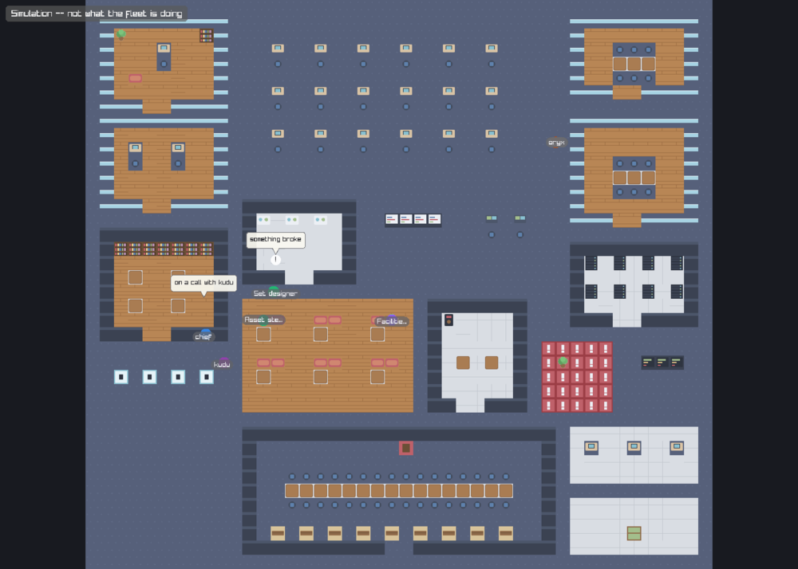

#+title: Office world adapters
#+description: Drawing the office in someone else's world: the adapter interface, the built-in Tiled one, and writing a module
#+authors: Zach Podbielniak
#+categories: software documentation
#+created: [2026-11-22 Sun]
#+updated: [2026-11-22 Sun]
#+version: 0.1.0

* World adapters
:PROPERTIES:
:CUSTOM_ID: adapters
:END:

A world pack is usually drawn by the office itself: its Tiled map from above, or its libregnum level in 3D ([[file:office.org::#drawn][the drawn office]]).  A pack can instead name a *world adapter*: code that owns a whole world -- loads it, walks actors through it, draws it -- with the office telling it only who goes where.  The point is worlds the office could never describe as a map and some zones: a game's town, with the fleet as its townsfolk.

The office's half stays the same whatever the adapter: the director still seats everybody (~office.layout~), and the scene still draws what floats over people -- names, bubbles, emotes -- wherever the adapter says they are.

** The interface
:PROPERTIES:
:CUSTOM_ID: interface
:END:

An adapter is a libregnum =LrgWorldAdapter= (libregnum 0.11.0, =src/stage/lrg-world-adapter.h=; its own documentation is =docs/modules/stage/world-adapter.org= there).  The office uses these of it:

| Call | When |
|------+------|
| =lrg_world_adapter_load()= | once, with the pack's =source= (below) |
| =lrg_world_adapter_set_camera()= | once, =LRG_WORLD_CAMERA_OVERVIEW= |
| =lrg_world_adapter_spawn_actor()= | a participant first appears: its id, and its colour as =#rrggbb= |
| =lrg_world_adapter_move_actor()= | its seat changes: the director's =x=, =y= (map pixels), =z= 0 |
| =lrg_world_adapter_get_actor_position()= | every frame, so the overlays follow the adapter's own walking |
| =lrg_world_adapter_remove_actor()= | it has walked out |
| =lrg_world_adapter_update()=, =lrg_world_adapter_draw()= | every frame |

Positions are the director's, in the pack's map pixels.  An adapter whose world has other units maps them itself -- a pack written for it has zones whose anchors are in the adapter's units, since the director only passes them through.

** Naming one in a pack
:PROPERTIES:
:CUSTOM_ID: pack
:END:

#+begin_src yaml
renderers:
  adapter:
    module: tiled            # a name, never a path
    source: map.tmj          # a file in the pack, or the adapter's own name for a place
  2d:
    map: map.tmj             # optional: drawn instead if the adapter will not load
#+end_src

=source= is a file in the pack when the pack has one by that name (and it is fetched with the pack, so a renderer on another machine has it); otherwise it is passed to the adapter as it stands -- "Goldshire" means something to a game's adapter and nothing to the office.  A pack with an adapter and no =2d= or =3d= renderer is fine; one whose adapter will not load and that has nothing else is refused at load with the reason, and one that has a map falls back to it with a warning.

** The built-in adapter: =tiled=
:PROPERTIES:
:CUSTOM_ID: tiled
:END:

=module: tiled= is libregnum's =LrgTiledWorld=: the Tiled map drawn by libregnum, with *walls* -- tiles in a layer with a true =collision= or =solid= property, or named =collision= or =walls=, and area objects of type =obstacle= -- and people walking round them on its grid (=LrgActorMover=).  Seats come from the director as always.  It is deliberately plain: people are discs in their colour.  Use it when a pack's walls matter more than its faces.

#+caption: modern-office through the =tiled= adapter (simulate mode)

What the plain office does that the =tiled= adapter does not: faces and bodies, characters from their sheets ([[file:office-custodial-team.org::#characters][characters]]), the usage board, and the 3D view (Tab still switches to the pack's level when it has one).

** Writing an adapter module
:PROPERTIES:
:CUSTOM_ID: module
:END:

A module is a shared library named =libclawt-office-adapter-<name>.so= exporting one function:

#+begin_src c
/*
 * pack_dir: the pack's directory in the renderer's cache, for files the
 *   adapter wants beside its source
 * Returns: (transfer full) (nullable): a new LrgWorldAdapter, or NULL
 *   with error set
 */
LrgWorldAdapter *
clawt_office_adapter_new(
    const gchar  *pack_dir,
    GError      **error
);
#+end_src

Build it against the same libregnum the renderer links (the =LRG_CFLAGS= in clawtilla's =config.mk=), implement =LrgWorldAdapterInterface= (=load=, =resolve_place=, =spawn_actor=, =move_actor=, =remove_actor= and =set_camera= are required; =get_actor_position=, =update= and =draw= are what make it visible), and put it where the renderer looks, in order:

1. each =--adapter-dir= given to =clawtilla-office=;
2. =$XDG_DATA_HOME/clawtilla/office-adapters/=;
3. the install location, =<libdir>/clawtilla/office-adapters/=.

The error when a module is missing names every path it looked at.  A module is loaded once and kept: its GTypes are registered for the life of the process.

Adapters run on the *renderer's* machine, not the daemon's -- a laptop drawing a workstation's office needs the module installed on the laptop.  The web client draws its own canvas and does not run adapters; its Office page draws the pack's map.

** Where this is going
:PROPERTIES:
:CUSTOM_ID: future
:END:

The adapters this was made for are games: librewow and librefall worlds with a god's-eye camera over them, the fleet's agents as their people -- the Goldshire inn as the lounge, the keep as the town hall.  Those adapters need the person's own game data and live with the games, not here; this interface is what they implement.
