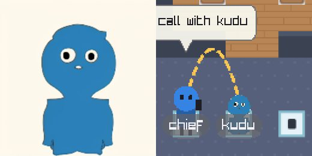

#+title: The office's custodial team
#+description: The agents that keep the office -- its worlds, assets and characters -- and the tools they use
#+authors: Zach Podbielniak
#+categories: software documentation
#+created: [2026-11-21 Sat]
#+updated: [2026-11-21 Sat]
#+version: 0.1.0

* The custodial team
:PROPERTIES:
:CUSTOM_ID: custodial-team
:END:

The office is data -- world packs, choreography, characters -- and data can be kept by agents.  The custodial team is a team that does that: you ask it for a war room, a winter theme, or a character for the agent you just made, and it changes the packs, checks the result and tells you.  It is optional, never made without being asked, and the chief can do all of it alone.  The office itself is described in [[file:office.org][office.org]]; packs in [[file:office-world-packs.org][office-world-packs.org]].

** Who is on it
:PROPERTIES:
:CUSTOM_ID: members
:END:

| Agent | Role | Does |
|-------+------+------|
| ~<team>-lead~ | lead | takes requests from you and the chief, hands each to the member whose work it is, checks the result with ~clawtilla_office_preview~ |
| ~<team>-assets~ | member | the asset steward: makes and imports tiles, props and characters, with the configured generator, and records where every file came from |
| ~<team>-designer~ | member | the set designer: edits ~office.yaml~ (zones, tags, seats), ~choreography.yaml~ and the maps |

Each starts with that mission in its ~SOUL.org~, ~tools.office~ on, and the team's lead able to assign to the other two.  Change any of it afterwards like any agent.

** The team is found by its tag, not its name
:PROPERTIES:
:CUSTOM_ID: tag
:END:

The custodial team is whichever team carries the ~office-custodial~ tag (see [[file:team-tags.org][team-tags.org]]).  Call it Facilities, Groundskeepers or the Town Council: rename it, or tag a team of your own instead, and the office still finds it.  The tag is unique -- a second team carrying it is a fleet warning, and the first in the team list wins.

** Installing it
:PROPERTIES:
:CUSTOM_ID: install
:END:

Three ways, which all do the same thing (~clawt_daemon_office_custodians_install()~):

#+begin_src bash
clawtilla office custodians install                 # a team called facilities
clawtilla office custodians install --team town-council
#+end_src

- in any client: the Office page, *Create custodial team*;
- the chief, with ~clawtilla_office_custodians_install~ -- which also needs ~tools.manage_fleet~, because it creates agents.

It is refused when a team already carries the tag (it names that team), and when the team id or any of the three agent ids is taken -- checked before anything is written, so a refusal leaves nothing half made.  The three agents are started at once.

When ~office.asset_generator~ is set at install time, the asset steward is given an action rule for it, ~mcp__clawtilla-<generator>__*=ask~: every call to the generator becomes a decision card you approve, because a generator that charges must not spend because a model decided to.  Loosen it in the steward's ~policy.rules~ if you want; see [[file:security.org::*Action policy][Action policy]].

** The office tools
:PROPERTIES:
:CUSTOM_ID: tools
:END:

Offered to any agent with ~tools.office~ -- on for the chief of staff unless set otherwise, on for the custodians, off for everybody else, never to an ephemeral helper:

| Tool | Does |
|------+------|
| ~clawtilla_office_worlds~ | lists the packs: which is in use, which were refused and why, which were written here |
| ~clawtilla_office_world_read~ | reads one text file of a pack, with the loader's warnings |
| ~clawtilla_office_world_write~ | writes one file of a pack (see below) |
| ~clawtilla_office_world_apply~ | draws the office in another world, for everybody |
| ~clawtilla_office_preview~ | who would sit where, in what pose, in a world as it stands |
| ~clawtilla_office_asset_import~ | copies a file from the agent's workspace into a pack or a character, with its checksum, licence and provenance |
| ~clawtilla_office_character_mesh~ | gives a character an imported 3D model (=.glb=, =.obj=, =.vox=, =.iqm=, =.m3d=; a =.gltf= is refused, it names other files) for the 3D view |
| ~clawtilla_office_character_layout~ | says how an imported sprite sheet is laid out -- the frame size and which row is which animation -- checked against the image, after which the office draws that agent from it |
| ~clawtilla_office_custodians_install~ | installs this team (also needs ~tools.manage_fleet~) |

How writes stay safe (~src/office/clawt-office-pack.c~, so every caller gets the same rules):

- *Only under the state directory.*  A change to a shipped pack is made to a copy under ~<state_dir>/office/worlds/<id>/~, which the office then uses for that id (the state directory is searched before the shipped one).  A pack in your own =office.world_dirs= is never written: it is searched first, so a copy would never be drawn, and the write is refused with the way that works -- a new world copied from it (~from~) and applied.
- *Only inside the pack.*  A path is relative, with no ~..~ and no hidden names, and the directory it lands in is resolved through any symbolic link and must still be inside the pack.
- *Never a pack that will not load.*  A write to ~office.yaml~ or ~choreography.yaml~ is checked by loading the pack; a refusal puts the old file back and returns the loader's reason.
- *An asset comes from the agent's own workspace*, and arrives with its provenance or not at all: the sha256 goes into the manifest's ~assets~, so a pack synced to another fleet can be verified (~clawt_office_world_verify_assets()~).

** Characters from an agent's picture
:PROPERTIES:
:CUSTOM_ID: characters
:END:

With the office on and =office.asset_generator= naming a generator, creating an agent files a task: *Office character for <agent>*, to the custodial lead -- or, with no custodial team, to the chief when its ~tools.office~ is on.  Nothing is generated without that task, nothing about the new agent waits on it, and an ephemeral helper gets none.

The daemon puts the reference picture where the maker can read it, in its own workspace under ~office-characters/<agent>/~: the agent's own picture when it has one -- =agents.avatar=, or the profile picture a client stored in its workspace, the picture every sidebar draws -- otherwise its generated face as an SVG -- the face every client already draws.  The task asks for a turnaround, short clips per action (walk, idle, sit and type, phone, present) and a sprite sheet cut from them, each imported with ~clawtilla_office_asset_import~ under ~character~.  They land in ~<state_dir>/office/characters/<agent>/~ beside a ~character.yaml~ listing each file's checksum and provenance.  The steward then says how the sheet is laid out with ~clawtilla_office_character_layout~ -- the frame size and a row per animation:

#+begin_src json
{"agent": "kudu", "sheet": "sprites/sheet.png", "frame_width": 32, "frame_height": 48,
 "animations": {"idle": {"row": 0, "frames": 1},
                "walk_down": {"row": 1, "frames": 4, "fps": 8},
                "walk_up": {"row": 2, "frames": 4, "fps": 8},
                "walk_left": {"row": 3, "frames": 4, "fps": 8},
                "walk_right": {"row": 4, "frames": 4, "fps": 8},
                "type": {"row": 5, "frames": 4, "fps": 6}}}
#+end_src

Every row and frame is checked against the image, so a layout that runs past the sheet is refused and the manifest left as it was; the sheet must have been imported first, so it has its checksum and provenance.  From then on every renderer draws the agent from it (see [[file:office.org::#drawn][the drawn office]]); until then the agent is drawn with the default body and its own face.

A sheet painted on a plain backdrop -- what an image generator gives back -- says so with ~background~: ="corners"= (the colour all four corners of a frame share) or ="#rrggbb"=.  Each renderer then makes that backdrop transparent, frame by frame, but only the part *connected to the frame's edge*: the whites of a pair of eyes sit as close to a cream backdrop as the backdrop's own noise, and keying by colour alone punched them out.  A frame whose corners disagree is left as it is.  The rule is one function, ~clawt_office_character_key_background()~, which the web client's ~office.js~ mirrors; a new layout without ~background~ clears an old one, since the backdrop belongs to the sheet.  Once keyed, what was backdrop is margin, so a keyed sheet is drawn from the smallest rectangle holding every visible pixel of every frame (~clawt_office_character_opaque_bounds()~, one rectangle so an animation does not wobble): a generator frames a full-body portrait with a wide margin, and scaled whole it stood half as tall as everybody else.  A character the daemon makes itself ([[#direct][below]]) is marked ="corners"= for you.

#+caption: kudu, made by ComfyUI from its picture (left), drawn with its backdrop keyed out (right)

To ask again (a new picture, a better generator):

#+begin_src bash
clawtilla office character <agent>
#+end_src

Higgsfield makes images and video and no 3D models.  Meshy does (=office.asset_api_3d: meshy=, below, since 0.76.0); otherwise a model comes from elsewhere -- a ComfyUI workflow with an image-to-3D node (TRELLIS and its kin, licences yours to check), an artist, a CC0 pack -- and is imported like any asset, then attached with ~clawtilla_office_character_mesh~.  A rigged =.glb= with an animation whose name says /walk/ walks; without one the model glides, and a still one never moves.  A character with no model is its current frame on a billboard facing the camera.

** Made by the daemon itself
:PROPERTIES:
:CUSTOM_ID: direct
:END:

The road above has a model deciding what to ask a generator for.  The other road has none: with =office.asset_api= set, the daemon makes a character itself -- one image, from the agent's description and its own picture -- and imports it as a one-frame character.

#+begin_src bash
clawtilla office character kudu --direct
#+end_src

*** ComfyUI, self-hosted (the FOSS road)

#+begin_src yaml
office:
  asset_api: comfyui
  comfyui_url: http://127.0.0.1:8188          # your ComfyUI
  comfyui_workflow: ~/office/character.json   # exported in API format
#+end_src

1. Build a workflow in ComfyUI that makes the picture you want -- a pixel-art checkpoint or LoRA for sprites suits the shipped worlds -- and export it in *API format* (/Export (API)/ in current frontends, /Save (API format)/ with the old dev mode).  The ordinary save is refused: it is the editor's layout, not the graph.
2. Put placeholders in its text inputs: ={{prompt}}= where the description goes (the CLIPTextEncode node's text), optionally ={{negative_prompt}}=, ={{seed}}= (a whole input becomes a number), and ={{image}}= in a LoadImage node to start from the agent's own picture.
3. Point =office.comfyui_workflow= at the file.  Behind an auth proxy, store its bearer token: ~clawtilla office api-key comfyui~.

A self-hosted server costs nothing -- its estimate is 0 -- so nothing is put to you: the character is made at once, and ~clawtilla office character AGENT --direct~ says so.  A workflow with ={{image}}= needs the agent to have a picture (=agents.avatar= or one set with ~clawtilla agent avatar set~, PNG, JPEG or WebP); an agent with none is refused there and then, naming that remedy, rather than failing out of sight.  A request the server's workflow will not take is a warning in the daemon log, never a card: there is no money to ask about.  The placeholders are filled by walking the parsed graph, so a description with quotes or braces stays one string; results are only fetched from the server's own =/view= under the configured URL.  The licence of what comes out is that of the models you run, and the provenance says which server made it.  ai-glib's =AiComfyuiClient= does the work (=docs/providers/comfyui.org= there).

A workflow that was run end to end against ComfyUI 0.46.0 on CPU in podman, with CommonCanvas-S-C (CC BY-SA 4.0, trained on Creative Commons images; ~commoncanvas_s_c.safetensors~ in ~models/checkpoints~): the agent's picture, re-imagined from the description at 0.72 denoise and scaled to a 192-pixel frame.

#+begin_src json
{
  "1": {"class_type": "CheckpointLoaderSimple", "inputs": {"ckpt_name": "commoncanvas_s_c.safetensors"}},
  "2": {"class_type": "LoadImage", "inputs": {"image": "{{image}}"}},
  "3": {"class_type": "ImageScale", "inputs": {"image": ["2", 0], "upscale_method": "bilinear", "width": 512, "height": 512, "crop": "center"}},
  "4": {"class_type": "VAEEncode", "inputs": {"pixels": ["3", 0], "vae": ["1", 2]}},
  "5": {"class_type": "CLIPTextEncode", "inputs": {"text": "{{prompt}}", "clip": ["1", 1]}},
  "6": {"class_type": "CLIPTextEncode", "inputs": {"text": "blurry, text, watermark, photo, realistic", "clip": ["1", 1]}},
  "7": {"class_type": "KSampler", "inputs": {"model": ["1", 0], "positive": ["5", 0], "negative": ["6", 0], "latent_image": ["4", 0], "seed": "{{seed}}", "steps": 16, "cfg": 7.0, "sampler_name": "euler_ancestral", "scheduler": "normal", "denoise": 0.72}},
  "8": {"class_type": "VAEDecode", "inputs": {"samples": ["7", 0], "vae": ["1", 2]}},
  "9": {"class_type": "ImageScale", "inputs": {"image": ["8", 0], "upscale_method": "bilinear", "width": 192, "height": 192, "crop": "disabled"}},
  "10": {"class_type": "SaveImage", "inputs": {"images": ["9", 0], "filename_prefix": "clawtilla"}}
}
#+end_src

The provenance then names a CC BY-SA model's output: the character carries that licence's attribution and share-alike terms, which the pack's ~character.yaml~ is the place to record.

*** Higgsfield, hosted and paid: two roads, billed separately

Higgsfield bills two ways, and an account can have money in one and not the other, so you choose:

| =office.asset_api= | Talks to | Signs in with | Pays from | Default model |
|--------------------+----------+---------------+-----------+---------------|
| ~higgsfield~ | the REST API, ~api.higgsfield.ai~ | a key pair from ~console.higgsfield.ai~, ~clawtilla office api-key higgsfield~ | the *API balance*, topped up in the console | ~higgsfield-ai/soul/v2/standard~ (0.05 credits, $0.004) |
| ~higgsfield-mcp~ | the MCP server, ~mcp.higgsfield.ai~ | the connector's sign-in (SSO), ~clawtilla connector connect hf~ | the account's *app credits*, the ones the website and the ~hf~ CLI spend | ~nano_banana_2~ (1.5 credits) |

=office.asset_model= overrides the model in that road's own spelling -- the two catalogues name models differently and each refuses the other's names.  Both were run end to end on 2026-11-22, each making kudu's character from its picture: the REST road after its balance was funded, the MCP road on app credits (8.5 before, 7 after: the 1.5 the card quoted).

The MCP road needs a Higgsfield connector ([[file:higgsfield.org][higgsfield.org]]); =office.asset_generator= names which one pays, and with it empty the fleet's only Higgsfield connector does -- two with neither named is refused, since they may be two accounts.  A connector that is not signed in is refused when you ask, with the command that signs it in, and never reaches a card.  The daemon talks to the server itself (~ClawtMcpHttpClient~, asynchronous, reusing the connector's credential exactly as an agent's relay does through ~clawt_connector_plan_for_name()~): ~estimate_image_cost~ for the card, ~media_upload~, a PUT to the presigned URL and ~media_confirm~ for the agent's picture, ~generate_image~, ~job_status~, then the result from Higgsfield's CDN.

#+begin_src bash
clawtilla office api-key higgsfield          # the REST road: KEY_ID:KEY_SECRET, read with the echo off
clawtilla connector add hf --provider higgsfield && clawtilla connector connect hf   # the MCP road
#+end_src

With either road set:

1. The daemon asks Higgsfield for an *estimate* -- behind the reply; nothing waits on the network -- and puts it to you as a decision naming the price and which money pays: /It costs about $0.0040, from your Higgsfield API balance (console.higgsfield.ai)/ on the REST road, /It costs 1.5 credits, from your Higgsfield app credits (the account signed in to the connector 'hf')/ on the MCP road.  It has no deadline and no default but decline: nothing is ever spent because nobody answered.
2. On *approve* (the exact word; anything else typed is not a yes), it uploads the agent's own picture when it has one (PNG, JPEG or WebP), submits one image, waits for the job, downloads the result and imports it as =generated/portrait.png=, provenance naming the model, the road, the price the card quoted and Higgsfield's terms.
3. Decline, dismiss or delete spends nothing.
4. Whatever happens after an approval -- made, or refused by the service -- is said in your own conversation with that agent, as a system note that starts no turn; the daemon's log has it too.

Only a self-hosted server skips the card.  A paid service that estimates zero -- a price too small to round, or free credits -- still asks, because what it spends is still yours.  Small prices are shown with their digits: Higgsfield's Soul v2 portrait is 0.05 credits, /about $0.0040/ on the card.

Higgsfield's REST API (~api.higgsfield.ai~, the key pair from ~console.higgsfield.ai~) bills a balance of its own, separate from the credits the app, the ~hf~ CLI and the connector spend: on 2026-11-22 an account with 8.5 app credits was refused every submit with =HTTP 403 not_enough_credits=, and the note in the agent's conversation said exactly that.  Fund the API balance in the console to use this road, or switch to ~higgsfield-mcp~, which spends the app credits.

Keys and tokens are files under =secrets.dir/office/= (0600); a reply names the file and never the value, and a key is read when a generation starts, never kept.  A one-frame character stands still in every pose -- a walk cycle needs a sheet, which PixelLab makes on its own road (below) and the custodial team cuts on theirs.

*** PixelLab and Meshy: a character that walks, in 2D and 3D

Since 0.76.0 two more services make characters the renderer animates, in several steps per request and with one card for all of them:

| Key | Value | Makes | Steps |
|---+---+---+---|
| =office.asset_api= | ~pixellab~ | a pixel-art sprite sheet: rows =idle=, =walk_down=, =walk_up=, =walk_left=, =walk_right= | a character in four directions at =office.pixel_size= (default 48), then its walk in each direction |
| =office.asset_api_3d= | ~meshy~ | a rigged GLB with a walking clip, which the 3D view plays when the character walks | a model from the agent's picture (=image-to-3d=) or, with none, its description (=text-to-3d=), at =office.mesh_polycount= (default 8000), A-pose; then Meshy's rig (=biped=), whose free walking clip is the GLB kept |

=office.asset_api_3d= sits beside =office.asset_api=: set both to ~pixellab~ and ~meshy~ and one request makes the 2D sprite and the 3D model on one card.  With =office.asset_api= on another road (Higgsfield, ComfyUI) a Meshy model gets a card of its own beside that road's.

#+begin_src bash
clawtilla office api-key pixellab       # or bind a pixellab integration to any agent
clawtilla office api-key meshy          # or bind a meshy integration to any agent
clawtilla office character kudu --direct
#+end_src

- *The key*: =secrets.dir/office/<service>.key= from =clawtilla office api-key=, else the first agent's =pixellab= / =meshy= integration ([[file:media-generation.org][media-generation.org]]) -- the account somebody already gave the fleet.  With neither, the request is refused when you ask, naming both remedies.
- *The card* lists each road and its price: Meshy's from its credit list (=image-to-3d= plus =rig=, "about 35 credits"), PixelLab's as "priced by PixelLab when each is done".  No deadline, default decline, the id prefix =office-generate-media-=.
- *On approve* each road runs on its own: submit, wait (a Meshy model can take most of an hour on a busy day; the wait allows an hour), the second step with the first's id (PixelLab's character, Meshy's newest task), wait, fetch every result it needs -- https only, no credential, capped while read -- and import it with provenance naming both jobs and the service's terms.  A step that fails stops its road, keeps what was already imported, and is said in your chat with the agent; the other road carries on.
- *The sheet* is laid out by =clawt_office_sheet_compose()=: every cell the size of the largest frame, frames centred, transparent, so no backdrop keying.  It needs cairo, which comes with the build's optional PDF support (=POPPLER=1=); without it the character is PixelLab's front view, standing, and the note says why.
- *Spend*: what each job cost goes into the agent's media spend, which the daily caps read (=orchestration.meshy_credit_micros= prices Meshy's credits).
- Meshy deletes what it made after about three days; the office's copy under =<state_dir>/office/characters/<agent>/generated/= is the one that lasts.

** Generators
:PROPERTIES:
:CUSTOM_ID: generators
:END:

=office.asset_generator= is the name of a connector the asset steward holds:

- [[file:higgsfield.org][Higgsfield]] -- hosted, paid per call, images and video, closed;
- a self-hosted ComfyUI behind an MCP server, added as any connector (~--provider remote --url ...~ or ~--provider api-key --command ...~), for the custodial team to drive -- or, with no model in the loop, ComfyUI's own API through =office.asset_api: comfyui= ([[#direct][made by the daemon itself]]).  The licence of each model is yours to check.

Grant the connector to the asset steward (~--scope selected --agents facilities-assets~) and to nobody who has no use for it.

** Troubleshooting
:PROPERTIES:
:CUSTOM_ID: troubleshooting
:END:

- /No character task appears/: the office is off, =office.asset_generator= is empty, or nobody keeps the office (no custodial team and the chief's ~tools.office~ off).  ~clawtilla office character <agent>~ says which.
- /A write is refused/: read the message -- it is the loader's reason the pack would not load, and the pack is as it was.
- /The steward cannot see the picture/: it is in the *maker's* workspace; a lead that hands the task on should pass the path, or the steward reads it from the lead's message.
- /Every generator call waits on me/: that is the action rule the install wrote; see [[#install][Installing it]].
