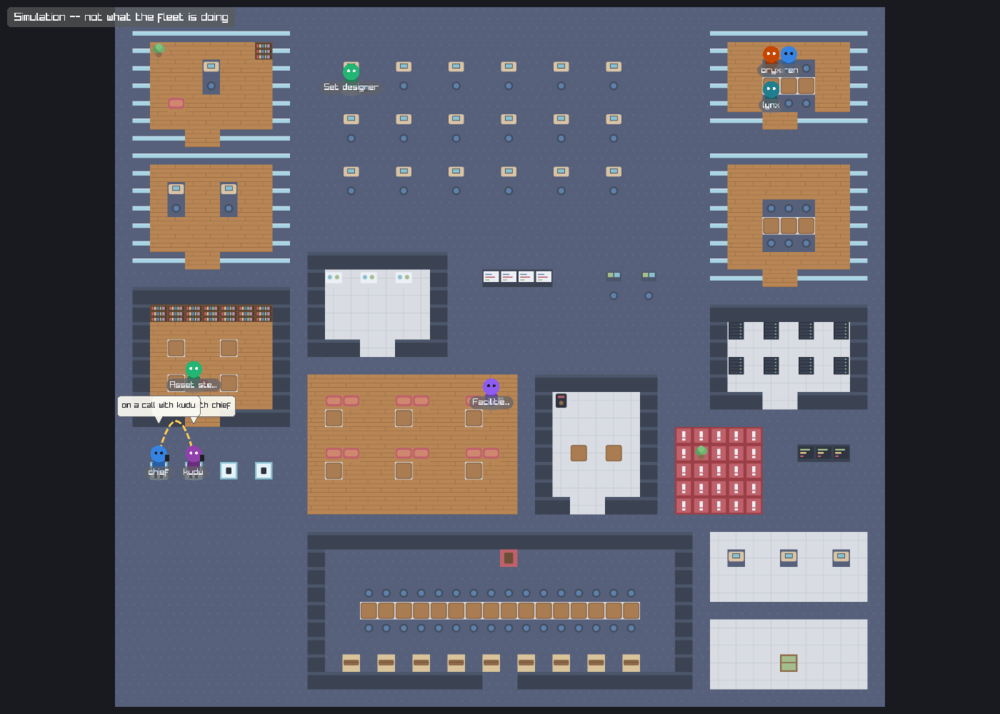
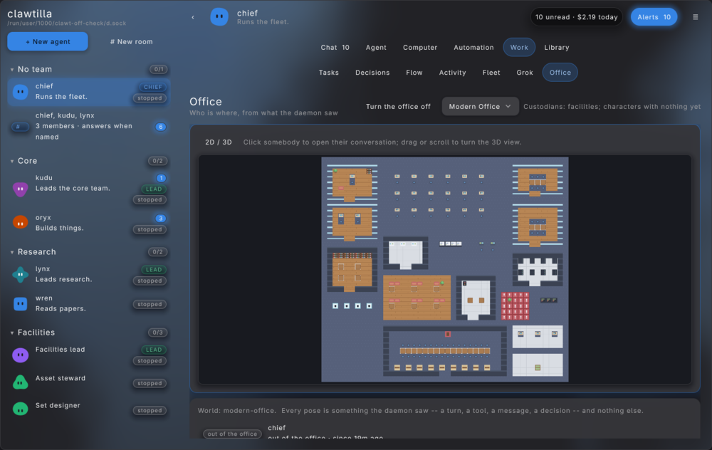
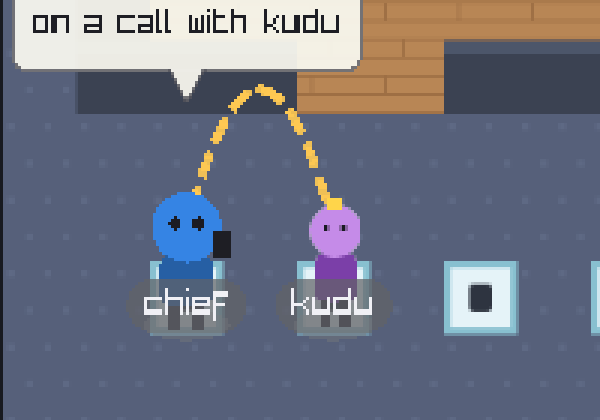

#+title: The office
#+description: The fleet drawn as people in a building: who is where, and why
#+authors: Zach Podbielniak
#+categories: software documentation
#+created: [2026-11-21 Sat]
#+updated: [2026-11-21 Sat]
#+version: 0.1.0

* The office
:PROPERTIES:
:CUSTOM_ID: office
:END:

The office draws the fleet as people in a building.  An agent sits at its desk while a turn is running, walks to the library when it reads and to the lab when it runs commands, takes out a phone while it messages another agent, and joins a meeting round a table when a group round is under way.  When the chief or you start a round that every lead is in, everybody walks to the town hall.  An idle agent sits in the lounge, one whose turn broke stands in the bug corner, and one that asked you something waits at its desk with a question mark over its head.  An ephemeral helper walks in through the entrance when it is spawned and out again when it is reaped.

It is a view of what the daemon already knows, and it never invents anything.  Every pose comes from an event the daemon saw: a turn edge, a tool step, a message, a decision, an incident.  An edge that is never closed decays after =office.stale_seconds=.

** At a glance
:PROPERTIES:
:CUSTOM_ID: glance
:END:

| Piece | What it is | Built |
|-------+------------+-------|
| presence | the fold from events to an activity per participant, in libclawt; the daemon runs it | always |
| ~office.snapshot~, ~office.presence~ | who is doing what, on request and as it changes | always (answers "off" unless =office.enabled=) |
| world packs | directories describing a place: zones, a 2D map, a 3D level | always (two ship) |
| choreography | which zone, pose and prop each activity gets | always (built in, overridable) |
| ~office.layout~ | the director's answer: who sits in which seat | always |
| the roster | a who-is-where list on every client's Office page and in ~clawtilla office who~ | always |
| =clawtilla-office= | the renderer: 2D and 3D, on libregnum | =OFFICE=1= |
| the lrg Office page | the same renderer inside the libregnum client | =OFFICE=1 LRG_BACKEND=1= |
| the GTK Office page | =clawtilla-office= run as a child, its frames shown in the window ([[#gtk-embed][the GTK embed]]) | always; needs =clawtilla-office= at run time |
| the web Office page | its own canvas renderer of the same layout (=data/web/office.js=), with a tilted view and =?simulate=1=; see [[file:web-client.org::#office-drawn][web-client.org]] | always |

The roster, the presence and the layout are in every build, because they cost nothing and every client should be able to say who is where.  Only the libregnum renderer needs =OFFICE=1=: the GTK client runs it as a child and the web client draws its own, so neither links libregnum.

** Turning it on
:PROPERTIES:
:CUSTOM_ID: enabling
:END:

#+begin_src bash
clawtilla office on                    # or the switch on the Office page
clawtilla office use cozy-town         # or the World picker; modern-office is the default
clawtilla office who                   # the roster
clawtilla office worlds                # what packs are available
#+end_src

~office.set~ writes =office.enabled=, =office.world= and =office.renderer= to clawtilla.yaml and applies them at once; no reload and no agent restart is needed.  Editing the keys by hand works too, followed by ~clawtilla config reload~.  The Office page in each client has the switch and the world picker, and says the office is off until it is on.

** Activities
:PROPERTIES:
:CUSTOM_ID: activities
:END:

Each participant has one activity, chosen by priority: the loud ones win.

| Activity | When | Drawn by default |
|----------+------+------------------|
| =waiting_on_you= | it asked you a decision and nobody has answered | at its desk, a question mark overhead |
| =error= | its last turn timed out or kept repeating, or a run of its broke; cleared by its next turn | the bug corner, an alert overhead |
| =in_meeting= | a group room with at least =office.meeting_min_members= members had a message in the last three minutes | round the table of the smallest meeting room that fits; the town hall when the chief or you are speaking and every lead is in the room |
| =on_call= | it and one other agent exchanged a message in a room of two within the last minute | a phone booth, phone out, facing the other; at its desk when the world has no booth |
| =delivering= | it just handed work over (a task assigned, a handoff queued) | beside the assignee's desk with a folder |
| =working= | a turn is running and it used a tool in the last 45 seconds | the tool's station, see below |
| =thinking= | a turn is running with no tool in hand | at its desk |
| =arriving= | an ephemeral helper spawned in the last 15 seconds | at the entrance |
| =leaving= | an ephemeral helper being reaped | walking out through the entrance |
| =idle= | running, nothing to do | the lounge |
| =offline= | not running | not drawn |

*Stations* put a working agent where its tool belongs, matched on the tool's name (=clawt_office_station_for_tool()=):

| Station | Tools |
|---------+-------|
| library | read, grep, glob, search, fetch, research, recall, memory |
| lab | bash, shell, exec, test, computer |
| whiteboard | todo, plan, task, delegate, ephemeral, decision |
| terminal | browser, display, screen |
| desk | anything else (writing and editing) |

** Participants
:PROPERTIES:
:CUSTOM_ID: participants
:END:

| Kind | Who | Notes |
|------+-----+-------|
| =agent= | every agent in the fleet | the chief's home is the chief's office, a lead's the leads' offices, everybody else's a desk, a team's own desks first |
| =ephemeral= | ephemeral helpers ([[file:ephemeral-agents.org][ephemeral-agents.org]]) | arrive and leave through the entrance |
| =grok_bot= | a Grok bot with a job ([[file:grok.org][grok.org]]) | a remote worker at the visitor desk while it has a job; waiting on you when the job needs input |
| =external= | reserved: another agent system, or a participant from another fleet | drawn at the visitor desk |

Every participant carries =fleet= -- this fleet's id, made once and kept in =<state_dir>/fleet-id= -- so a future merged office can tell fleets apart.  See [[#federation][Federation]].

** World packs
:PROPERTIES:
:CUSTOM_ID: worlds
:END:

A world pack is a directory with an ~office.yaml~.  Two ship with clawtilla, both CC0 and drawn by =tools/clawt-office-genworld.c= so nothing is downloaded:

- =modern-office= -- an open-plan floor with glass offices, a huddle room and a boardroom, a library, a lab, a planning wall, an ops desk, a server room, a lounge and kitchen, phone booths, a bug corner, a visitor desk, a usage board, a lobby and a town hall.
- =cozy-town= -- workshops for the teams, a manor for the chief, a guild hall for the leads, a tea house and a council chamber, a café garden, a library, a smithy, an observatory, an inn for visitors, a repair shed, a market square and a town hall.

Packs are looked for, in order, in =office.world_dirs=, then =<state_dir>/office/worlds/= (where the custodial team writes), then the shipped =data/office/worlds/=.  A pack id found twice keeps the first, so your own copy of =modern-office= replaces the shipped one.

How to write one -- the manifest, the zone tags, a 2D map in Tiled, a 3D level in lrgeditor, assets and provenance -- is in [[file:office-world-packs.org][office-world-packs.org]].

** The drawn office
:PROPERTIES:
:CUSTOM_ID: drawn
:END:

=clawtilla-office= draws the layout: the pack's Tiled map from above, or its libregnum level from an orbiting god's-eye camera, with each participant in its own colour and face, walking to the seat the director gave it.  What floats over people is the activity, loudest first: a question mark and a bubble for somebody waiting on you, an exclamation mark for something broken, a dotted gold arc between two agents on a call, a folder carried to the assignee's desk, a laptop or book or marker for the work at hand.  People stand still once seated -- an idle fleet is a quiet room, not a bouncing one.

#+caption: modern-office in 2D (simulate mode): a call between chief and kudu

#+caption: the same office in 3D, drawn from its .rlevel
[[file:images/office/office-3d-sim.png]]

*** Building it

#+begin_src bash
make OFFICE=1            # clawtilla-office, and the lrg client with its Office view
make OFFICE=1 install
#+end_src

=OFFICE=1= brings =LRG_BACKEND=1= with it and needs libregnum 0.11.0 or newer at =LRG_DIR= (default =../libregnum=): the Tiled importer, the world-space UI (name plates, bubbles, emotes), beams and frame export are that release's.  Loading a 3D level reaches libregnum's scripting, so the binary also links =girepository-2.0= and =gjs-1.0= when libregnum was built with them -- on Fedora, =gobject-introspection-devel= and =gjs-devel=, on top of the lrg client's packages ([[file:lrg-client.org][lrg-client.org]]).

*** Running it

#+begin_src bash
clawtilla office open                       # or run clawtilla-office directly
clawtilla-office --3d --world cozy-town
clawtilla-office --profile workstation      # a daemon on another machine
clawtilla-office --simulate                 # invented activity, labelled, never sent anywhere
clawtilla-office --screenshot office.png --width 1600 --height 900
#+end_src

| Option | Does |
|--------+------|
| ~--socket~, ~--profile~, ~--host~ | which daemon, as every client takes it |
| ~--world ID~ | draw this pack rather than =office.world= |
| ~--2d~, ~--3d~ | the view to start in (Tab switches in a window) |
| ~--simulate~ | deal the real participants into calls, a meeting, a question, a failure -- on this screen only, with "Simulation" written over it |
| ~--screenshot FILE~ | draw offscreen until the office has loaded and people have walked to their seats (~--frames~, default 90), write a PNG, exit; 30 seconds without a world or a layout is a failure that says so |
| ~--embed FD~ | stream frames over the socket =FD= for a host that does not link libregnum (the GTK client); see below |
| ~--width~, ~--height~ | the size, 64 to 8192 pixels |

In a window: Tab switches 2D and 3D, the arrow keys or a right-drag turn the 3D camera, the wheel zooms, Escape quits, and a click on somebody prints ~{"event":"open_agent","agent":"<id>"}~ on stdout.

The pack is fetched from the daemon file by file (~office.file~) into =$XDG_CACHE_HOME/clawtilla/office/<world>/=, so a renderer on a laptop draws the workstation's office.  The layout is read once a second and whenever ~office.presence~ says something changed; agent colours come from ~agent.list~.

*** In the lrg client

The lrg client draws the same scene in its own process, into an =LrgViewport= on the Office page: no child and no frames over a socket, since it already is libregnum.  A *2D / 3D* button switches the view, a drag or the wheel turns the 3D camera, and a click on somebody opens their conversation.

#+caption: the lrg client's Office page

*** Embedding it

~--embed FD~ draws offscreen and streams each frame over the unix socket =FD= in libregnum's frame protocol (LFRM v1: a 16-byte header, RGBA8 frames inline or in a sealed memfd passed with =SCM_RIGHTS=; pointer, button, scroll, key and resize back), dropping frames rather than queueing them when the host falls behind.  The host owns the size: a resize message re-sizes the frames.  A click on somebody is the same stdout line as in a window.  The protocol is specified in libregnum's =docs/modules/remote/frame-protocol.org=.

*** Characters

An agent the custodial team has made a character for ([[file:office-custodial-team.org::#characters][characters]]) is drawn from its own sprite sheet instead of the shared body: walking picks the row for the direction it is going, a pose (sit, type, read, phone, present) its own row, a still pose holds a frame.  A sheet is fetched with ~office.character_file~ and checked against the sha256 its manifest recorded -- one that does not match is not drawn.  The 3D view keeps the shared body with its face.

#+caption: kudu drawn from its sheet, on a call with the chief

*** The usage board

Each provider login's allowance -- the meters on the Fleet page, from the same library calls -- is drawn on the wall a pack tags =usage_board=.  It reads ~usage.providers~ as it stands and never asks for a fresh read: a wall display left open all day must not spawn a provider's CLI once a minute.  The Fleet page refreshes; the board shows the result.

#+caption: the usage board
[[file:images/office/office-board.png]]

*** World adapters

A pack can name a world adapter -- code that owns its world and walks people through it -- instead of being drawn by the office: libregnum's =tiled= adapter (walls and path-finding), or a module of your own.  See [[file:office-adapters.org][office-adapters.org]].

*** Opening on the office

=--office= on =clawtilla-gtk= and =clawtilla-lrg= opens on the Office page; on =clawtilla-web= it sends =/= there, for a wall display.

*** What it does not do yet

- People walk in a straight line to their seat in the office's own drawing: the shipped maps carry no collision layer.  A pack with walls should use the [[file:office-adapters.org::#tiled][=tiled= adapter]], which paths round them.

** Who keeps it
:PROPERTIES:
:CUSTOM_ID: custodians
:END:

Agents can keep the office for you.  The chief has the office tools by role (~tools.office~): it can list, read, change, preview and apply world packs and import assets.  A *custodial team* -- a lead, an asset steward and a set designer, on a team tagged ~office-custodial~ and named whatever you like -- takes requests for the office and makes each new agent's character from its picture with the generator you configure (=office.asset_generator=).  Nothing is installed or generated unasked: ~clawtilla office custodians install~, *Create custodial team* on the Office page, or the chief's ~clawtilla_office_custodians_install~.  See [[file:office-custodial-team.org][office-custodial-team.org]].

*** The chief bootstraps the office in one conversation

#+begin_example
you:   Turn the office on and make it feel like a winter lodge.
chief: (clawtilla_office_worlds) The office uses modern-office.  I'll make a
       new world from cozy-town called winter-lodge ...
       (clawtilla_office_world_write world=winter-lodge from=cozy-town
        path=choreography.yaml: idle -> breakroom with coffee)
       (clawtilla_office_preview world=winter-lodge) everybody seated; nobody
       on a fallback.  Shall I apply it?
you:   Yes.
chief: (clawtilla_office_world_apply world=winter-lodge) Done.
#+end_example

Turning the office on is yours (~clawtilla office on~); everything after it can be the chief's, or the custodial team's once there is one.

** Choreography
:PROPERTIES:
:CUSTOM_ID: choreography
:END:

Which zone, pose, prop and emote each activity gets.  Three layers, each replacing the rules it names: the built-in rules, then the pack's own ~choreography.yaml~, then the file =office.choreography= names.  ~clawtilla office choreography~ prints the built-in rules, which are also the format.  See [[file:office-choreography.org][office-choreography.org]].

** The wire
:PROPERTIES:
:CUSTOM_ID: wire
:END:

| Request | Answers |
|---------+---------|
| ~office.snapshot~ | ~enabled~, ~fleet~, ~now~, ~world~, ~renderer~ and ~participants~ (each ~fleet~, ~kind~, ~id~, ~name~, ~team~, ~parent~, ~role~, ~activity~, ~station~, ~peer~, ~room~, ~since~, ~detail~); or ~enabled: false~ and ~why~ |
| ~office.worlds~ | ~enabled~, ~current~, ~worlds~ (~id~, ~name~, ~license~, ~has_2d~, ~has_3d~, ~warnings~) and ~refused~ (why a pack was not loaded) |
| ~office.world~ (~world~ optional) | the pack: ~zones~, ~assets~, ~warnings~, ~districts~, relative ~map_2d~ / ~level_3d~, and the merged ~choreography~ |
| ~office.layout~ (~world~ optional) | the director's ~placements~ (each ~id~, ~activity~, ~zone~, ~zone_tag~, ~seat~, ~x~/~y~, ~x3~/~z3~, ~pose~, ~prop~, ~emote~, ~facing~, ~fallback~) plus ~participants~ and ~now~ |
| ~office.file~ (~world~, ~path~) | one file of a pack as ~base64~, at most 32 MiB, only inside the pack -- for a renderer not on the daemon's machine |
| ~office.set~ (~enabled~, ~world~, ~renderer~, each optional) | writes them to clawtilla.yaml and applies them at once; answers the new ~enabled~, ~world~, ~renderer~; a world that does not exist is refused |
| ~office.characters~ | ~characters~: each agent the custodial team has made a whole character for -- ~agent~, ~sheet~, ~sheet_sha256~, ~frame~ ([w, h]) and ~animations~ (~{name: {row, frames, fps}}~) (since 0.60.0) |
| ~office.character_file~ (~agent~, ~path~) | one file of a character as ~base64~, resolved by the kernel inside =<state_dir>/office/characters/<agent>/= |
| ~office.custodians~ | ~team~ (the team tagged ~office-custodial~, or null) and ~generator~ (=office.asset_generator=) -- whether a client offers the install (since 0.58.0) |
| ~office.custodians_install~ (~team~, ~start~ optional) | makes the custodial team and its three agents, started unless ~start: false~; answers ~team~ and ~agents~; refused when a team already carries the tag |
| ~office.character~ (~agent~, ~direct~ optional) | files the task that makes ~agent~'s character and answers its ~task~ id; with ~direct: true~ the daemon makes it itself through =office.asset_api= and answers ~asked: true~ -- the estimate arrives as a decision.  Refused with what is missing |
| ~office.api_key~ (~service~, ~key~) | stores the key =office.asset_api= uses; answers ~key_file~, never the key (since 0.60.0) |

~office.changed~ is published after ~office.set~.  ~office.presence~ is published whenever what a participant should be drawn doing changes, and never for a repeat: subject the participant's id, details every member of the participant as strings, or ~activity: gone~ when a helper has walked out.  It is ephemeral like ~turn.step~: not replayed and not logged.  Read ~office.snapshot~ on connect.

** The GTK embed
:PROPERTIES:
:CUSTOM_ID: gtk-embed
:END:

The GTK client never links libregnum, so it cannot draw the office itself.  It runs =clawtilla-office= as a child process instead: the child renders offscreen and streams frames over a unix socket, the window shows them and sends the pointer back.  The view is built in every build of the GTK client; only the child needs =make OFFICE=1 LRG_BACKEND=1=.

*** How it works

1. *Finding the renderer.*  =clawt_office_renderer_resolve()= looks beside the running binary (a checkout's =build/release/=), then at the install location (=<prefix>/bin=), then on =PATH=.  When none has it, the Office page shows a note naming all three places and the build command.
2. *Starting it.*  The window makes a =socketpair()= and hands one end to the child as fd 3:

   #+begin_src bash
   clawtilla-office --embed=3 --socket /run/user/1000/clawtilla/daemon.sock --width 966 --height 420
   clawtilla-office --embed=3 --profile workstation --width 966 --height 420
   #+end_src

   The connection argument reproduces the window's own: ~--socket PATH~ for a local daemon (nothing at all for the default socket), ~--profile NAME~ for a saved connection profile.  A remote daemon reached through a connection that is not saved cannot be followed -- its token would have to go in the argv, which every user on the machine can read -- so the page says to save it under Connections.  =clawt_office_renderer_embed_argv()= builds the line.  The child is given =PR_SET_PDEATHSIG= (=SIGTERM=) in its setup, so it dies with the window however the window ends.
3. *Frames.*  The socket speaks libregnum's frame protocol, version 1 (libregnum's =docs/modules/remote/frame-protocol.org=): a 16-byte little-endian header (="LFRM"=, version, type, body size), a HELLO, then FRAME messages of RGBA8 pixels, inline or in a sealed memfd passed with =SCM_RIGHTS=.  =ClawtOfficeFrames= in libclawt is the host side, written from the specification rather than linked.  It is watched by a source on the window's main context; each frame becomes a =GdkMemoryTexture= in a =GtkPicture= 420 pixels tall and as wide as the page.  A memfd frame is shown straight from its read-only mapping, so it costs no copy -- which is why an unsealed memfd is refused: a file shrunk under a live mapping would be a =SIGBUS= in the window.
4. *Input.*  Pointer motion, buttons and the wheel are sent back as POINTER_MOVE, POINTER_BUTTON and SCROLL in frame pixels (the letterbox subtracted, buttons renumbered to raylib's 0 left, 1 right, 2 middle, the wheel's sign flipped to the protocol's "positive away from the user").  When the page changes size a RESIZE follows once the size has held for 200 ms, at the display's scale factor, so the child draws at the size it is shown.  Keys are not forwarded yet; =clawt_office_frames_send_key()= exists for when they are.
5. *Events.*  The child writes JSON lines on stdout.  ~{"event":"open_agent","agent":"kudu"}~ opens that agent's chat.  Anything else is ignored, and a line longer than 64 KiB is dropped rather than buffered.  Its stderr is kept, last line only, to explain an exit; with =G_MESSAGES_DEBUG=Clawtilla= every line is logged.

*** When it runs

Only while it can be seen: the office is on (the last ~office.snapshot~ said =enabled=) *and* the Office page is on screen.  Leaving the page, turning the office off and closing the window each stop the child -- =SIGTERM=, then =SIGKILL= if it has not gone within three seconds -- and coming back starts a fresh one.  A child is also restarted when the window switches to another daemon, since it was told about the old one.

*** When it stops

If the child exits, is killed or breaks the stream, the slot shows a banner -- /The office stopped drawing: clawtilla-office exited with status 3: <its last line on stderr>/ -- with *Restart*.  Nothing respawns it on its own, so a renderer that cannot start does not become a loop; leaving the page and coming back is a fresh try too.  The window is never affected.

The receiver never accumulates past the message it is assembling: a header announcing more than 256 MiB is refused before its body is read, a frame whose sizes do not add up is refused at its 48-byte fixed part, and an unknown message type's body is read through a scratch buffer and dropped.  Input the socket will not take is queued (it is never dropped) up to 1 MiB, past which the child is declared stuck.

** Federation
:PROPERTIES:
:CUSTOM_ID: federation
:END:

Not built yet.  These invariants exist so it can be built without undoing anything:

- Every participant carries its fleet's id; locally they all carry this one.
- A fleet publishes only its own participants.  A merged office would take other fleets' snapshots as read-only participants, kind =external=, drawn at the visitor desk or in a district of their own.
- A pack names files by relative path only, and lists each with a =sha256= (=clawt_office_world_verify_assets()= checks them), so a pack can be synced between fleets by hash.  =districts= in a manifest names the parts of a world a merged office could give to other fleets.
- ~office.file~ serves pack files by pack and path, never by a path on this machine.
- Team tags and ephemeral names are unique within a fleet only; anything that crosses fleets namespaces them.

** Troubleshooting
:PROPERTIES:
:CUSTOM_ID: troubleshooting
:END:

- *The Office page says the office is off.*  Turn it on there, or ~clawtilla office on~.
- *The drawn office is empty.*  Nobody is in the office: a stopped agent is "out of the office" and is not drawn, rather than drawn somewhere it is not.  ~clawtilla office who~ says the same; ~--simulate~ shows what a busy floor looks like.
- *~clawtilla-office~ says the office did not load within 30 seconds.*  The daemon is not reachable, or =office.enabled= is off (~clawtilla office on~).
- *The 3D view is missing.*  The pack has no =.rlevel=, or it did not load -- the reason is in the log, and the 2D view is used.
- *Everybody is in the lounge.*  Nobody is in a turn.  Send an agent a message and watch it walk to its desk.
- *An agent stays at its desk long after it finished.*  A turn edge was never closed -- the agent's process died mid-turn, say.  It decays after =office.stale_seconds= (600 by default).
- *A pack is missing from ~clawtilla office worlds~.*  It is listed under ~refused~ with the reason: no licence, a path outside the pack, or YAML that does not parse.
- *The GTK Office page says clawtilla-office was not found.*  It names the three places it looked.  Build it with ~make OFFICE=1 LRG_BACKEND=1~ in the same checkout as =clawtilla-gtk= (it lands beside it), or install it.
- *The GTK Office page says the office stopped drawing.*  The banner carries the exit status and the child's last line on stderr; run the command from [[#gtk-embed][the GTK embed]] by hand, with =--embed= left off, to see the rest.  /closed its frame socket/ means the child shut the socket and kept running; /does not add up/, /bad magic/ or /not sealed/ mean it is not speaking frame protocol version 1.  *Restart* tries again.
- *The GTK Office page says a remote daemon can be followed only through a saved connection.*  The window was opened with ~--host~; save the connection (the connection menu), switch to it, and come back.
- *The drawing is blank but nothing is reported.*  The child is running but has sent no frame yet; =G_MESSAGES_DEBUG=Clawtilla clawtilla-gtk= shows its stderr.
- *Somebody is "at the lounge instead".*  The pack has no zone with the tag the choreography asked for; ~office.layout~ names the fallback.  Add the zone, or override the rule.
