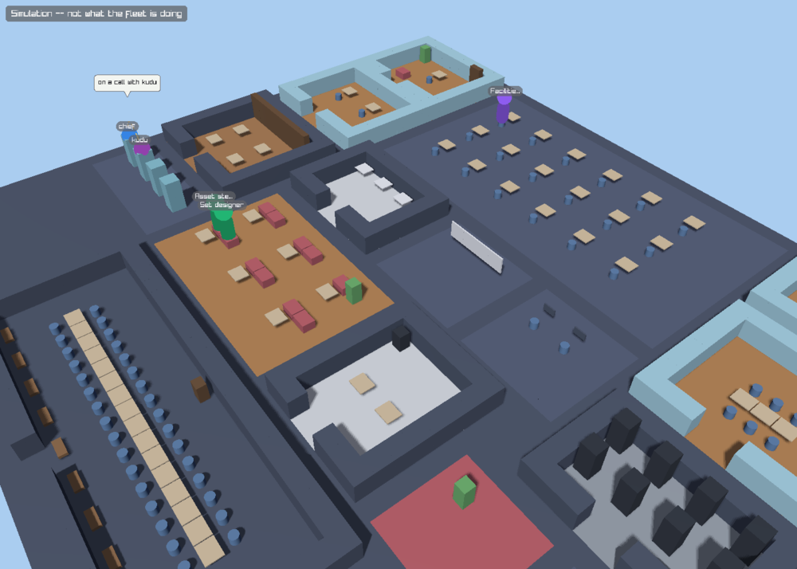
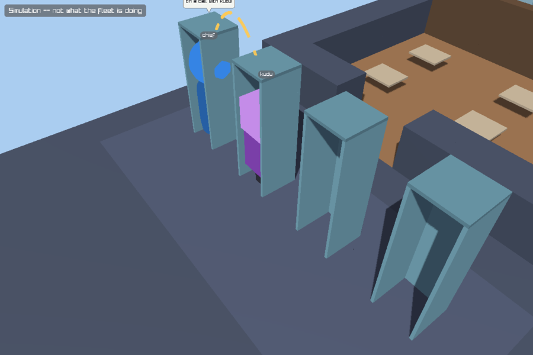
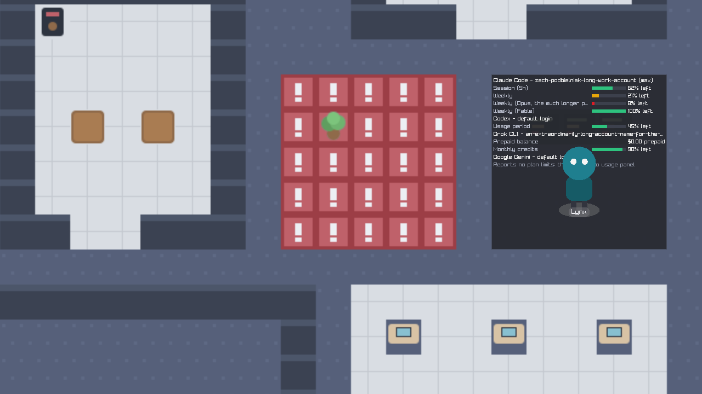
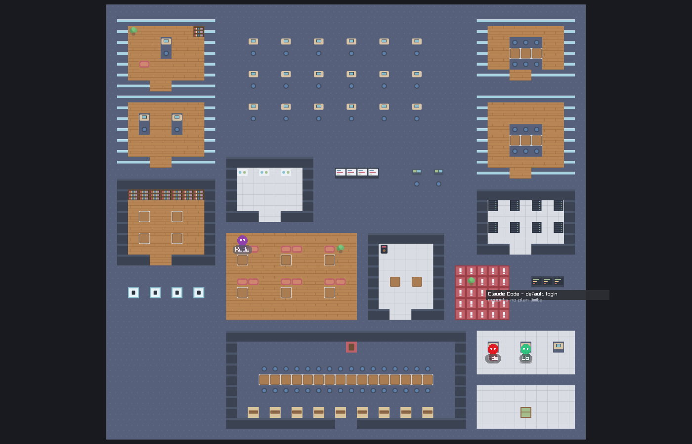

#+title: The office
#+description: The fleet drawn as people in a building: who is where, and why
#+authors: Zach Podbielniak
#+categories: software documentation
#+created: [2026-11-21 Sat]
#+updated: [2026-11-21 Sat]
#+version: 0.1.0

* The office
:PROPERTIES:
:CUSTOM_ID: office
:END:

The office draws the fleet as people in a building.  An agent sits at its desk while a turn is running, walks to the library when it reads and to the lab when it runs commands, takes out a phone while it messages another agent, and joins a meeting round a table when a group round is under way.  When the chief or you start a round that every lead is in, everybody walks to the town hall.  An idle agent sits in the lounge, one whose turn broke stands in the bug corner, and one that asked you something waits at its desk with a question mark over its head.  An ephemeral helper walks in through the entrance when it is spawned and out again when it is reaped.

It is a view of what the daemon already knows, and it never invents anything.  Every pose comes from an event the daemon saw: a turn edge, a tool step, a message, a decision, an incident.  An edge that is never closed decays after =office.stale_seconds=.

** At a glance
:PROPERTIES:
:CUSTOM_ID: glance
:END:

| Piece | What it is | Built |
|-------+------------+-------|
| presence | the fold from events to an activity per participant, in libclawt; the daemon runs it | always |
| ~office.snapshot~, ~office.presence~ | who is doing what, on request and as it changes | always (answers "off" unless =office.enabled=) |
| world packs | directories describing a place: zones, a 2D map, a 3D level | always (two ship) |
| choreography | which zone, pose and prop each activity gets | always (built in, overridable) |
| ~office.layout~ | the director's answer: who sits in which seat | always |
| the roster | a who-is-where list on every client's Office page and in ~clawtilla office who~ | always |
| =clawtilla-office= | the renderer: 2D and 3D, on libregnum | =OFFICE=1= |
| the lrg Office page | the same renderer inside the libregnum client | =OFFICE=1 LRG_BACKEND=1= |
| the GTK Office page | =clawtilla-office= run as a child, its frames shown in the window ([[#gtk-embed][the GTK embed]]) | always; needs =clawtilla-office= at run time |
| the web Office page | its own canvas renderer of the same layout (=data/web/office.js=), with a tilted view and =?simulate=1=; see [[file:web-client.org::#office-drawn][web-client.org]] | always |

The roster, the presence and the layout are in every build, because they cost nothing and every client should be able to say who is where.  Only the libregnum renderer needs =OFFICE=1=: the GTK client runs it as a child and the web client draws its own, so neither links libregnum.

** Turning it on
:PROPERTIES:
:CUSTOM_ID: enabling
:END:

#+begin_src bash
clawtilla office on                    # or the switch on the Office page
clawtilla office use cozy-town         # or the World picker; modern-office is the default
clawtilla office who                   # the roster, linked fleets' visitors included (ALIAS:AGENT)
clawtilla office worlds                # what packs are available
#+end_src

~office.set~ writes =office.enabled=, =office.world= and =office.renderer= to clawtilla.yaml and applies them at once; no reload and no agent restart is needed.  Editing the keys by hand works too, followed by ~clawtilla config reload~.  The Office page in each client has the switch and the world picker, and says the office is off until it is on.

** Activities
:PROPERTIES:
:CUSTOM_ID: activities
:END:

Each participant has one activity, chosen by priority: the loud ones win.

| Activity | When | Drawn by default |
|----------+------+------------------|
| =waiting_on_you= | it asked you a decision and nobody has answered | at its desk, a question mark overhead |
| =error= | its last turn timed out or kept repeating, or a run of its broke; cleared by its next turn | the bug corner, an alert overhead |
| =in_meeting= | a group room with at least =office.meeting_min_members= members had a message in the last three minutes | round the table of the smallest meeting room that fits; the town hall when the chief or you are speaking and every lead is in the room |
| =on_call= | it and one other agent exchanged a message in a room of two within the last minute | a phone booth, phone out, facing the other; at its desk when the world has no booth |
| =delivering= | it just handed work over (a task assigned, a handoff queued) | beside the assignee's desk with a folder |
| =working= | a turn is running and it used a tool in the last 45 seconds | the tool's station, see below |
| =thinking= | a turn is running with no tool in hand | at its desk |
| =arriving= | an ephemeral helper spawned in the last 15 seconds | at the entrance |
| =leaving= | an ephemeral helper being reaped | walking out through the entrance |
| =idle= | running, nothing to do | the lounge |
| =offline= | not running | not drawn |

*Stations* put a working agent where its tool belongs, matched on the tool's name (=clawt_office_station_for_tool()=):

| Station | Tools |
|---------+-------|
| library | read, grep, glob, search, fetch, research, recall, memory |
| lab | bash, shell, exec, test, computer |
| whiteboard | todo, plan, task, delegate, ephemeral, decision |
| terminal | browser, display, screen |
| desk | anything else (writing and editing) |

** Participants
:PROPERTIES:
:CUSTOM_ID: participants
:END:

| Kind | Who | Notes |
|------+-----+-------|
| =agent= | every agent in the fleet | the chief's home is the chief's office, a lead's the leads' offices, everybody else's a desk, a team's own desks first |
| =ephemeral= | ephemeral helpers ([[file:ephemeral-agents.org][ephemeral-agents.org]]) | arrive and leave through the entrance |
| =grok_bot= | a Grok bot with a job ([[file:grok.org][grok.org]]) | a remote worker at the visitor desk while it has a job; waiting on you when the job needs input |
| =external= | reserved: another agent system, or a participant from another fleet | drawn at the visitor desk |

Every participant carries =fleet= -- this fleet's id, made once and kept in =<state_dir>/fleet-id= -- so a future merged office can tell fleets apart.  See [[#federation][Federation]].

** World packs
:PROPERTIES:
:CUSTOM_ID: worlds
:END:

A world pack is a directory with an ~office.yaml~.  Two ship with clawtilla, both CC0 and drawn by =tools/clawt-office-genworld.c= so nothing is downloaded:

- =modern-office= -- an open-plan floor with glass offices, a huddle room and a boardroom, a library, a lab, a planning wall, an ops desk, a server room, a lounge and kitchen, phone booths, a bug corner, a visitor desk, a usage board, a lobby and a town hall.
- =cozy-town= -- workshops for the teams, a manor for the chief, a guild hall for the leads, a tea house and a council chamber, a café garden, a library, a smithy, an observatory, an inn for visitors, a repair shed, a market square and a town hall.

Packs are looked for, in order, in =office.world_dirs=, then =<state_dir>/office/worlds/= (where the custodial team writes), then the shipped =data/office/worlds/=.  A pack id found twice keeps the first, so your own copy of =modern-office= replaces the shipped one.

How to write one -- the manifest, the zone tags, a 2D map in Tiled, a 3D level in lrgeditor, assets and provenance -- is in [[file:office-world-packs.org][office-world-packs.org]].

** The drawn office
:PROPERTIES:
:CUSTOM_ID: drawn
:END:

=clawtilla-office= draws the layout: the pack's Tiled map from above, or its libregnum level from an orbiting god's-eye camera, with each participant in its own colour and face, walking to the seat the director gave it.  What floats over people is the activity, loudest first: a question mark and a bubble for somebody waiting on you, an exclamation mark for something broken, a dotted gold arc between two agents on a call, a folder carried to the assignee's desk, a laptop or book or marker for the work at hand.  People stand still once seated -- an idle fleet is a quiet room, not a bouncing one.

#+caption: modern-office in 2D (simulate mode): a call between chief and kudu
[[file:images/office/office-2d-sim.png]]

#+caption: the same office in 3D, drawn from its .rlevel

*** Building it

#+begin_src bash
make OFFICE=1            # clawtilla-office, and the lrg client with its Office view
make OFFICE=1 install
#+end_src

=OFFICE=1= brings =LRG_BACKEND=1= with it and needs libregnum 0.11.1 or newer at =LRG_DIR= (default =../libregnum=): the Tiled importer, the world-space UI (name plates, bubbles, emotes), beams and frame export are 0.11.0's, and 0.11.1's raylib decodes JPEG, the texture format a generated model (Meshy's) carries -- older, the model drew plain white.  The build refuses an older libregnum.  Loading a 3D level reaches libregnum's scripting, so the binary also links =girepository-2.0= and =gjs-1.0= when libregnum was built with them -- on Fedora, =gobject-introspection-devel= and =gjs-devel=, on top of the lrg client's packages ([[file:lrg-client.org][lrg-client.org]]).

*** Running it

#+begin_src bash
clawtilla office open                       # or run clawtilla-office directly
clawtilla-office --3d --world cozy-town
clawtilla-office --profile workstation      # a daemon on another machine
clawtilla-office --simulate                 # invented activity, labelled, never sent anywhere
clawtilla-office --screenshot office.png --width 1600 --height 900
#+end_src

| Option | Does |
|--------+------|
| ~--socket~, ~--profile~, ~--host~ | which daemon, as every client takes it; with none, the one a running GTK or lrg client is on (below) |
| ~--token-file FILE~ | the token for ~--host~, read from a file; ~--token~ still works but warns, since argv is readable by every user |
| ~--world ID~ | draw this pack rather than =office.world= |
| ~--2d~, ~--3d~ | the view to start in (Tab switches in a window) |
| ~--simulate~ | deal the real participants into calls, a meeting, a question, a failure -- on this screen only, with "Simulation" written over it |
| ~--screenshot FILE~ | draw offscreen until the office has loaded and people have walked to their seats (~--frames~, default 90), write a PNG, exit; 30 seconds without a world or a layout is a failure that says so |
| ~--embed FD~ | stream frames over the socket =FD= for a host that does not link libregnum (the GTK client); see below |
| ~--width~, ~--height~ | the size, 64 to 8192 pixels |
| ~--focus ID~ | the 3D camera follows this participant, close up; a 2D map zoomed past the view is centred on them |
| ~--zoom fit\|1x\|2x~ | how far the 2D map is zoomed (below); in 3D, the camera's starting distance |
| ~--ui-scale N~ | draw text, name plates and marks /N/ times larger (1 to 4), for a frame shown on a HiDPI screen; ~--ui-scale 2~ with a 4K ~--screenshot~ reads like 1080p |

*Which daemon, run bare.*  With no ~--socket~, ~--profile~ or ~--host~, the office opens on the daemon a running ~clawtilla-gtk~ or ~clawtilla-lrg~ is on right now, so it draws the fleet that is on screen beside it; with none running, on the one the clients were last switched to; then on the local socket.  It prints which and why on stderr.  The details -- the per-process ~current-connection-PID~ file, why it never holds a token, and where the token comes from instead -- are in [[file:clients.org::#office-follows-the-clients][clients.org]].

In a window: Tab switches 2D and 3D, the arrow keys or a right-drag turn the 3D camera, the wheel zooms, Escape quits, and a click on somebody prints ~{"event":"open_agent","agent":"<id>"}~ on stdout.

The pack is fetched from the daemon file by file (~office.file~) into =$XDG_CACHE_HOME/clawtilla/office/<world>/=, so a renderer on a laptop draws the workstation's office.  The layout is read once a second and whenever ~office.presence~ says something changed; agent colours come from ~agent.list~.

*** In the lrg client

The lrg client draws the same scene in its own process, into an =LrgViewport= on the Office page: no child and no frames over a socket, since it already is libregnum.  A *2D / 3D* button switches the view, a drag or the wheel turns the 3D camera, and a click on somebody opens their conversation.  *Open office* beside it starts ~clawtilla-office~ in a window of its own, in the mode drawn there ([[#open-office][Open office]]).

#+caption: the lrg client's Office page
[[file:images/office/lrg-office.png]]

*** Open office
:PROPERTIES:
:CUSTOM_ID: open-office
:END:

The GTK and lrg clients can start ~clawtilla-office~ as a program of its own -- its own window, keyboard and all (Tab, the arrow keys, Escape) -- on the daemon the client is on, rather than drawn inside the client:

| Client | Where | Mode |
|--------+-------+------|
| GTK | *Open office* on the Office page, beside the *2D / 3D* switch | the one the switch shows |
| GTK | the main menu (the sidebar's ☰), *Open office* → *2D* or *3D* (the ~win.open-office~ action, parameter ~"2d"~ or ~"3d"~) | chosen there |
| lrg | *Open office* on the Office page, beside *2D / 3D* (=OFFICE=1= builds, where the page draws the office) | the one drawn there |
| lrg | the main menu, *Open office* → *2D* or *3D* (~win.office-2d~, ~win.office-3d~), in every build | chosen there |
| web | not offered: see below | -- |

Unlike *Pop out*, which moves the embedded drawing into another window and keeps it the client's child, this is a separate process: nothing waits for it, it is not killed when the client closes, and closing it does not touch the client.  Each press starts another.  =clawt_office_renderer_open_window()= does it, for both clients.

*Which daemon.*  The client's own connection is named outright, so the window never falls back on following whichever client last published a connection ([[file:clients.org::#office-follows-the-clients][clients.org]]).  =clawt_office_renderer_window_argv()= builds the line -- the embed's, without ~--embed~, ~--width~ and ~--height~, and with ~--2d~ or ~--3d~ always said:

#+begin_example
clawtilla-office --3d --socket /run/user/1000/clawtilla/daemon.sock
clawtilla-office --2d --profile workstation
clawtilla-office --3d --host 100.64.0.9 --daemon-port 8792 --token-file /dev/fd/3
#+end_example

- A local daemon by its socket, the default one spelled out too.
- A saved connection by ~--profile NAME~: the profile carries the host, the TLS settings and the token.
- A connection typed on the command line (~clawtilla-gtk --host~), which is not saved, by ~--host~ and ~--daemon-port~, and its token -- if it has one -- through a pipe: the client writes the token into a fresh pipe and closes the write end before the child exists, and the child gets the read end as fd 3 and reads it to the end with ~--token-file /dev/fd/3~.  The token is never in an argv, which every user on the machine can read through ~/proc/PID/cmdline~, and never on disk.  So the embed's "save it under Connections" refusal does not apply here.
- A typed connection with TLS is refused -- ~clawtilla-office~ takes TLS settings only from a saved profile -- with a toast saying to save it.

*It says which.*  Every launch logs, with =g_message()=, the pid, the mode and the daemon it was handed -- /opened clawtilla-office (pid 48211) in 3D on the saved connection “workstation” (100.72.0.41:8792)/ -- and toasts the same: /Opened the office in 3D on the local daemon (/run/user/1000/clawtilla/daemon.sock)./  For a typed connection it says /100.64.0.9:8792, its token through a pipe/: how the token went, never the token.  The window itself prints which daemon it opened on, on the client's stderr, as it always does.

*Failing.*  A renderer that is not found (the same three places as the embed, and the same advice), or that cannot be started, is a toast -- /The office did not open: .../ -- and the same line in the log.  What happens after it has started is the window's own business: it prints to the client's stdout and stderr.

*The web client.*  Not offered.  ~clawtilla-web~ is a server; the browser it serves can be on another machine, so a process it started would open on the server's display, not in front of the person who pressed the button.  The web Office page draws the office itself, in the browser ([[file:web-client.org::#office-drawn][web-client.org]]), which is the web client's answer to opening it.

*** Embedding it

~--embed FD~ draws offscreen and streams each frame over the unix socket =FD= in libregnum's frame protocol (LFRM v1: a 16-byte header, RGBA8 frames inline or in a sealed memfd passed with =SCM_RIGHTS=; pointer, button, scroll, key and resize back), dropping frames rather than queueing them when the host falls behind.  The host owns the size: a resize message re-sizes the frames.  The protocol is specified in libregnum's =docs/modules/remote/frame-protocol.org=.

Embedded, a left click on somebody (a press and release within four logical pixels) is the same stdout line as in a window; a left drag turns the 3D camera, or moves a 2D map that is zoomed past the view; the wheel zooms the 3D camera.  The click is sent on release, so a drag that starts on somebody does not open their chat.

Two more channels, both JSON lines, so a host can change the view without restarting the child:

- *stdin, host to renderer.*  ~{"mode":"3d","focus":"chief","zoom":"fit","ui_scale":2}~ -- =clawt_office_view_control_line()= writes it and =clawt_office_view_control_parse()= reads it.  Every member is optional; ~"focus":""~ (or =null=) follows nobody; unknown members are ignored, and a line with a member of the wrong type or an unknown mode or zoom is refused whole, with the reason on stderr.  Lines are applied between frames.  The stream is read only with ~--embed~; at end of file the view stays as it is.
- *stdout, renderer to host.*  Besides ~open_agent~, ~{"event":"view","mode":"2d","has_3d":true}~ whenever what is drawn changes: a world without a 3D level is drawn in 2D whatever was asked, and says so.

*** Characters

An agent the custodial team has made a character for ([[file:office-custodial-team.org::#characters][characters]]) is drawn from its own sprite sheet instead of the shared body: walking picks the row for the direction it is going, a pose (sit, type, read, phone, present) its own row, a still pose holds a frame.  A sheet is fetched with ~office.character_file~ and checked against the sha256 its manifest recorded -- one that does not match is not drawn.  In the 3D view a character with a *model* (a =.glb=, =.obj=, =.vox=, =.iqm= or =.m3d= the custodial team attached with ~clawtilla_office_character_mesh~) is drawn as that model -- scaled to the body's height, stood on the floor by its own bounding box, turned the way it walks, and playing an animation whose name says /walk/ while it walks (a still one holds its first frame).  One with only a sheet is its current frame on a billboard facing the camera.  The web canvas draws the office from above and uses the sheet.

#+caption: kudu's own model in a phone booth, the camera following it (=--focus kudu=)

#+caption: kudu drawn from its sheet, on a call with the chief
[[file:images/office/office-character.png]]

*** The usage board

Each provider login's allowance -- the meters on the Fleet page, from the same library calls -- is drawn on the wall a pack tags =usage_board=.  It reads ~usage.providers~ as it stands and never asks for a fresh read: a wall display left open all day must not spawn a provider's CLI once a minute.  The Fleet page refreshes; the board shows the result.

#+caption: the usage board

*** World adapters

A pack can name a world adapter -- code that owns its world and walks people through it -- instead of being drawn by the office: libregnum's =tiled= adapter (walls and path-finding), or a module of your own.  See [[file:office-adapters.org][office-adapters.org]].

*** Opening on the office

=--office= on =clawtilla-gtk= and =clawtilla-lrg= opens on the Office page; on =clawtilla-web= it sends =/= there, for a wall display.

*** What it does not do yet

- People walk in a straight line to their seat in the office's own drawing: the shipped maps carry no collision layer.  A pack with walls should use the [[file:office-adapters.org::#tiled][=tiled= adapter]], which paths round them.

** Who keeps it
:PROPERTIES:
:CUSTOM_ID: custodians
:END:

Agents can keep the office for you.  The chief has the office tools by role (~tools.office~): it can list, read, change, preview and apply world packs and import assets.  A *custodial team* -- a lead, an asset steward and a set designer, on a team tagged ~office-custodial~ and named whatever you like -- takes requests for the office and makes each new agent's character from its picture with the generator you configure (=office.asset_generator=).  Nothing is installed or generated unasked: ~clawtilla office custodians install~, *Create custodial team* on the Office page, or the chief's ~clawtilla_office_custodians_install~.  See [[file:office-custodial-team.org][office-custodial-team.org]].

*** The chief bootstraps the office in one conversation

#+begin_example
you:   Turn the office on and make it feel like a winter lodge.
chief: (clawtilla_office_worlds) The office uses modern-office.  I'll make a
       new world from cozy-town called winter-lodge ...
       (clawtilla_office_world_write world=winter-lodge from=cozy-town
        path=choreography.yaml: idle -> breakroom with coffee)
       (clawtilla_office_preview world=winter-lodge) everybody seated; nobody
       on a fallback.  Shall I apply it?
you:   Yes.
chief: (clawtilla_office_world_apply world=winter-lodge) Done.
#+end_example

Turning the office on is yours (~clawtilla office on~); everything after it can be the chief's, or the custodial team's once there is one.

** Choreography
:PROPERTIES:
:CUSTOM_ID: choreography
:END:

Which zone, pose, prop and emote each activity gets.  Three layers, each replacing the rules it names: the built-in rules, then the pack's own ~choreography.yaml~, then the file =office.choreography= names.  ~clawtilla office choreography~ prints the built-in rules, which are also the format.  See [[file:office-choreography.org][office-choreography.org]].

** The wire
:PROPERTIES:
:CUSTOM_ID: wire
:END:

| Request | Answers |
|---------+---------|
| ~office.snapshot~ | ~enabled~, ~fleet~, ~now~, ~world~, ~renderer~ and ~participants~ (each ~fleet~, ~kind~, ~id~, ~name~, ~team~, ~parent~, ~role~, ~color~ (since 0.64.0), ~activity~, ~station~, ~peer~, ~room~, ~since~, ~detail~) -- this fleet's own people only, never a visitor; or ~enabled: false~ and ~why~ |
| ~office.worlds~ | ~enabled~, ~current~, ~worlds~ (~id~, ~name~, ~license~, ~has_2d~, ~has_3d~, ~warnings~) and ~refused~ (why a pack was not loaded) |
| ~office.world~ (~world~ optional) | the pack: ~zones~, ~assets~, ~warnings~, ~districts~, relative ~map_2d~ / ~level_3d~, and the merged ~choreography~ |
| ~office.layout~ (~world~ optional) | the director's ~placements~ (visitors from =office.peers= fleets included, as =<peer>:<id>= with ~visiting_from~) (each ~id~, ~activity~, ~zone~, ~zone_tag~, ~seat~, ~x~/~y~, ~x3~/~z3~, ~pose~, ~prop~, ~emote~, ~facing~, ~fallback~) plus ~participants~ and ~now~ |
| ~office.file~ (~world~, ~path~) | one file of a pack as ~base64~, at most 32 MiB, only inside the pack -- for a renderer not on the daemon's machine |
| ~office.set~ (~enabled~, ~world~, ~renderer~, each optional) | writes them to clawtilla.yaml and applies them at once; answers the new ~enabled~, ~world~, ~renderer~; a world that does not exist is refused |
| ~office.characters~ | ~characters~: each agent the custodial team has made a whole character for -- ~agent~, ~sheet~, ~sheet_sha256~, ~frame~ ([w, h]) and ~animations~ (~{name: {row, frames, fps}}~) (since 0.60.0), ~mesh~ and ~mesh_sha256~ for one with a model (since 0.62.0), and ~background~ (=corners= or =#rrggbb=) for a sheet on a backdrop the renderer keys out (since 0.62.1) |
| ~office.character_file~ (~agent~, ~path~) | one file of a character as ~base64~, resolved by the kernel inside =<state_dir>/office/characters/<agent>/= |
| ~office.custodians~ | ~team~ (the team tagged ~office-custodial~, or null) and ~generator~ (=office.asset_generator=) -- whether a client offers the install (since 0.58.0) |
| ~office.custodians_install~ (~team~, ~start~ optional) | makes the custodial team and its three agents, started unless ~start: false~; answers ~team~ and ~agents~; refused when a team already carries the tag |
| ~office.character~ (~agent~, ~direct~ optional) | files the task that makes ~agent~'s character and answers its ~task~ id; with ~direct: true~ the daemon makes it itself through =office.asset_api= and answers ~asked: true~ and ~service~ (=comfyui=, =higgsfield=) -- a paid service's estimate arrives as a decision, a self-hosted ComfyUI starts at once.  Refused with what is missing |
| ~office.api_key~ (~service~, ~key~) | stores the key =office.asset_api= uses; answers ~key_file~, never the key (since 0.60.0) |
| ~office.world.restyle~ (~base~, ~name~, ~style~, ~two_d~, ~three_d~) | a new world with ~base~'s layout, its tiles redrawn by PixelLab and (~three_d~) its furniture made by Meshy; answers ~decision~, the priced card nothing runs before (since 0.77.0; see [[file:office-world-packs.org::#restyle][office-world-packs.org]]) |
| ~office.peers~ | ~peers~: each =office.peers= fleet's ~name~, ~where~, ~state~ (=asking=, =ok=, =quiet=, =error=), ~error~, ~fleet~ (its id), ~visitors~ (how many) and ~read_at~ (since 0.64.0) |
| ~office.peer_pair~ (~name~, ~code~) | pairs with a tailnet peer by redeeming a code its daemon printed; answers ~token_file~, never the token (since 0.64.0) |

~office.changed~ is published after ~office.set~.  ~office.presence~ is published whenever what a participant should be drawn doing changes, and never for a repeat: subject the participant's id, details every member of the participant as strings, or ~activity: gone~ when a helper has walked out.  It is ephemeral like ~turn.step~: not replayed and not logged.  Read ~office.snapshot~ on connect.

** The GTK embed
:PROPERTIES:
:CUSTOM_ID: gtk-embed
:END:

The GTK client never links libregnum, so it cannot draw the office itself.  It runs =clawtilla-office= as a child process instead: the child renders offscreen and streams frames over a unix socket, the window shows them and sends the pointer back.  The view is built in every build of the GTK client; only the child needs =make OFFICE=1 LRG_BACKEND=1=.

*** How it works

1. *Finding the renderer.*  =clawt_office_renderer_resolve()= looks beside the running binary (a checkout's =build/release/=), then at the install location (=<prefix>/bin=), then on =PATH=.  When none has it, the Office page shows a note naming all three places and the build command.
2. *Starting it.*  The window makes a =socketpair()= and hands one end to the child as fd 3:

   #+begin_src bash
   clawtilla-office --embed=3 --socket /run/user/1000/clawtilla/daemon.sock --width 1600 --height 675
   clawtilla-office --embed=3 --profile workstation --width 3200 --height 1350
   #+end_src

   The connection argument reproduces the window's own: ~--socket PATH~ for a local daemon (nothing at all for the default socket), ~--profile NAME~ for a saved connection profile.  A remote daemon reached through a connection that is not saved cannot be followed -- its token would have to go in the argv, which every user on the machine can read -- so the page says to save it under Connections.  =clawt_office_renderer_embed_argv()= builds the line.  The child is given =PR_SET_PDEATHSIG= (=SIGTERM=) in its setup, so it dies with the window however the window ends.
3. *Frames.*  The socket speaks libregnum's frame protocol, version 1 (libregnum's =docs/modules/remote/frame-protocol.org=): a 16-byte little-endian header (="LFRM"=, version, type, body size), a HELLO, then FRAME messages of RGBA8 pixels, inline or in a sealed memfd passed with =SCM_RIGHTS=.  =ClawtOfficeFrames= in libclawt is the host side, written from the specification rather than linked.  It is watched by a source on the window's main context; each frame becomes a =GdkMemoryTexture=, drawn in a =GtkPicture= through a small paintable that scales with =GSK_SCALING_FILTER_NEAREST= -- pixel art is repeated, never smeared, including in the moment between a resize and the frame drawn for it.  A memfd frame is shown straight from its read-only mapping, so it costs no copy -- which is why an unsealed memfd is refused: a file shrunk under a live mapping would be a =SIGBUS= in the window.
4. *Input.*  Pointer motion, buttons and the wheel are sent back as POINTER_MOVE, POINTER_BUTTON and SCROLL in frame pixels (the letterbox subtracted, buttons renumbered to raylib's 0 left, 1 right, 2 middle, the wheel's sign flipped to the protocol's "positive away from the user").  When the drawing changes size -- the window resized, maximized or tiled, the drawing popped out, or moved to a monitor with another scale -- a RESIZE follows once the size has held for 200 ms, in device pixels (=clawt_office_view_device_size()=), so the child draws at the size it is shown and is never restarted for it.  Keys are not forwarded yet; =clawt_office_frames_send_key()= exists for when they are.
5. *Control.*  The child's stdin is a pipe.  The mode, zoom, whom to follow and the scale factor go down it as one control line ([[*Embedding it][Embedding it]]) right after the child starts -- before the world has loaded, so it loads in the mode asked for -- and again, whole, whenever any of them changes.  One write is in flight at a time; a change during it is folded into the next line, which says the newest state.
6. *Events.*  The child writes JSON lines on stdout.  ~{"event":"open_agent","agent":"kudu"}~ opens that agent's chat; ~{"event":"view",...}~ sets the 2D / 3D switch to what is drawn and makes 3D insensitive for a world without a level.  Anything else is ignored, and a line longer than 64 KiB is dropped rather than buffered.  Its stderr is kept, last line only, to explain an exit; with =G_MESSAGES_DEBUG=Clawtilla= every line is logged.

*** The Office page
:PROPERTIES:
:CUSTOM_ID: gtk-office-page
:END:

Above the drawing:

| Control | Does |
|---------+------|
| *2D / 3D* | the map from above, or the 3D level from an orbiting camera.  Shows what is drawn: a world without a level is 2D, and *3D* is greyed out with a tooltip saying why.  Remembered as ~office_view~ in ~appearance.yaml~ |
| *Fit / 1x / 2x* | the zoom.  *Fit* is the whole map at the largest whole-number scale that fits, or the fraction that fits when the map is bigger than the view; *1x* is one map pixel per logical pixel and *2x* two, each crisp on any screen.  Zoomed past the view, a drag moves the map; in 3D the three set the camera's distance and the wheel goes on from there.  Remembered as ~office_zoom~ |
| *Follow* | nobody, or a participant from the roster: the 3D camera centres on them and comes in close; a zoomed 2D map stays centred on them; their name plate is always drawn.  Not remembered -- it names an agent of one fleet -- and reset to nobody when they leave the office |
| *Pop out* | the drawing, toolbar and all, in a window of its own (1280 by 800 to start), for another monitor.  The page says it is out, with *Bring back*; closing the window brings it back too.  The child is not restarted for either: the drawing moves, and its new size is a RESIZE |
| *Open office* | beside *2D / 3D*: ~clawtilla-office~ started as a separate program, in a window of its own, on this window's connection and in the mode the switch shows.  Not the embedded drawing: see [[#open-office][Open office]] |

Under them, the lrg client's hint: /Click somebody to open their conversation; drag or scroll to turn the 3D view./

*Size.*  The drawing is as wide as the page and three quarters as tall as what the page shows (=clawt_office_view_height_for_page()=), never under 320 logical pixels -- a short window scrolls the page instead -- so the roster's heading still shows beneath it.  The height follows the page's visible height (its scrolled window's =page-size=), which changes when the window does, not when the roster grows.  Popped out, it is the whole window.  Frames are asked for in device pixels, at most 8192 on a side (past that the frame keeps its shape and is scaled up, nearest-neighbour).

*Readable at 1080p and 4K.*  The child is told the scale factor (=ui_scale=): name plates, bubbles, marks, the status line and the usage board are drawn that many times larger, so a 4K frame at scale 2 has the text of a 1080p one, at twice the sharpness.  *Fit* rounds down to a whole number whenever the map fits at one or more, which on a 4K page draws the shipped worlds at exactly one device pixel per map pixel.

*Name plates do not overlap.*  People at adjacent desks used to draw their names over each other (/aye-a elephant neyguide/).  Plates are now placed together, in screen space, by =clawt_office_labels_arrange()=: the hovered and the followed are drawn where they are; everyone else keeps their place if it is free, else is pushed just below the plate in the way, at most twice; a plate with no room within reach, or pushed off the bottom of the view, is not drawn and appears when its person is hovered.  Zoomed out, fewer names show; zoomed in, all of them.  The same placement is used in 2D, 3D and by world adapters, and by the lrg client, which draws the same scene.

*** When it runs

Only while it can be seen: the office is on (the last ~office.snapshot~ said =enabled=) *and* the Office page is on screen, or the drawing is popped out.  Leaving the page (unless the drawing is popped out), turning the office off (which also closes a popped-out window) and closing the main window each stop the child -- =SIGTERM=, then =SIGKILL= if it has not gone within three seconds -- and coming back starts a fresh one.  A child is also restarted when the window switches to another daemon, since it was told about the old one.

*** When it stops

If the child exits, is killed or breaks the stream, the slot shows a banner -- /The office stopped drawing: clawtilla-office exited with status 3: <its last line on stderr>/ -- with *Restart*.  Nothing respawns it on its own, so a renderer that cannot start does not become a loop; leaving the page and coming back is a fresh try too.  The window is never affected.

The receiver never accumulates past the message it is assembling: a header announcing more than 256 MiB is refused before its body is read, a frame whose sizes do not add up is refused at its 48-byte fixed part, and an unknown message type's body is read through a scratch buffer and dropped.  Input the socket will not take is queued (it is never dropped) up to 1 MiB, past which the child is declared stuck.

** Federation
:PROPERTIES:
:CUSTOM_ID: federation
:END:

Another fleet's people can visit this office.  =office.peers= names the other daemons, each ~NAME=WHERE~:

#+begin_src yaml
office:
  peers:
    - studio=/run/user/1000/studio/d.sock   # another fleet on this machine: its socket
    - lab=100.64.0.7:8792                   # another machine: its tailnet address
  peer_poll_seconds: 5
#+end_src

A peer on another machine is paired once, with a code that machine's daemon prints:

#+begin_src bash
clawtilla device pair --name home-office        # on the peer's machine
clawtilla office peer-pair lab K7Q-4MZ          # here: the token goes to secrets.dir/office/peers/lab.token (0600)
clawtilla office peers                          # who visits, and whether each answers
#+end_src

#+caption: fleet "home" with fleet "studio"'s Ada and Bo visiting, at the visitor desk in their own colours

How it works, and what it holds to:

- *Read-only.*  This daemon asks each peer for its ~office.snapshot~ and draws the people in it.  Nothing a peer sends can act here: each becomes a participant of kind =external=, named =<peer>:<id>= (=studio:ada=), drawn and nothing else.
- *A peer's answer is somebody else's input* (~clawt_daemon_office_peer_sanitize()~): only the peer's own people (a third fleet's, passed on, are not believed), at most 200, every string bounded, ids in a plain spelling, an activity this clawtilla does not know drawn as idle, a colour kept only as =#rrggbb=, and a snapshot carrying this fleet's own id refused -- it would draw everybody twice.
- *No echo.*  A fleet publishes only its own people: ~office.snapshot~ never includes a visitor, which is merged into ~office.layout~ alone.  Two fleets that peer with each other see each other's people and never their own come back.
- *Guests stay guests.*  A visitor keeps to the visitor desk whatever it is doing -- its meetings, calls and idle hours happen in its own office -- and its activity is drawn on it there.  Its nameplate is its name; hovering says which fleet (/Ada · studio/).  It is drawn in its own fleet's colour, which every snapshot now carries.
- *Nothing at start.*  The first ~office.layout~ -- a client drawing the office -- starts the polling, so a daemon nobody looks at never dials a peer; nothing waits on a peer while a request is answered.
- *Quiet, not frozen.*  A peer that has not answered for three polls is drawn empty, and ~clawtilla office peers~ says /quiet/ or the error it gave.

The invariants laid down before this was built still hold:

- Every participant carries its fleet's id (=<state_dir>/fleet-id=, random, made once).
- A pack names files by relative path only, and lists each with a =sha256= (=clawt_office_world_verify_assets()= checks them), so a pack can be synced between fleets by hash.  =districts= in a manifest names the parts of a world a merged office could give to other fleets.
- ~office.file~ serves pack files by pack and path, never by a path on this machine.
- Team tags and ephemeral names are unique within a fleet only; anything that crosses fleets namespaces them, as visitor ids do.

Superseded: since 0.67.0 a linked fleet's people visit from the link
itself ([[file:federation.org::#office][federation.org, "In the office"]]), as that fleet's grant allows,
with no device token on the other daemon.  =office.peers= still works
and is drawn as described here; a fleet both linked and listed is drawn
once, from the link.  Prefer linking: ~clawtilla federation migrate-office~
lists the entries and links each one you name with the token it was
paired with (see [[file:federation.org::#migrate-office][federation.org]]).

Not built here: anything that acts across fleets -- messages, delegation, handing a task to another fleet's agent.  Visiting is looking.

** Troubleshooting
:PROPERTIES:
:CUSTOM_ID: troubleshooting
:END:

- *The Office page says the office is off.*  Turn it on there, or ~clawtilla office on~.
- *The drawn office is empty.*  Nobody is in the office: a stopped agent is "out of the office" and is not drawn, rather than drawn somewhere it is not.  ~clawtilla office who~ says the same; ~--simulate~ shows what a busy floor looks like.
- *~clawtilla-office~ says the office did not load within 30 seconds.*  The daemon is not reachable, or =office.enabled= is off (~clawtilla office on~).
- *The 3D view is missing.*  The pack has no =.rlevel=, or it did not load -- the reason is in the log, and the 2D view is used.
- *Everybody is in the lounge.*  Nobody is in a turn.  Send an agent a message and watch it walk to its desk.
- *An agent stays at its desk long after it finished.*  A turn edge was never closed -- the agent's process died mid-turn, say.  It decays after =office.stale_seconds= (600 by default).
- *A pack is missing from ~clawtilla office worlds~.*  It is listed under ~refused~ with the reason: no licence, a path outside the pack, or YAML that does not parse.
- *The GTK Office page says clawtilla-office was not found.*  It names the three places it looked.  Build it with ~make OFFICE=1 LRG_BACKEND=1~ in the same checkout as =clawtilla-gtk= (it lands beside it), or install it.
- *The GTK Office page says the office stopped drawing.*  The banner carries the exit status and the child's last line on stderr; run the command from [[#gtk-embed][the GTK embed]] by hand, with =--embed= left off, to see the rest.  /closed its frame socket/ means the child shut the socket and kept running; /does not add up/, /bad magic/ or /not sealed/ mean it is not speaking frame protocol version 1.  *Restart* tries again.
- *The GTK Office page says a remote daemon can be followed only through a saved connection.*  The window was opened with ~--host~; save the connection (the connection menu), switch to it, and come back.
- *Open office toasts "The office did not open".*  The rest of the line says why: not found (build it as above), not startable, or a typed ~--host~ connection with TLS, which only a saved connection can hand over.
- *Open office opened a window on the wrong daemon.*  It cannot: the line names the client's connection outright.  Check the client's log -- /opened clawtilla-office (pid N) in 2D on .../ -- and the window's own first line on stderr.
- *The drawing is blank but nothing is reported.*  The child is running but has sent no frame yet; =G_MESSAGES_DEBUG=Clawtilla clawtilla-gtk= shows its stderr.
- *Somebody is "at the lounge instead".*  The pack has no zone with the tag the choreography asked for; ~office.layout~ names the fallback.  Add the zone, or override the rule.
